# v3 実験結果

データ 100 グラフ（ready: 99、unavailable: 1）。
実験適格 98 グラフ。未取得 1、代替配布との同一性未確認 0、LCC規模による除外 1 グラフ。未取得・同一性未確認・規模除外は実行前の区別として扱う。
計画条件の記録 3,210 件：success: 2,426、memory_limit: 46、warmup_failed: 720、unavailable: 15、timeout: 3。 計画 3,210 件。

条件レコードとして確定した本測定の実起動 2,370 件（success: 2,321、memory_limit: 46、timeout: 3）。既存結果の再利用 120 条件、warmup失敗による未起動 690 条件。未確定の中断attemptはこの実起動数に含めず、最終監査で別枠に数える。
再利用のうち失敗結果の参照は 15 条件。新たな実起動やwarmup失敗による新規未起動には重複計上しない。
別枠のwarmupは実起動 468 件（success: 342、memory_limit: 117、timeout: 9）。warmupは性能・stressの本集計に混ぜない。

速度は前処理を除いたSGD反復の実時間。速度比は同じグラフ・seed・family・pivot数のCPU時間÷各手法時間。stress比は各手法÷同じCPU。点はseedの中央値、範囲は最小〜最大。失敗・未取得の条件は0に置き換えない。
FullとSparseの絶対stressは同じ評価定義を用いる。頂点数8,000以下は全点対の厳密値、8,000超は固定256起点（stress seed=0）による推定値とする。小中規模20件の中にも推定値のグラフがある。SGDの制約がFullであることと、比較用stressを厳密評価することは別である。
座標等のテキストはlossless gzipで保管する。圧縮時間はnative process_wall_seconds・SGD・cold総時間の計測外で、archive_secondsとして別記録する。圧縮の有無で座標値やstressは変化しない。
SGD時間は各反復の処理区間の合計で、CPUのshuffle、GPUへの投入と完了待ちを含む。前後の初期化やcheckpoint座標取得・保存は含まない。CPUの反復前ペアclone等はこの区間の外。cold総時間は別に保存する。反復別の図はtraceの反復番号・累積和・本測定record時間の一致を検査し、不一致をiteration-time-validation.csvに残して除外する。
Sparse全グラフの補足は制約数/頂点数・RRラウンド・dispatch数（sparse-schedule.csv）。さらに代表 5 グラフは同一input/preprocess/initial SHAを照合したseed0/P200の独立診断で、頂点別の厳密な予定回数分布を補足する。予定回数はGPU実store・lock retry・待ち時間の実測ではない。
以下は現在保存されている記録の集計。実行中の再集計では未完了条件が欠ける。

SNAP原配布復旧による追加測定は、core原本 3,210 件と独立recovery原本 90 件（計 3,300 件）を保持し、未起動unavailableだった90条件だけを補完した。有効な計画条件は 3,210 件。元90件はsupersededとして追跡し、実起動済み条件を上書きしていない。
対象はcom-Amazon、com-DBLP、com-Youtube、com-LiveJournal、soc-Pokec、loc-Gowalla。公式SNAP原配布と公開ノード数・unique edge数・変換/LCCの証拠を検証した、同名の原配布からの補完である。SuiteSparse MTXとのbyte/edgewise一致は未検証で、既存Network Repository代替データを検証済み扱いに変えたものではない。power197kの未取得とG_n_pin_poutの規模除外は保持する。
coreとrecoveryはそれぞれのexecution.jsonのnative commitに照合した。commitは異なるが、native/sharedの67ファイル集合・SHA、runner 1ファイルのSHA、6実行binaryのSHA、実行制限は一致する。共通の15反復・seed・P200の元basic90 ID/設定を照合しており、新条件として二重計上しない。
[有効データ一覧](../tables/effective-datasets.json) · [補完検証provenance](../tables/cohort.json) · [原記録と有効/置換状態](../tables/cohort-source-records.csv) · [置換前の未起動90条件](../tables/cohort-superseded.csv) · [追加測定の固定設定](../snap-origin-recovery/config/execution.json)。

## 1. 代表グラフの描画

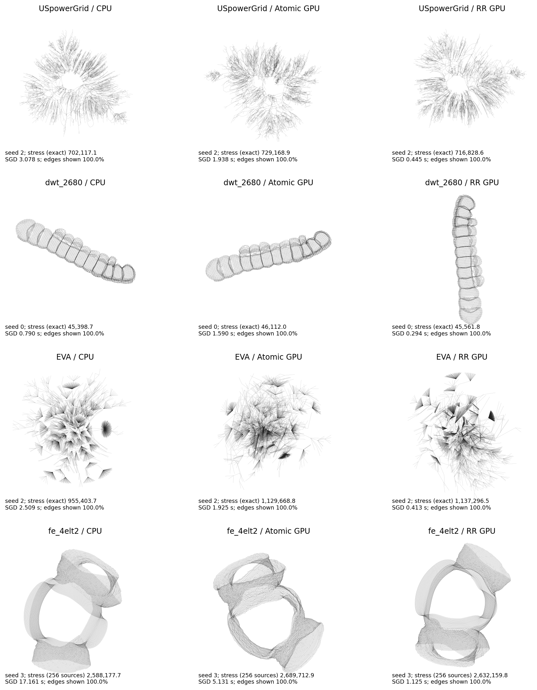

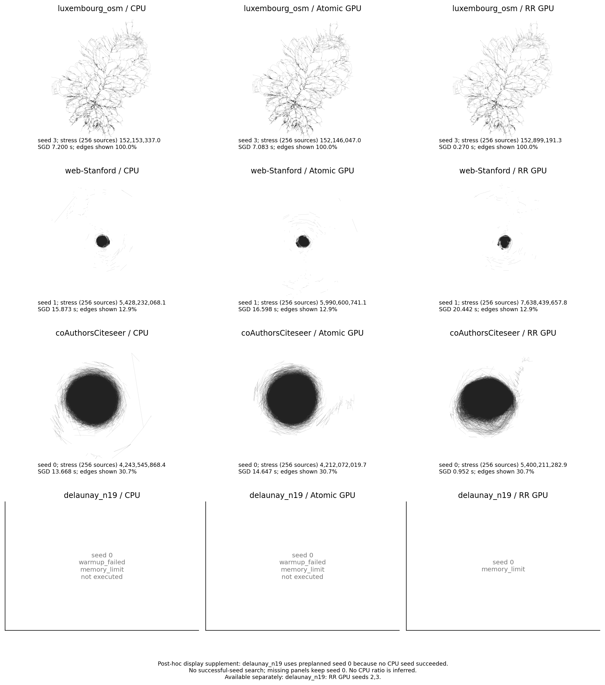

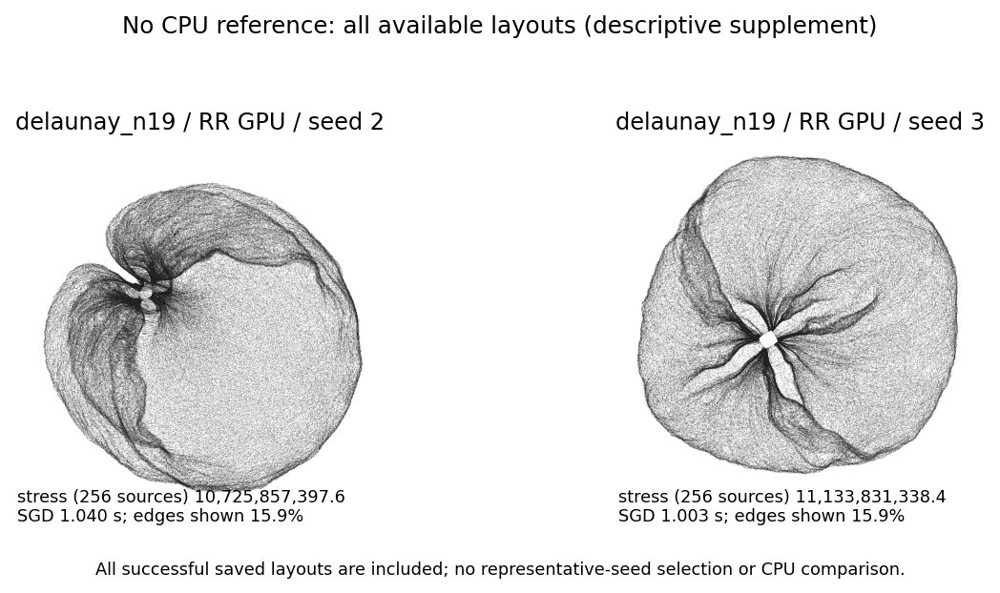

成功CPUがある場合はCPUの最終stress中央値に最も近いseedを選び、GPUも同じseedを表示する。良好なGPU実行だけを選抜していない。CPU成功seedが0件の場合だけ、事前に計画されたseed 0を固定で使い、同seedで成功し座標が存在する手法だけを表示する。成功したGPU seedを探して置き換えない。このfallbackはNo.1の描画選択だけを対象とする事後補足で、CPU比や主結果の対応ペアには使わない。
今回のCPU基準欠如による固定seed 0の対象：Sparse: delaunay_n19。欠測枠には選択seedと失敗理由を表示し、warmup失敗による未起動も区別する。seed 0自身が失敗していれば、別seedの成功座標があっても描画しない。
[描画seed・選択規則・欠測理由](../tables/layout-selection.csv)に全24枠を記録する。CPU成功があるのに有効なstress値がない場合はseed 0へ移らず、選択不能として記録する。
同じグラフの全手法は座標のunion範囲から同じx/y縮尺で描画する。25万辺を超える描画は辺のみ等間隔で間引き、表示割合とSGD秒を併記する。stressは間引く前の全グラフで評価する。

別図 `01_layout_sparse_partial` は **CPU基準なし・利用可能な全layoutを示す記述的補足**。本図の固定seed 0を成功seedで差し替えるものではなく、対応比較や中央値代表とは呼ばない。CPU成功のない対象グラフについて、成功かつ保存先のあるlayoutをseedや品質で絞らず全件表示する。今回の利用可能分：delaunay_n19 / RR GPU: seed 2,3。図を読めない保存先は欠測枠と事故記録に残す。
[補足図の全条件・利用可否](../tables/layout-sparse-partial-availability.csv)。本図が全欠測でも、別seedの成功layoutが存在する場合がある。

## 2. 小規模20グラフ：Full SGD

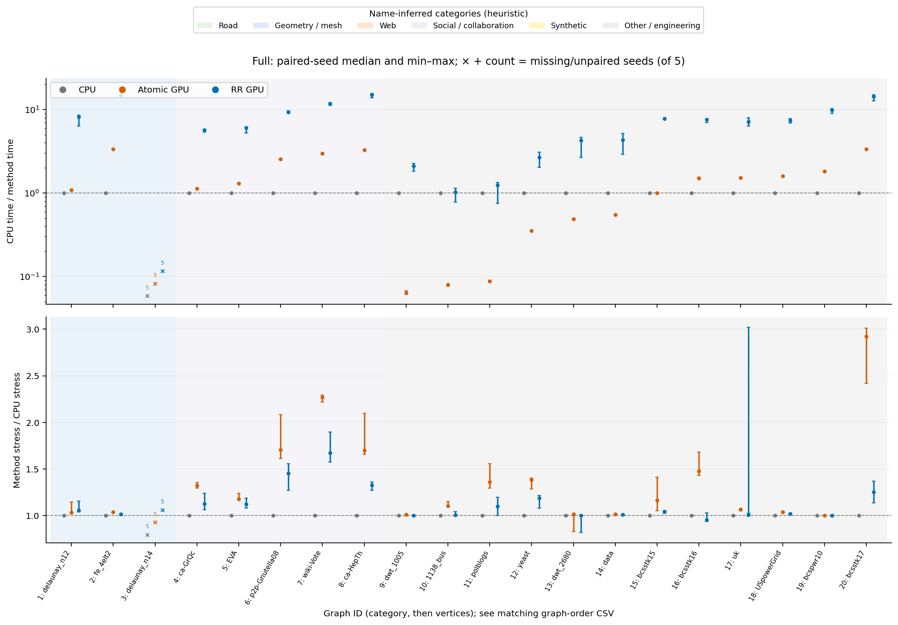

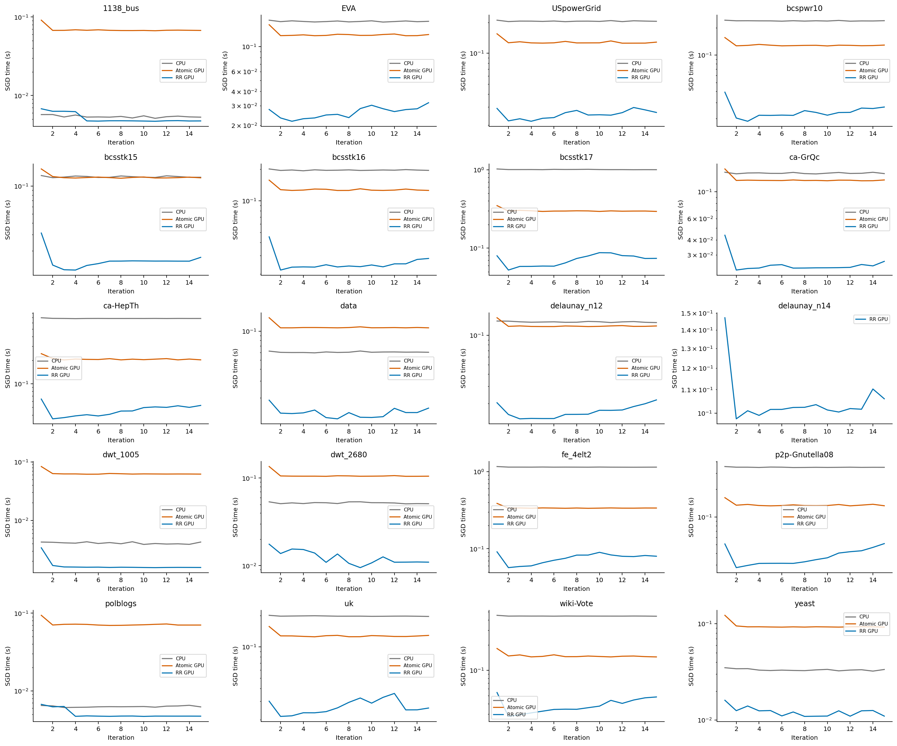

- Atomic GPU：対応比較できた 19 グラフ中 13 グラフでCPUより高速。グラフ別速度比 0.06〜3.36倍、stress比 1.001〜2.921。
- RR GPU：対応比較できた 19 グラフ中 19 グラフでCPUより高速。グラフ別速度比 1.03〜15.02倍、stress比 0.954〜1.671。

[Full20のID・名前対応](../tables/02_full-graph-order.csv) · [対応seed数](../tables/02_full-counts.csv)

上下2段は全グラフの共通x軸。背景は名前から推定したカテゴリで、分類内を頂点数順に並べる。graph-order.csvにID・名前を、counts.csvに対応seed数を保存。下端の×と数は欠測・CPU基準欠如による未対応seed数（5件中）で、0や1の測定値ではない。比は対応する成功seedのみで計算する。

## 3. 大規模80グラフ：Sparse SGD

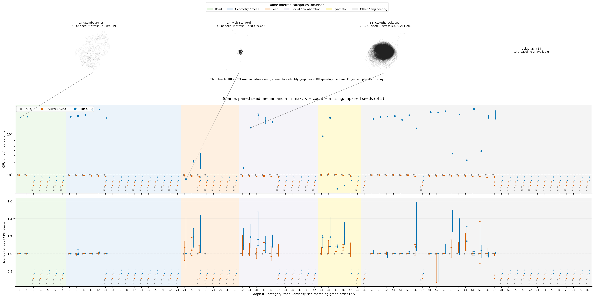

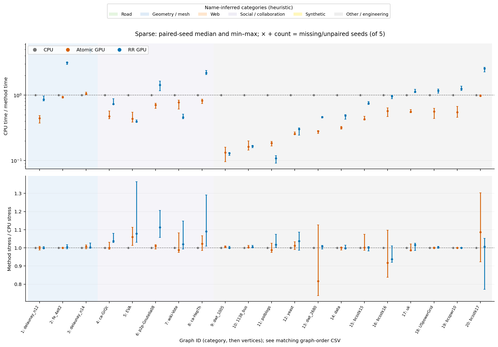

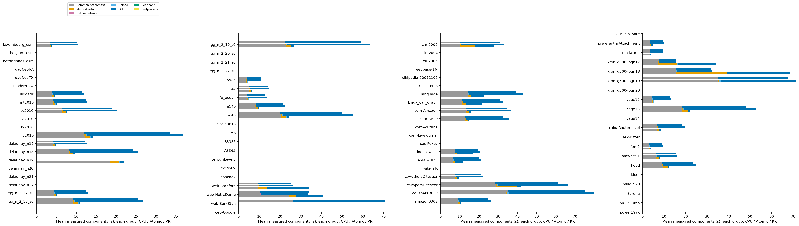

- Atomic GPU：対応比較できた 39 グラフ中 2 グラフでCPUより高速。グラフ別速度比 0.87〜1.04倍、stress比 0.971〜1.139。
- RR GPU：対応比較できた 37 グラフ中 34 グラフでCPUより高速。グラフ別速度比 0.45〜40.67倍、stress比 1.000〜1.341。

Sparse80 overviewにはRR GPUの代表描画4枠を添える。seedは実験1と同じCPU stress中央値に近いものを選び、接続線は対応するグラフのRR速度比中央値を指す。描画seed単独の速度比を指す線ではない。取得・成功していない描画は欠測枠として残す。小規模20グラフのSparse補助比較も別図で表示する。大規模80グラフの集計とは混ぜない。時間内訳図の積み上げは計測できた成分の平均で、cold総時間との差には区間外の準備処理が含まれる。

[Sparse80のID・名前対応](../tables/03_sparse-graph-order.csv) · [対応seed数](../tables/03_sparse-counts.csv) · [Sparse小20補助のID対応](../tables/03_sparse_small_aux-graph-order.csv)

上下2段は全グラフの共通x軸。背景は名前から推定したカテゴリで、分類内を頂点数順に並べる。graph-order.csvにID・名前を、counts.csvに対応seed数を保存。下端の×と数は欠測・CPU基準欠如による未対応seed数（5件中）で、0や1の測定値ではない。比は対応する成功seedのみで計算する。

## 4. グラフ構造と速度

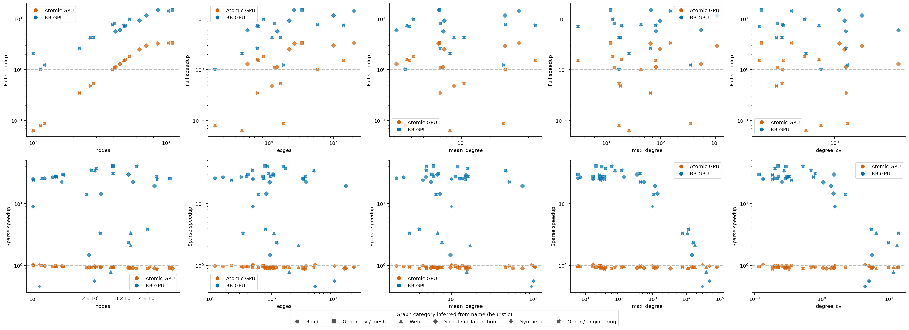

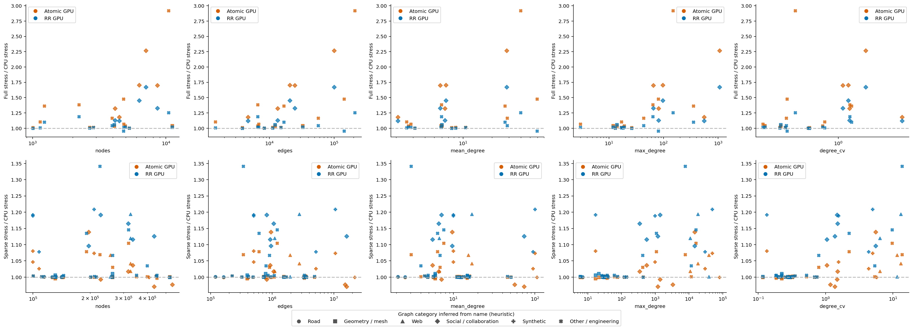

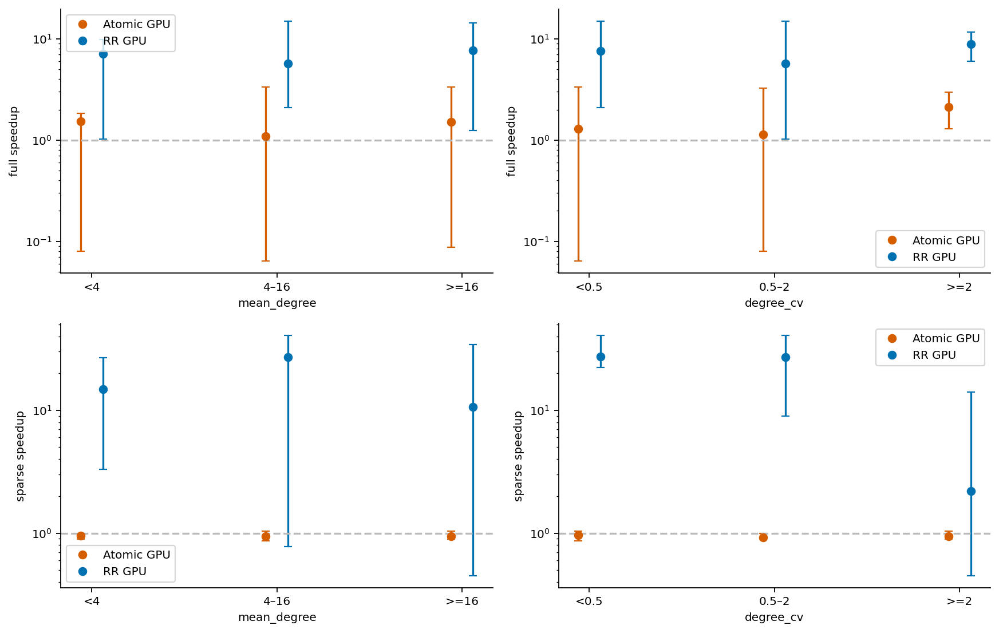

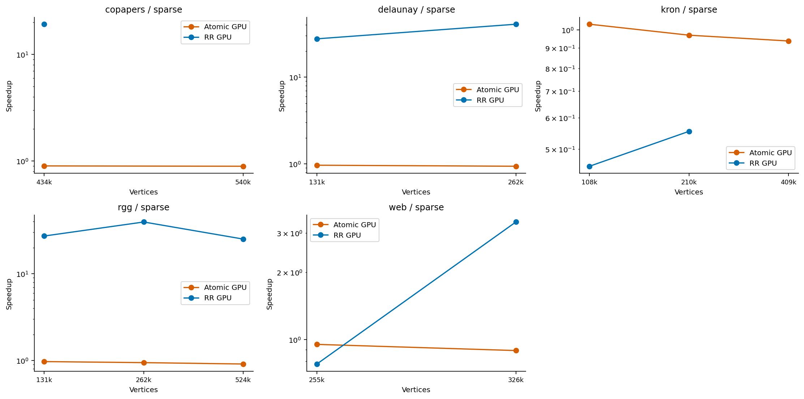

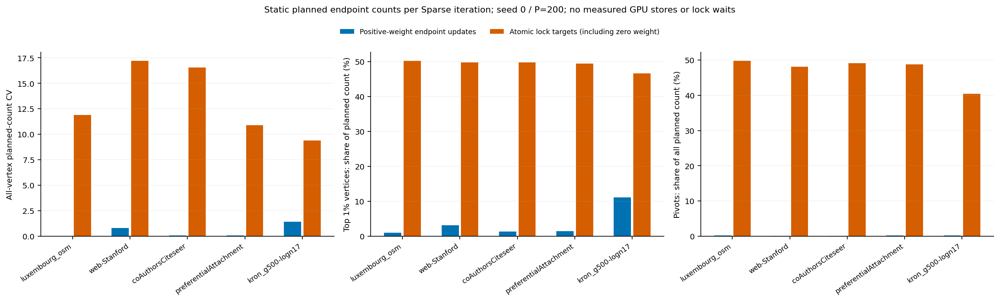

頂点数V・辺数E・次数の平均・最大値・変動係数の5指標を、Full/Sparseの上下2段で速度比と比較する。品質比も同じ2×5構成の補助図で示す。各グラフは対応seed比の中央値1点とし、Spearman CSVはmetric列で速度と品質を区別する。CV=0はsymlog軸で保持する。次数だけで実行時間は決まらず、頂点数・制約数・タイル数との交絡がある。相関係数はstructure-correlations.csvに保存し、因果関係として扱わない。点形状の構造カテゴリはグラフ名からの推定であり、確認済みの用途分類ではない。元のSuiteSparseグループはsource_groupとしてgraph-structure.csvに保存する。平均次数4/16とCV0.5/2で分けた図はグラフごとの速度比中央値を再集計し、グラフを等重みにする。同系列のサイズ曲線もグラフ名prefixからの推定系列で、規模以外の構造差を制御した実験ではない。

[代表グラフの予定書込回数CSV](../analysis/sparse-write-load/summary.csv)・[選択とSHA照合の証拠](../analysis/sparse-write-load/selection.json)。Atomicは重み0の端点もlockするため、正重みの端点更新予定数と両端lock対象予定数を分ける。いずれも1反復あたりの静的回数で、実際のGPU store、競合率、retry、待ち時間を表さない。図は全頂点CV・上位1%頂点の割合・pivot群の総回数割合。表はall群の総数・最大値を併記する。

| Graph | 予定回数の定義 | 総数 / 反復 | 最大 / 頂点 | CV | 上位1%割合 | pivot群割合 |
|---|---|---:|---:|---:|---:|---:|
| luxembourg_osm | 正重み端点更新 | 23,158,518 | 206 | 0.002 | 1.01% | 0.17% |
| luxembourg_osm | Atomic lock対象 | 46,037,904 | 114,598 | 11.886 | 50.20% | 49.78% |
| web-Stanford | 正重み端点更新 | 54,934,849 | 38,814 | 0.813 | 3.10% | 0.08% |
| web-Stanford | Atomic lock対象 | 105,946,046 | 255,264 | 17.199 | 49.74% | 48.19% |
| coAuthorsCiteseer | 正重み端点更新 | 47,091,146 | 1,572 | 0.051 | 1.33% | 0.09% |
| coAuthorsCiteseer | Atomic lock対象 | 92,514,224 | 227,319 | 16.545 | 49.76% | 49.14% |
| preferentialAttachment | 正重み端点更新 | 20,998,006 | 1,182 | 0.074 | 1.47% | 0.20% |
| preferentialAttachment | Atomic lock対象 | 40,956,244 | 99,999 | 10.885 | 49.46% | 48.83% |
| kron_g500-logn17 | 正重み端点更新 | 31,796,316 | 30,090 | 1.406 | 11.16% | 0.16% |
| kron_g500-logn17 | Atomic lock対象 | 53,324,870 | 107,900 | 9.403 | 46.64% | 40.47% |

## 5. 収束曲線と目標stress到達

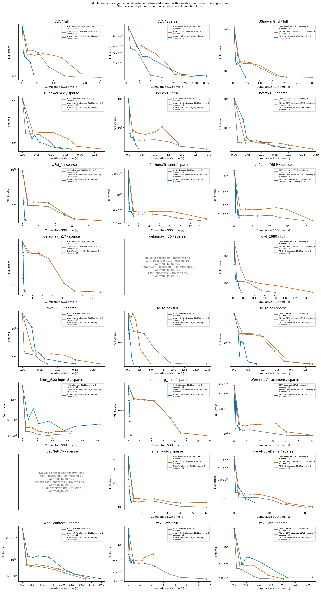

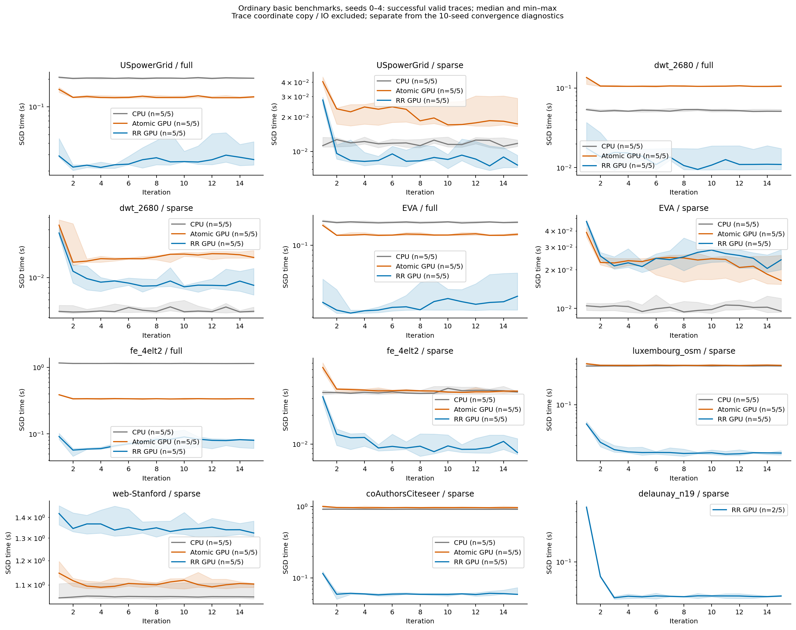

`05_convergence` は座標保存を伴う収束診断の計画10seedから、反復0・1・2・3・5・8・10・15のstressを後計算した図。GPUとCPUで同じ起点を使う。曲線はcheckpointごとの各手法の成功seed中央値であり、実際の単一実行の軌跡ではない。失敗により手法間の成功seed集合が異なる場合がある。計画した全24 graph/family枠を残し、全観測欠測の枠も表示する。図のobservedは有効なcheckpointが1点以上あるseed数、missingはないseed数。併記statusは計画条件の分類で、warmup_failedを実起動の事故件数と数えない。[図の観測・欠測・status対応](../tables/convergence-panel-coverage.csv)。
`05_iteration_times` は通常の `study=basic` benchmarkのseed 0〜4のうち、成功し反復時間trace検査を通過した実行だけを使う別図。線は反復ごとの中央値、帯は最小〜最大、凡例n/5は利用できたseed数。座標コピー・trace IOはSGD時間から除外している。10seedの収束診断やその目標到達時間を示す図ではない。
目標は同じseed・familyのCPU 15反復後stressの1.05倍と1.01倍。最初に到達を観測したcheckpointと直前観測点の幅を記録する。これは実際の初到達を保証する区間ではない。stressが非単調になり、未観測の反復で到達後に再上昇する場合、真の初到達はこの幅より前の可能性がある。upper_ms時点には目標を満たす保存座標があるが、lower_msは真の初到達の下限と断定しない。正確な初到達時刻や未到達条件の外挿は行わない。診断の同期・保存による影響があるため、図2・3の通常実行時間とは分けて読む。

[最終stress評価の整合監査](../tables/convergence-stress-audit.csv)は、各成功runのoffline反復15とnative stressを比較する。snapshotは重心移動前、nativeは移動後で、数学的には並進でstressは不変だがf32/f64の丸めによりbit一致は要求しない。stress定義・起点数・seedも照合し、相対差0.1%以上を要調査として記録する。監査flagだけで成功runを除外しない。

- sgd / 1.05倍目標：必要checkpointとCPU基準が揃った 60 実行中 60 実行で到達を観測。観測またはCPU基準の欠測 0 実行は到達率の分母から除外。到達観測後に再び目標超を観測したのは 0 実行、最終反復15で目標以下だったのは 60/60 実行。
- atomic_sgd / 1.05倍目標：必要checkpointとCPU基準が揃った 60 実行中 30 実行で到達を観測。観測またはCPU基準の欠測 0 実行は到達率の分母から除外。到達観測後に再び目標超を観測したのは 0 実行、最終反復15で目標以下だったのは 30/60 実行。
- rr_sgd / 1.05倍目標：必要checkpointとCPU基準が揃った 60 実行中 36 実行で到達を観測。観測またはCPU基準の欠測 0 実行は到達率の分母から除外。到達観測後に再び目標超を観測したのは 0 実行、最終反復15で目標以下だったのは 36/60 実行。
- sparse_sgd / 1.05倍目標：必要checkpointとCPU基準が揃った 160 実行中 160 実行で到達を観測。観測またはCPU基準の欠測 20 実行は到達率の分母から除外。到達観測後に再び目標超を観測したのは 1 実行、最終反復15で目標以下だったのは 160/160 実行。
- atomic_sparse_sgd / 1.05倍目標：必要checkpointとCPU基準が揃った 160 実行中 126 実行で到達を観測。観測またはCPU基準の欠測 20 実行は到達率の分母から除外。到達観測後に再び目標超を観測したのは 5 実行、最終反復15で目標以下だったのは 123/160 実行。
- rr_sparse_sgd / 1.05倍目標：必要checkpointとCPU基準が揃った 157 実行中 97 実行で到達を観測。観測またはCPU基準の欠測 23 実行は到達率の分母から除外。到達観測後に再び目標超を観測したのは 6 実行、最終反復15で目標以下だったのは 91/157 実行。
- sgd / 1.01倍目標：必要checkpointとCPU基準が揃った 60 実行中 60 実行で到達を観測。観測またはCPU基準の欠測 0 実行は到達率の分母から除外。到達観測後に再び目標超を観測したのは 0 実行、最終反復15で目標以下だったのは 60/60 実行。
- atomic_sgd / 1.01倍目標：必要checkpointとCPU基準が揃った 60 実行中 4 実行で到達を観測。観測またはCPU基準の欠測 0 実行は到達率の分母から除外。到達観測後に再び目標超を観測したのは 0 実行、最終反復15で目標以下だったのは 4/60 実行。
- rr_sgd / 1.01倍目標：必要checkpointとCPU基準が揃った 60 実行中 14 実行で到達を観測。観測またはCPU基準の欠測 0 実行は到達率の分母から除外。到達観測後に再び目標超を観測したのは 0 実行、最終反復15で目標以下だったのは 14/60 実行。
- sparse_sgd / 1.01倍目標：必要checkpointとCPU基準が揃った 160 実行中 160 実行で到達を観測。観測またはCPU基準の欠測 20 実行は到達率の分母から除外。到達観測後に再び目標超を観測したのは 1 実行、最終反復15で目標以下だったのは 160/160 実行。
- atomic_sparse_sgd / 1.01倍目標：必要checkpointとCPU基準が揃った 160 実行中 103 実行で到達を観測。観測またはCPU基準の欠測 20 実行は到達率の分母から除外。到達観測後に再び目標超を観測したのは 4 実行、最終反復15で目標以下だったのは 99/160 実行。
- rr_sparse_sgd / 1.01倍目標：必要checkpointとCPU基準が揃った 157 実行中 72 実行で到達を観測。観測またはCPU基準の欠測 23 実行は到達率の分母から除外。到達観測後に再び目標超を観測したのは 5 実行、最終反復15で目標以下だったのは 67/157 実行。

計画上の全10seedを残し、観測なし・CPU基準なし・checkpoint不完全を未達と区別する。下表の欠測は到達率の分母に含めない。観測幅は評価可能で到達を観測したseedだけで、直前観測時刻と初到達を観測した時刻をそれぞれ中央値にした幅（秒）。seed間の隣接観測時刻の幅中央値であり、単一実行の初到達時刻でも、真の初到達を挟む保証区間でもない。CSVには到達観測後の再上昇と最終checkpoint・反復15で目標以下かのflagsも残す。[全seedの時刻幅](../tables/target-arrival.csv)・[集計CSV](../tables/target-arrival-coverage.csv)で確認できる。

| Graph | Family | Method | 計画seed | 評価可能 | 1.05倍到達 | 1.01倍到達 | 欠測 | 1.05倍 観測幅中央値 s | 1.01倍 観測幅中央値 s |
|---|---|---|---:|---:|---:|---:|---:|---:|---:|
| EVA | full | atomic_sgd | 10 | 10 | 0 | 0 | 0 | — | — |
| EVA | full | rr_sgd | 10 | 10 | 0 | 0 | 0 | — | — |
| EVA | full | sgd | 10 | 10 | 10 | 10 | 0 | 1.345–1.678 | 1.678–2.510 |
| EVA | sparse | atomic_sparse_sgd | 10 | 10 | 8 | 5 | 0 | 0.205–0.291 | 0.184–0.217 |
| EVA | sparse | rr_sparse_sgd | 10 | 10 | 6 | 2 | 0 | 0.239–0.352 | 0.111–0.160 |
| EVA | sparse | sparse_sgd | 10 | 10 | 10 | 10 | 0 | 0.097–0.148 | 0.101–0.152 |
| USpowerGrid | full | atomic_sgd | 10 | 10 | 10 | 0 | 0 | 1.237–1.845 | — |
| USpowerGrid | full | rr_sgd | 10 | 10 | 10 | 0 | 0 | 0.292–0.446 | — |
| USpowerGrid | full | sgd | 10 | 10 | 10 | 10 | 0 | 1.638–2.046 | 2.046–3.062 |
| USpowerGrid | sparse | atomic_sparse_sgd | 10 | 10 | 10 | 10 | 0 | 0.189–0.272 | 0.189–0.272 |
| USpowerGrid | sparse | rr_sparse_sgd | 10 | 10 | 10 | 9 | 0 | 0.099–0.140 | 0.098–0.138 |
| USpowerGrid | sparse | sparse_sgd | 10 | 10 | 10 | 10 | 0 | 0.113–0.171 | 0.113–0.171 |
| bcsstk16 | full | atomic_sgd | 10 | 10 | 0 | 0 | 0 | — | — |
| bcsstk16 | full | rr_sgd | 10 | 10 | 7 | 4 | 0 | 0.265–0.395 | 0.267–0.404 |
| bcsstk16 | full | sgd | 10 | 10 | 10 | 10 | 0 | 1.940–2.907 | 1.940–2.907 |
| bcsstk16 | sparse | atomic_sparse_sgd | 10 | 10 | 8 | 8 | 0 | 0.200–0.288 | 0.200–0.288 |
| bcsstk16 | sparse | rr_sparse_sgd | 10 | 10 | 9 | 8 | 0 | 0.143–0.203 | 0.143–0.202 |
| bcsstk16 | sparse | sparse_sgd | 10 | 10 | 10 | 10 | 0 | 0.136–0.205 | 0.136–0.205 |
| bmw7st_1 | sparse | atomic_sparse_sgd | 10 | 10 | 10 | 10 | 0 | 6.282–9.415 | 6.290–9.416 |
| bmw7st_1 | sparse | rr_sparse_sgd | 10 | 10 | 10 | 10 | 0 | 0.288–0.382 | 0.293–0.413 |
| bmw7st_1 | sparse | sparse_sgd | 10 | 10 | 10 | 10 | 0 | 6.344–9.503 | 6.349–9.506 |
| coAuthorsCiteseer | sparse | atomic_sparse_sgd | 10 | 10 | 5 | 1 | 0 | 10.021–15.024 | 10.021–15.017 |
| coAuthorsCiteseer | sparse | rr_sparse_sgd | 10 | 10 | 0 | 0 | 0 | — | — |
| coAuthorsCiteseer | sparse | sparse_sgd | 10 | 10 | 10 | 10 | 0 | 9.272–13.925 | 9.288–13.963 |
| coPapersDBLP | sparse | atomic_sparse_sgd | 10 | 10 | 8 | 6 | 0 | 29.391–43.766 | 29.338–43.766 |
| coPapersDBLP | sparse | rr_sparse_sgd | 10 | 7 | 1 | 0 | 3 | 2.017–2.759 | — |
| coPapersDBLP | sparse | sparse_sgd | 10 | 10 | 10 | 10 | 0 | 25.932–38.803 | 25.932–38.803 |
| delaunay_n17 | sparse | atomic_sparse_sgd | 10 | 10 | 10 | 10 | 0 | 5.192–7.787 | 5.234–7.848 |
| delaunay_n17 | sparse | rr_sparse_sgd | 10 | 10 | 10 | 7 | 0 | 0.180–0.254 | 0.183–0.256 |
| delaunay_n17 | sparse | sparse_sgd | 10 | 10 | 10 | 10 | 0 | 5.191–7.787 | 5.196–7.800 |
| delaunay_n20 | sparse | atomic_sparse_sgd | 10 | 0 | 0 | 0 | 10 | — | — |
| delaunay_n20 | sparse | rr_sparse_sgd | 10 | 0 | 0 | 0 | 10 | — | — |
| delaunay_n20 | sparse | sparse_sgd | 10 | 0 | 0 | 0 | 10 | — | — |
| dwt_2680 | full | atomic_sgd | 10 | 10 | 10 | 4 | 0 | 1.038–1.546 | 1.040–1.552 |
| dwt_2680 | full | rr_sgd | 10 | 10 | 9 | 9 | 0 | 0.098–0.144 | 0.098–0.144 |
| dwt_2680 | full | sgd | 10 | 10 | 10 | 10 | 0 | 0.538–0.807 | 0.538–0.807 |
| dwt_2680 | sparse | atomic_sparse_sgd | 10 | 10 | 9 | 9 | 0 | 0.152–0.223 | 0.152–0.223 |
| dwt_2680 | sparse | rr_sparse_sgd | 10 | 10 | 9 | 7 | 0 | 0.107–0.150 | 0.108–0.152 |
| dwt_2680 | sparse | sparse_sgd | 10 | 10 | 10 | 10 | 0 | 0.048–0.072 | 0.048–0.072 |
| fe_4elt2 | full | atomic_sgd | 10 | 10 | 10 | 0 | 0 | 3.302–4.926 | — |
| fe_4elt2 | full | rr_sgd | 10 | 10 | 10 | 1 | 0 | 0.719–1.124 | 0.702–1.109 |
| fe_4elt2 | full | sgd | 10 | 10 | 10 | 10 | 0 | 9.282–11.593 | 11.593–17.381 |
| fe_4elt2 | sparse | atomic_sparse_sgd | 10 | 10 | 10 | 10 | 0 | 0.377–0.549 | 0.377–0.549 |
| fe_4elt2 | sparse | rr_sparse_sgd | 10 | 10 | 10 | 8 | 0 | 0.111–0.157 | 0.111–0.157 |
| fe_4elt2 | sparse | sparse_sgd | 10 | 10 | 10 | 10 | 0 | 0.354–0.530 | 0.354–0.530 |
| kron_g500-logn18 | sparse | atomic_sparse_sgd | 10 | 10 | 9 | 6 | 0 | 3.400–5.677 | 3.278–5.431 |
| kron_g500-logn18 | sparse | rr_sparse_sgd | 10 | 10 | 5 | 4 | 0 | 5.358–8.775 | 8.794–13.987 |
| kron_g500-logn18 | sparse | sparse_sgd | 10 | 10 | 10 | 10 | 0 | 1.063–2.138 | 3.196–5.327 |
| luxembourg_osm | sparse | atomic_sparse_sgd | 10 | 10 | 10 | 10 | 0 | 4.484–6.719 | 4.484–6.719 |
| luxembourg_osm | sparse | rr_sparse_sgd | 10 | 10 | 10 | 10 | 0 | 0.145–0.173 | 0.168–0.235 |
| luxembourg_osm | sparse | sparse_sgd | 10 | 10 | 10 | 10 | 0 | 4.479–6.722 | 4.479–6.722 |
| preferentialAttachment | sparse | atomic_sparse_sgd | 10 | 10 | 7 | 5 | 0 | 3.938–5.866 | 3.938–5.866 |
| preferentialAttachment | sparse | rr_sparse_sgd | 10 | 10 | 0 | 0 | 0 | — | — |
| preferentialAttachment | sparse | sparse_sgd | 10 | 10 | 10 | 10 | 0 | 2.653–3.684 | 3.229–4.025 |
| roadNet-CA | sparse | atomic_sparse_sgd | 10 | 0 | 0 | 0 | 10 | — | — |
| roadNet-CA | sparse | rr_sparse_sgd | 10 | 0 | 0 | 0 | 10 | — | — |
| roadNet-CA | sparse | sparse_sgd | 10 | 0 | 0 | 0 | 10 | — | — |
| smallworld | sparse | atomic_sparse_sgd | 10 | 10 | 0 | 0 | 0 | — | — |
| smallworld | sparse | rr_sparse_sgd | 10 | 10 | 1 | 0 | 0 | 0.171–0.239 | — |
| smallworld | sparse | sparse_sgd | 10 | 10 | 10 | 10 | 0 | 3.241–4.052 | 4.037–6.055 |
| web-NotreDame | sparse | atomic_sparse_sgd | 10 | 10 | 6 | 3 | 0 | 14.908–22.338 | 14.908–22.382 |
| web-NotreDame | sparse | rr_sparse_sgd | 10 | 10 | 2 | 0 | 0 | 3.847–5.846 | — |
| web-NotreDame | sparse | sparse_sgd | 10 | 10 | 10 | 10 | 0 | 13.512–20.281 | 13.512–20.281 |
| web-Stanford | sparse | atomic_sparse_sgd | 10 | 10 | 6 | 4 | 0 | 11.465–17.140 | 11.461–17.138 |
| web-Stanford | sparse | rr_sparse_sgd | 10 | 10 | 7 | 5 | 0 | 13.108–19.743 | 12.875–19.260 |
| web-Stanford | sparse | sparse_sgd | 10 | 10 | 10 | 10 | 0 | 10.588–15.877 | 10.588–15.877 |
| wiki-Vote | full | atomic_sgd | 10 | 10 | 0 | 0 | 0 | — | — |
| wiki-Vote | full | rr_sgd | 10 | 10 | 0 | 0 | 0 | — | — |
| wiki-Vote | full | sgd | 10 | 10 | 10 | 10 | 0 | 4.463–6.691 | 4.463–6.691 |
| wiki-Vote | sparse | atomic_sparse_sgd | 10 | 10 | 10 | 6 | 0 | 0.280–0.400 | 0.282–0.400 |
| wiki-Vote | sparse | rr_sparse_sgd | 10 | 10 | 7 | 2 | 0 | 0.364–0.442 | 0.399–0.542 |
| wiki-Vote | sparse | sparse_sgd | 10 | 10 | 10 | 10 | 0 | 0.156–0.195 | 0.187–0.261 |

## 6. タイルサイズ

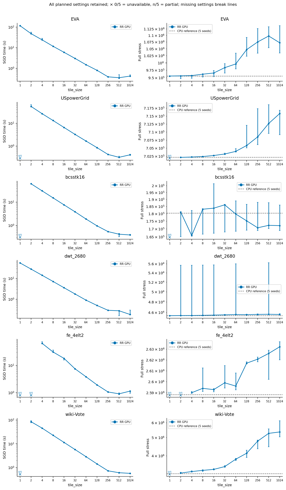

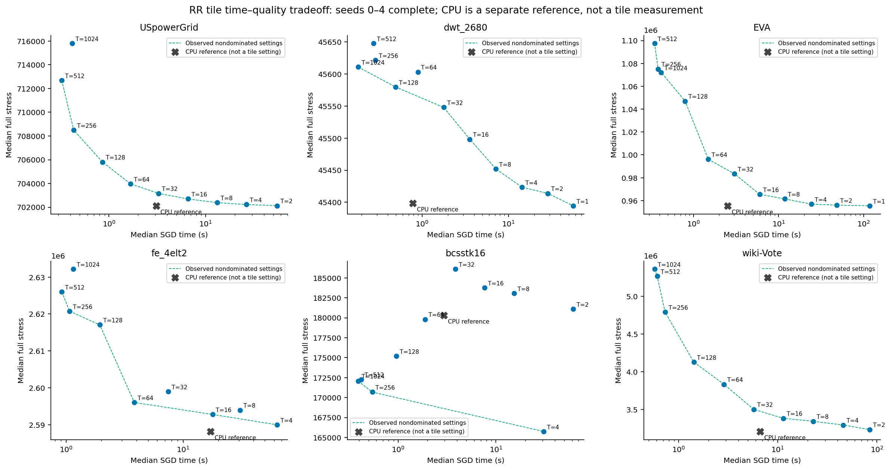

- EVA：5seed完備条件のうち今回測れた最短は rr_sgd（5/5成功）、tile_size=512、SGD 0.348 秒、stress 1,097,464.6。
- USpowerGrid：5seed完備条件のうち今回測れた最短は rr_sgd（5/5成功）、tile_size=512、SGD 0.325 秒、stress 712,678.1。
- bcsstk16：5seed完備条件のうち今回測れた最短は rr_sgd（5/5成功）、tile_size=1024、SGD 0.391 秒、stress 172,083.8。
- dwt_2680：5seed完備条件のうち今回測れた最短は rr_sgd（5/5成功）、tile_size=1024、SGD 0.182 秒、stress 45,611.1。
- fe_4elt2：5seed完備条件のうち今回測れた最短は rr_sgd（5/5成功）、tile_size=512、SGD 0.915 秒、stress 2,626,016.0。
- wiki-Vote：5seed完備条件のうち今回測れた最短は rr_sgd（5/5成功）、tile_size=1024、SGD 0.572 秒、stress 5,359,121.8。
- EVA / T=1：同seed CPU stress比の中央値 1.000、SGD 117.673 秒（対応 5/5 seed）。
- EVA / T=1024：同seed CPU stress比の中央値 1.122、SGD 0.417 秒（対応 5/5 seed）。
- USpowerGrid / T=1024：同seed CPU stress比の中央値 1.019、SGD 0.418 秒（対応 5/5 seed）。
- bcsstk16 / T=1024：同seed CPU stress比の中央値 0.954、SGD 0.391 秒（対応 5/5 seed）。
- dwt_2680 / T=1：同seed CPU stress比の中央値 1.000、SGD 56.602 秒（対応 5/5 seed）。
- dwt_2680 / T=1024：同seed CPU stress比の中央値 1.004、SGD 0.182 秒（対応 5/5 seed）。
- fe_4elt2 / T=1024：同seed CPU stress比の中央値 1.017、SGD 1.147 秒（対応 5/5 seed）。
- wiki-Vote / T=1024：同seed CPU stress比の中央値 1.671、SGD 0.572 秒（対応 5/5 seed）。
全予定パラメータをx軸に残し、全欠測は軸下端の× 0/5、部分成功は手法色のn/5で示す。欠測はNaNとして線を切り、0の測定値へ置換しない。[条件別・指標別のcoverage](../tables/tiling-parameter-coverage.csv)で成功・欠測・未記録数を確認できる。

時間だけで選ぶと品質を落とす可能性があるため、同じ条件のstressも併記する。時間–品質散布図はseed 0–4の5件すべてが成功したTだけを描き、Tラベルを付ける。CPU水平線と散布図のCPU点はbasic Full CPUの5seedが完備したときだけ表示する別枠の参照であり、T比較の測定点ではない。欠測・部分成功条件はtile-pareto.csvに残し、散布図に値を補わない。破線は測定した中央値に対して非劣位の条件を結ぶもので、未測定条件を含む最適性の証明ではない。最短条件は今回の測定範囲での値。

## 7. pivot数

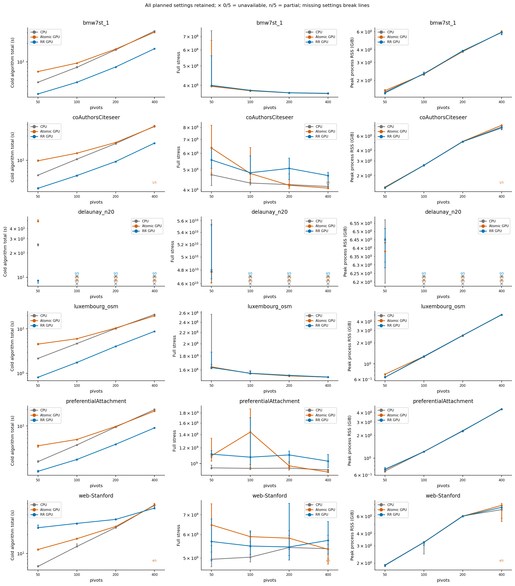

- bmw7st_1：5seed完備条件のうち今回測れた最短は rr_sparse_sgd（5/5成功）、pivots=50、SGD 0.320 秒、stress 399,650,838.7。 cold総時間 2.990 秒。
- coAuthorsCiteseer：5seed完備条件のうち今回測れた最短は rr_sparse_sgd（5/5成功）、pivots=50、SGD 0.813 秒、stress 5,575,457,825.7。 cold総時間 2.824 秒。
- delaunay_n20：5seed完備条件のうち今回測れた最短は rr_sparse_sgd（5/5成功）、pivots=50、SGD 0.278 秒、stress 47,803,912,362.0。 cold総時間 9.140 秒。
- luxembourg_osm：5seed完備条件のうち今回測れた最短は rr_sparse_sgd（5/5成功）、pivots=50、SGD 0.067 秒、stress 163,311,293.5。 cold総時間 0.815 秒。
- preferentialAttachment：5seed完備条件のうち今回測れた最短は rr_sparse_sgd（5/5成功）、pivots=50、SGD 0.573 秒、stress 1,114,683,340.2。 cold総時間 1.496 秒。
- web-Stanford：5seed完備条件のうち今回測れた最短は sparse_sgd（5/5成功）、pivots=50、SGD 4.190 秒、stress 4,952,670,900.7。 cold総時間 6.275 秒。
全予定パラメータをx軸に残し、全欠測は軸下端の× 0/5、部分成功は手法色のn/5で示す。欠測はNaNとして線を切り、0の測定値へ置換しない。[条件別・指標別のcoverage](../tables/pivots-parameter-coverage.csv)で成功・欠測・未記録数を確認できる。

pivot増加は制約数・前処理・メモリと品質の交換になる。主図の時間は前処理・GPU初期化・SGD・readbackを含むcoldアルゴリズム総時間で、入力読込・stress評価・描画ファイル保存を含まない。summary.csvにはSGD単独・前処理・process wall・peak RSSも保存。Peak RSSはGPU専用VRAM量ではない。

## 事故・欠測と調査

- memory_limit 46 件：記録参照
- timeout 3 件：記録参照
- warmupの実失敗 126 件：memory_limit 117、timeout 9。
- warmup 333SP / atomic_sparse_sgd：memory_limit、
- warmup 333SP / rr_sparse_sgd：memory_limit、
- warmup 333SP / sparse_sgd：memory_limit、
- warmup AS365 / atomic_sparse_sgd：memory_limit、
- warmup AS365 / rr_sparse_sgd：memory_limit、
- warmup AS365 / sparse_sgd：memory_limit、
- warmup Emilia_923 / atomic_sparse_sgd：memory_limit、
- warmup Emilia_923 / rr_sparse_sgd：memory_limit、
- warmup Emilia_923 / sparse_sgd：memory_limit、
- warmup M6 / atomic_sparse_sgd：memory_limit、
- warmup M6 / rr_sparse_sgd：memory_limit、
- warmup M6 / sparse_sgd：memory_limit、
- warmup NACA0015 / atomic_sparse_sgd：memory_limit、
- warmup NACA0015 / rr_sparse_sgd：memory_limit、
- warmup NACA0015 / sparse_sgd：memory_limit、
- 未起動の原因別条件数：memory_limit 645、timeout 45。対応するwarmup_run_idは 126 件。
- warmup_failed 690 条件はwarmupの失敗を受けて起動しなかった条件。warmup_run_idで失敗した実行に対応する。同じwarmupが5seedを止めても、実事故は1件として数える。
- LCCがlarge基準未満のため規模除外：1 グラフ（G_n_pin_pout）、未起動 15 計画条件。実行時のtimeoutやGPU事故とは区別する。
- 入力データ未取得：1 グラフ（power197k）、未起動 15 計画条件。実行時のtimeoutやGPU事故とは区別する。

timeoutは計画した時間上限で停止した実行で、完了時間の実測値ではない。memory_limitは資源制限であり、そのグラフに対する性能やstressを0とみなさない。取得不能データの類似グラフへの差し替えは行わない。

- CPU対応比較から 11 記録を除外。理由はpair-exclusions.csv。

## 保存先

- [全条件の集計](../tables/summary.csv)
- [同一seedのCPU対応比](../tables/paired-ratios.csv)
- [収束checkpoint](../tables/convergence.csv)
- [目標到達](../tables/target-arrival.csv)
- [失敗実行](../tables/failures.csv)
- [データの規模・由来](../config/datasets.json)

## 条件ごとの数値

| Study | Graph | Method | P | T | 成功 / 記録 | SGD秒 中央値 | stress 中央値 | RSS GiB |
|---|---|---|---:|---:|---:|---:|---:|---:|
| basic | 1138_bus | atomic_sgd | — | None | 5/5 | 1.046 | 44,020.4 | 0.090 |
| basic | 1138_bus | atomic_sparse_sgd | 200 | None | 5/5 | 0.155 | 41,029.1 | 0.035 |
| basic | 1138_bus | rr_sgd | — | 1024 | 5/5 | 0.078 | 40,192.7 | 0.070 |
| basic | 1138_bus | rr_sparse_sgd | 200 | None | 5/5 | 0.149 | 41,292.8 | 0.252 |
| basic | 1138_bus | sgd | — | None | 5/5 | 0.083 | 39,901.9 | 0.060 |
| basic | 1138_bus | sparse_sgd | 200 | None | 5/5 | 0.024 | 40,927.9 | 0.031 |
| basic | 144 | atomic_sparse_sgd | 200 | None | 5/5 | 9.364 | 970,089,838.6 | 3.367 |
| basic | 144 | rr_sparse_sgd | 200 | None | 5/5 | 0.307 | 982,858,712.3 | 3.400 |
| basic | 144 | sparse_sgd | 200 | None | 5/5 | 9.032 | 969,406,150.5 | 3.400 |
| basic | 333SP | atomic_sparse_sgd | 200 | None | 0/5 | — | — | — |
| basic | 333SP | rr_sparse_sgd | 200 | None | 0/5 | — | — | — |
| basic | 333SP | sparse_sgd | 200 | None | 0/5 | — | — | — |
| basic | 598a | atomic_sparse_sgd | 200 | None | 5/5 | 6.944 | 489,201,202.5 | 2.571 |
| basic | 598a | rr_sparse_sgd | 200 | None | 5/5 | 0.268 | 488,850,765.5 | 2.571 |
| basic | 598a | sparse_sgd | 200 | None | 5/5 | 6.808 | 488,632,481.0 | 2.574 |
| basic | AS365 | atomic_sparse_sgd | 200 | None | 0/5 | — | — | — |
| basic | AS365 | rr_sparse_sgd | 200 | None | 0/5 | — | — | — |
| basic | AS365 | sparse_sgd | 200 | None | 0/5 | — | — | — |
| basic | EVA | atomic_sgd | — | None | 5/5 | 1.935 | 1,127,359.3 | 0.917 |
| basic | EVA | atomic_sparse_sgd | 200 | None | 5/5 | 0.351 | 1,157,303.9 | 0.113 |
| basic | EVA | rr_sgd | — | 1024 | 5/5 | 0.417 | 1,072,128.4 | 0.793 |
| basic | EVA | rr_sparse_sgd | 200 | None | 5/5 | 0.385 | 1,198,718.6 | 0.339 |
| basic | EVA | sgd | — | None | 5/5 | 2.514 | 955,403.7 | 0.837 |
| basic | EVA | sparse_sgd | 200 | None | 5/5 | 0.154 | 1,111,264.7 | 0.111 |
| basic | Emilia_923 | atomic_sparse_sgd | 200 | None | 0/5 | — | — | — |
| basic | Emilia_923 | rr_sparse_sgd | 200 | None | 0/5 | — | — | — |
| basic | Emilia_923 | sparse_sgd | 200 | None | 0/5 | — | — | — |
| basic | G_n_pin_pout | atomic_sparse_sgd | 200 | None | 0/5 | — | — | — |
| basic | G_n_pin_pout | rr_sparse_sgd | 200 | None | 0/5 | — | — | — |
| basic | G_n_pin_pout | sparse_sgd | 200 | None | 0/5 | — | — | — |
| basic | Linux_call_graph | atomic_sparse_sgd | 200 | None | 5/5 | 20.973 | 11,036,222,483.5 | 7.195 |
| basic | Linux_call_graph | rr_sparse_sgd | 200 | None | 5/5 | 8.463 | 11,336,489,820.3 | 7.188 |
| basic | Linux_call_graph | sparse_sgd | 200 | None | 5/5 | 19.474 | 9,961,690,130.2 | 7.266 |
| basic | M6 | atomic_sparse_sgd | 200 | None | 0/5 | — | — | — |
| basic | M6 | rr_sparse_sgd | 200 | None | 0/5 | — | — | — |
| basic | M6 | sparse_sgd | 200 | None | 0/5 | — | — | — |
| basic | NACA0015 | atomic_sparse_sgd | 200 | None | 0/5 | — | — | — |
| basic | NACA0015 | rr_sparse_sgd | 200 | None | 0/5 | — | — | — |
| basic | NACA0015 | sparse_sgd | 200 | None | 0/5 | — | — | — |
| basic | Serena | atomic_sparse_sgd | 200 | None | 0/5 | — | — | — |
| basic | Serena | rr_sparse_sgd | 200 | None | 0/5 | — | — | — |
| basic | Serena | sparse_sgd | 200 | None | 0/5 | — | — | — |
| basic | StocF-1465 | atomic_sparse_sgd | 200 | None | 0/5 | — | — | — |
| basic | StocF-1465 | rr_sparse_sgd | 200 | None | 0/5 | — | — | — |
| basic | StocF-1465 | sparse_sgd | 200 | None | 0/5 | — | — | — |
| basic | USpowerGrid | atomic_sgd | — | None | 5/5 | 1.940 | 729,168.9 | 1.087 |
| basic | USpowerGrid | atomic_sparse_sgd | 200 | None | 5/5 | 0.329 | 727,766.7 | 0.125 |
| basic | USpowerGrid | rr_sgd | — | 1024 | 5/5 | 0.418 | 715,791.1 | 0.940 |
| basic | USpowerGrid | rr_sparse_sgd | 200 | None | 5/5 | 0.153 | 729,364.1 | 0.291 |
| basic | USpowerGrid | sgd | — | None | 5/5 | 3.087 | 702,117.1 | 0.989 |
| basic | USpowerGrid | sparse_sgd | 200 | None | 5/5 | 0.179 | 725,382.1 | 0.123 |
| basic | amazon0302 | atomic_sparse_sgd | 200 | None | 5/5 | 16.816 | 5,137,150,540.9 | 5.840 |
| basic | amazon0302 | rr_sparse_sgd | 200 | None | 5/5 | 0.514 | 5,031,670,821.5 | 5.842 |
| basic | amazon0302 | sparse_sgd | 200 | None | 5/5 | 15.892 | 4,845,120,122.4 | 5.823 |
| basic | apache2 | atomic_sparse_sgd | 200 | None | 0/5 | — | — | — |
| basic | apache2 | rr_sparse_sgd | 200 | None | 0/5 | — | — | — |
| basic | apache2 | sparse_sgd | 200 | None | 0/5 | — | — | — |
| basic | as-Skitter | atomic_sparse_sgd | 200 | None | 0/5 | — | — | — |
| basic | as-Skitter | rr_sparse_sgd | 200 | None | 0/5 | — | — | — |
| basic | as-Skitter | sparse_sgd | 200 | None | 0/5 | — | — | — |
| basic | auto | atomic_sparse_sgd | 200 | None | 4/5 | 33.849 | 8,026,874,338.6 | 7.951 |
| basic | auto | rr_sparse_sgd | 200 | None | 5/5 | 1.247 | 8,081,676,611.0 | 7.132 |
| basic | auto | sparse_sgd | 200 | None | 5/5 | 29.441 | 8,033,195,333.1 | 7.393 |
| basic | bcspwr10 | atomic_sgd | — | None | 5/5 | 1.962 | 679,967.5 | 1.120 |
| basic | bcspwr10 | atomic_sparse_sgd | 200 | None | 5/5 | 0.356 | 692,651.0 | 0.134 |
| basic | bcspwr10 | rr_sgd | — | 1024 | 5/5 | 0.364 | 679,966.8 | 1.069 |
| basic | bcspwr10 | rr_sparse_sgd | 200 | None | 5/5 | 0.159 | 692,724.7 | 0.286 |
| basic | bcspwr10 | sgd | — | None | 5/5 | 3.584 | 679,073.6 | 1.053 |
| basic | bcspwr10 | sparse_sgd | 200 | None | 5/5 | 0.199 | 691,693.2 | 0.127 |
| basic | bcsstk15 | atomic_sgd | — | None | 5/5 | 1.887 | 811,995.2 | 0.621 |
| basic | bcsstk15 | atomic_sparse_sgd | 200 | None | 5/5 | 0.316 | 713,221.9 | 0.109 |
| basic | bcsstk15 | rr_sgd | — | 1024 | 5/5 | 0.244 | 728,637.9 | 0.571 |
| basic | bcsstk15 | rr_sparse_sgd | 200 | None | 5/5 | 0.181 | 711,837.5 | 0.319 |
| basic | bcsstk15 | sgd | — | None | 5/5 | 1.893 | 696,971.2 | 0.611 |
| basic | bcsstk15 | sparse_sgd | 200 | None | 5/5 | 0.138 | 712,031.4 | 0.108 |
| basic | bcsstk16 | atomic_sgd | — | None | 5/5 | 1.939 | 266,639.3 | 0.970 |
| basic | bcsstk16 | atomic_sparse_sgd | 200 | None | 5/5 | 0.356 | 176,941.4 | 0.170 |
| basic | bcsstk16 | rr_sgd | — | 1024 | 5/5 | 0.391 | 172,083.8 | 0.896 |
| basic | bcsstk16 | rr_sparse_sgd | 200 | None | 5/5 | 0.215 | 189,587.8 | 0.332 |
| basic | bcsstk16 | sgd | — | None | 5/5 | 2.932 | 180,322.0 | 0.890 |
| basic | bcsstk16 | sparse_sgd | 200 | None | 5/5 | 0.201 | 192,123.2 | 0.146 |
| basic | bcsstk17 | atomic_sgd | — | None | 5/5 | 4.513 | 5,127,975.3 | 3.952 |
| basic | bcsstk17 | atomic_sparse_sgd | 200 | None | 5/5 | 0.553 | 2,320,358.6 | 0.279 |
| basic | bcsstk17 | rr_sgd | — | 1024 | 5/5 | 1.052 | 2,208,775.7 | 3.334 |
| basic | bcsstk17 | rr_sparse_sgd | 200 | None | 5/5 | 0.220 | 1,812,834.3 | 0.418 |
| basic | bcsstk17 | sgd | — | None | 5/5 | 15.110 | 1,755,978.3 | 3.603 |
| basic | bcsstk17 | sparse_sgd | 200 | None | 5/5 | 0.537 | 1,807,763.5 | 0.270 |
| basic | belgium_osm | atomic_sparse_sgd | 200 | None | 0/5 | — | — | — |
| basic | belgium_osm | rr_sparse_sgd | 200 | None | 0/5 | — | — | — |
| basic | belgium_osm | sparse_sgd | 200 | None | 0/5 | — | — | — |
| basic | bmw7st_1 | atomic_sparse_sgd | 200 | None | 5/5 | 9.699 | 367,022,437.7 | 3.851 |
| basic | bmw7st_1 | rr_sparse_sgd | 200 | None | 5/5 | 0.426 | 367,133,827.0 | 3.897 |
| basic | bmw7st_1 | sparse_sgd | 200 | None | 5/5 | 9.542 | 366,880,501.1 | 3.825 |
| basic | ca-GrQc | atomic_sgd | — | None | 5/5 | 1.904 | 1,397,859.4 | 0.733 |
| basic | ca-GrQc | atomic_sparse_sgd | 200 | None | 5/5 | 0.293 | 1,199,714.8 | 0.111 |
| basic | ca-GrQc | rr_sgd | — | 1024 | 5/5 | 0.380 | 1,191,740.1 | 0.807 |
| basic | ca-GrQc | rr_sparse_sgd | 200 | None | 5/5 | 0.183 | 1,244,843.6 | 0.299 |
| basic | ca-GrQc | sgd | — | None | 5/5 | 2.157 | 1,057,403.8 | 0.741 |
| basic | ca-GrQc | sparse_sgd | 200 | None | 5/5 | 0.136 | 1,186,194.2 | 0.106 |
| basic | ca-HepTh | atomic_sgd | — | None | 5/5 | 3.120 | 8,295,050.1 | 2.777 |
| basic | ca-HepTh | atomic_sparse_sgd | 200 | None | 5/5 | 0.471 | 5,971,924.5 | 0.216 |
| basic | ca-HepTh | rr_sgd | — | 1024 | 5/5 | 0.685 | 6,484,012.8 | 2.701 |
| basic | ca-HepTh | rr_sparse_sgd | 200 | None | 5/5 | 0.173 | 6,492,112.4 | 0.345 |
| basic | ca-HepTh | sgd | — | None | 5/5 | 10.259 | 4,881,527.9 | 2.492 |
| basic | ca-HepTh | sparse_sgd | 200 | None | 5/5 | 0.388 | 5,856,857.4 | 0.202 |
| basic | ca2010 | atomic_sparse_sgd | 200 | None | 0/5 | — | — | — |
| basic | ca2010 | rr_sparse_sgd | 200 | None | 0/5 | — | — | — |
| basic | ca2010 | sparse_sgd | 200 | None | 0/5 | — | — | — |
| basic | cage12 | atomic_sparse_sgd | 200 | None | 5/5 | 8.348 | 1,054,262,410.1 | 3.053 |
| basic | cage12 | rr_sparse_sgd | 200 | None | 5/5 | 0.293 | 1,054,471,070.4 | 3.066 |
| basic | cage12 | sparse_sgd | 200 | None | 5/5 | 8.083 | 1,056,924,651.5 | 3.070 |
| basic | cage13 | atomic_sparse_sgd | 200 | None | 5/5 | 33.616 | 10,029,736,185.1 | 7.786 |
| basic | cage13 | rr_sparse_sgd | 200 | None | 5/5 | 1.065 | 9,948,466,840.1 | 7.053 |
| basic | cage13 | sparse_sgd | 200 | None | 5/5 | 29.233 | 9,989,120,413.4 | 7.351 |
| basic | cage14 | atomic_sparse_sgd | 200 | None | 0/5 | — | — | — |
| basic | cage14 | rr_sparse_sgd | 200 | None | 0/5 | — | — | — |
| basic | cage14 | sparse_sgd | 200 | None | 0/5 | — | — | — |
| basic | caidaRouterLevel | atomic_sparse_sgd | 200 | None | 5/5 | 12.717 | 2,999,503,893.3 | 4.254 |
| basic | caidaRouterLevel | rr_sparse_sgd | 200 | None | 5/5 | 0.836 | 3,231,049,064.0 | 4.280 |
| basic | caidaRouterLevel | sparse_sgd | 200 | None | 5/5 | 11.702 | 2,834,458,010.7 | 4.290 |
| basic | cit-Patents | atomic_sparse_sgd | 200 | None | 0/5 | — | — | — |
| basic | cit-Patents | rr_sparse_sgd | 200 | None | 0/5 | — | — | — |
| basic | cit-Patents | sparse_sgd | 200 | None | 0/5 | — | — | — |
| basic | cnr-2000 | atomic_sparse_sgd | 200 | None | 5/5 | 21.901 | 7,152,454,469.3 | 7.730 |
| basic | cnr-2000 | rr_sparse_sgd | 200 | None | 5/5 | 9.785 | 8,291,074,491.0 | 7.749 |
| basic | cnr-2000 | sparse_sgd | 200 | None | 5/5 | 20.493 | 6,945,123,890.1 | 7.720 |
| basic | co2010 | atomic_sparse_sgd | 200 | None | 5/5 | 13.374 | 881,508,806.5 | 4.439 |
| basic | co2010 | rr_sparse_sgd | 200 | None | 5/5 | 0.359 | 881,529,816.8 | 4.466 |
| basic | co2010 | sparse_sgd | 200 | None | 5/5 | 12.345 | 880,536,919.8 | 4.434 |
| basic | coAuthorsCiteseer | atomic_sparse_sgd | 200 | None | 5/5 | 14.458 | 4,212,072,019.7 | 5.156 |
| basic | coAuthorsCiteseer | rr_sparse_sgd | 200 | None | 5/5 | 0.950 | 5,078,058,674.8 | 5.120 |
| basic | coAuthorsCiteseer | sparse_sgd | 200 | None | 5/5 | 13.678 | 4,243,545,868.4 | 5.120 |
| basic | coPapersCiteseer | atomic_sparse_sgd | 200 | None | 5/5 | 36.102 | 15,172,986,356.0 | 7.844 |
| basic | coPapersCiteseer | rr_sparse_sgd | 200 | None | 5/5 | 1.702 | 17,867,251,057.8 | 7.727 |
| basic | coPapersCiteseer | sparse_sgd | 200 | None | 5/5 | 32.633 | 15,731,401,925.2 | 7.104 |
| basic | coPapersDBLP | atomic_sparse_sgd | 200 | None | 4/5 | 44.457 | 24,207,730,166.0 | 8.003 |
| basic | coPapersDBLP | rr_sparse_sgd | 200 | None | 0/5 | — | — | — |
| basic | coPapersDBLP | sparse_sgd | 200 | None | 3/5 | 39.812 | 24,390,773,720.2 | 7.829 |
| basic | com-Amazon | atomic_sparse_sgd | 200 | None | 5/5 | 23.020 | 8,167,397,854.8 | 6.090 |
| basic | com-Amazon | rr_sparse_sgd | 200 | None | 5/5 | 0.955 | 8,397,459,693.5 | 5.374 |
| basic | com-Amazon | sparse_sgd | 200 | None | 5/5 | 21.023 | 7,842,206,196.6 | 5.459 |
| basic | com-DBLP | atomic_sparse_sgd | 200 | None | 5/5 | 22.255 | 8,589,652,303.0 | 5.953 |
| basic | com-DBLP | rr_sparse_sgd | 200 | None | 5/5 | 0.670 | 9,921,380,508.8 | 5.328 |
| basic | com-DBLP | sparse_sgd | 200 | None | 5/5 | 19.889 | 8,379,458,227.7 | 5.207 |
| basic | com-LiveJournal | atomic_sparse_sgd | 200 | None | 0/5 | — | — | — |
| basic | com-LiveJournal | rr_sparse_sgd | 200 | None | 0/5 | — | — | — |
| basic | com-LiveJournal | sparse_sgd | 200 | None | 0/5 | — | — | — |
| basic | com-Youtube | atomic_sparse_sgd | 200 | None | 0/5 | — | — | — |
| basic | com-Youtube | rr_sparse_sgd | 200 | None | 0/5 | — | — | — |
| basic | com-Youtube | sparse_sgd | 200 | None | 0/5 | — | — | — |
| basic | data | atomic_sgd | — | None | 5/5 | 1.671 | 39,993.6 | 0.428 |
| basic | data | atomic_sparse_sgd | 200 | None | 5/5 | 0.251 | 40,604.6 | 0.081 |
| basic | data | rr_sgd | — | 1024 | 5/5 | 0.210 | 39,824.2 | 0.357 |
| basic | data | rr_sparse_sgd | 200 | None | 5/5 | 0.169 | 40,778.2 | 0.292 |
| basic | data | sgd | — | None | 5/5 | 0.910 | 39,392.6 | 0.324 |
| basic | data | sparse_sgd | 200 | None | 5/5 | 0.082 | 40,749.1 | 0.076 |
| basic | delaunay_n12 | atomic_sgd | — | None | 5/5 | 1.896 | 642,941.9 | 0.598 |
| basic | delaunay_n12 | atomic_sparse_sgd | 200 | None | 5/5 | 0.303 | 630,031.7 | 0.107 |
| basic | delaunay_n12 | rr_sgd | — | 1024 | 5/5 | 0.254 | 655,092.1 | 0.643 |
| basic | delaunay_n12 | rr_sparse_sgd | 200 | None | 5/5 | 0.156 | 630,688.3 | 0.266 |
| basic | delaunay_n12 | sgd | — | None | 5/5 | 2.073 | 620,402.0 | 0.583 |
| basic | delaunay_n12 | sparse_sgd | 200 | None | 5/5 | 0.134 | 629,756.2 | 0.102 |
| basic | delaunay_n14 | atomic_sgd | — | None | 0/5 | — | — | — |
| basic | delaunay_n14 | atomic_sparse_sgd | 200 | None | 5/5 | 0.786 | 10,756,510.5 | 0.374 |
| basic | delaunay_n14 | rr_sgd | — | 1024 | 4/5 | 1.591 | 11,563,527.9 | 7.690 |
| basic | delaunay_n14 | rr_sparse_sgd | 200 | None | 5/5 | 0.173 | 10,850,246.9 | 0.413 |
| basic | delaunay_n14 | sgd | — | None | 0/5 | — | — | — |
| basic | delaunay_n14 | sparse_sgd | 200 | None | 5/5 | 0.827 | 10,685,499.9 | 0.368 |
| basic | delaunay_n17 | atomic_sparse_sgd | 200 | None | 5/5 | 8.290 | 684,481,380.0 | 2.934 |
| basic | delaunay_n17 | rr_sparse_sgd | 200 | None | 5/5 | 0.289 | 715,338,597.8 | 2.936 |
| basic | delaunay_n17 | sparse_sgd | 200 | None | 5/5 | 8.016 | 696,888,402.3 | 2.914 |
| basic | delaunay_n18 | atomic_sparse_sgd | 200 | None | 5/5 | 16.910 | 2,710,021,623.4 | 5.905 |
| basic | delaunay_n18 | rr_sparse_sgd | 200 | None | 5/5 | 0.395 | 2,731,122,942.8 | 5.944 |
| basic | delaunay_n18 | sparse_sgd | 200 | None | 5/5 | 15.993 | 2,704,131,729.6 | 5.904 |
| basic | delaunay_n19 | atomic_sparse_sgd | 200 | None | 0/5 | — | — | — |
| basic | delaunay_n19 | rr_sparse_sgd | 200 | None | 2/5 | 1.022 | 10,929,844,368.0 | 7.896 |
| basic | delaunay_n19 | sparse_sgd | 200 | None | 0/5 | — | — | — |
| basic | delaunay_n20 | atomic_sparse_sgd | 200 | None | 0/5 | — | — | — |
| basic | delaunay_n20 | rr_sparse_sgd | 200 | None | 0/5 | — | — | — |
| basic | delaunay_n20 | sparse_sgd | 200 | None | 0/5 | — | — | — |
| basic | delaunay_n21 | atomic_sparse_sgd | 200 | None | 0/5 | — | — | — |
| basic | delaunay_n21 | rr_sparse_sgd | 200 | None | 0/5 | — | — | — |
| basic | delaunay_n21 | sparse_sgd | 200 | None | 0/5 | — | — | — |
| basic | delaunay_n22 | atomic_sparse_sgd | 200 | None | 0/5 | — | — | — |
| basic | delaunay_n22 | rr_sparse_sgd | 200 | None | 0/5 | — | — | — |
| basic | delaunay_n22 | sparse_sgd | 200 | None | 0/5 | — | — | — |
| basic | dwt_1005 | atomic_sgd | — | None | 5/5 | 0.963 | 10,846.6 | 0.075 |
| basic | dwt_1005 | atomic_sparse_sgd | 200 | None | 5/5 | 0.156 | 11,070.2 | 0.032 |
| basic | dwt_1005 | rr_sgd | — | 1024 | 5/5 | 0.029 | 10,728.7 | 0.056 |
| basic | dwt_1005 | rr_sparse_sgd | 200 | None | 5/5 | 0.162 | 11,055.8 | 0.262 |
| basic | dwt_1005 | sgd | — | None | 5/5 | 0.061 | 10,727.0 | 0.049 |
| basic | dwt_1005 | sparse_sgd | 200 | None | 5/5 | 0.021 | 11,012.3 | 0.028 |
| basic | dwt_2680 | atomic_sgd | — | None | 5/5 | 1.614 | 46,121.1 | 0.392 |
| basic | dwt_2680 | atomic_sparse_sgd | 200 | None | 5/5 | 0.256 | 47,559.5 | 0.075 |
| basic | dwt_2680 | rr_sgd | — | 1024 | 5/5 | 0.182 | 45,611.1 | 0.325 |
| basic | dwt_2680 | rr_sparse_sgd | 200 | None | 5/5 | 0.154 | 58,475.2 | 0.274 |
| basic | dwt_2680 | sgd | — | None | 5/5 | 0.784 | 45,398.7 | 0.296 |
| basic | dwt_2680 | sparse_sgd | 200 | None | 5/5 | 0.072 | 57,871.4 | 0.070 |
| basic | email-EuAll | atomic_sparse_sgd | 200 | None | 5/5 | 14.237 | 5,202,461,266.0 | 4.948 |
| basic | email-EuAll | rr_sparse_sgd | 200 | None | 5/5 | 4.062 | 6,403,751,889.1 | 4.993 |
| basic | email-EuAll | sparse_sgd | 200 | None | 5/5 | 13.459 | 4,799,901,164.5 | 4.980 |
| basic | eu-2005 | atomic_sparse_sgd | 200 | None | 0/5 | — | — | — |
| basic | eu-2005 | rr_sparse_sgd | 200 | None | 0/5 | — | — | — |
| basic | eu-2005 | sparse_sgd | 200 | None | 0/5 | — | — | — |
| basic | fe_4elt2 | atomic_sgd | — | None | 5/5 | 5.112 | 2,689,557.4 | 4.445 |
| basic | fe_4elt2 | atomic_sparse_sgd | 200 | None | 5/5 | 0.565 | 2,642,751.1 | 0.273 |
| basic | fe_4elt2 | rr_sgd | — | 1024 | 5/5 | 1.147 | 2,632,159.8 | 3.923 |
| basic | fe_4elt2 | rr_sparse_sgd | 200 | None | 5/5 | 0.172 | 2,649,354.2 | 0.350 |
| basic | fe_4elt2 | sgd | — | None | 5/5 | 17.161 | 2,588,177.7 | 3.976 |
| basic | fe_4elt2 | sparse_sgd | 200 | None | 5/5 | 0.525 | 2,640,954.5 | 0.256 |
| basic | fe_ocean | atomic_sparse_sgd | 200 | None | 5/5 | 9.228 | 302,867,832.6 | 3.220 |
| basic | fe_ocean | rr_sparse_sgd | 200 | None | 5/5 | 0.296 | 303,592,962.4 | 3.228 |
| basic | fe_ocean | sparse_sgd | 200 | None | 5/5 | 8.797 | 303,085,196.3 | 3.205 |
| basic | ford2 | atomic_sparse_sgd | 200 | None | 5/5 | 6.061 | 323,767,937.5 | 2.221 |
| basic | ford2 | rr_sparse_sgd | 200 | None | 5/5 | 0.252 | 323,874,878.3 | 2.222 |
| basic | ford2 | sparse_sgd | 200 | None | 5/5 | 5.989 | 323,184,210.0 | 2.220 |
| basic | hood | atomic_sparse_sgd | 200 | None | 5/5 | 15.139 | 566,419,987.6 | 5.530 |
| basic | hood | rr_sparse_sgd | 200 | None | 5/5 | 0.418 | 568,602,295.6 | 5.556 |
| basic | hood | sparse_sgd | 200 | None | 5/5 | 14.262 | 567,288,631.5 | 5.575 |
| basic | in-2004 | atomic_sparse_sgd | 200 | None | 0/5 | — | — | — |
| basic | in-2004 | rr_sparse_sgd | 200 | None | 0/5 | — | — | — |
| basic | in-2004 | sparse_sgd | 200 | None | 0/5 | — | — | — |
| basic | kron_g500-logn17 | atomic_sparse_sgd | 200 | None | 5/5 | 7.714 | 1,217,941,207.0 | 3.309 |
| basic | kron_g500-logn17 | rr_sparse_sgd | 200 | None | 5/5 | 17.785 | 1,229,164,534.0 | 3.416 |
| basic | kron_g500-logn17 | sparse_sgd | 200 | None | 5/5 | 8.027 | 1,140,656,137.8 | 3.349 |
| basic | kron_g500-logn18 | atomic_sparse_sgd | 200 | None | 5/5 | 16.509 | 4,471,038,492.6 | 6.423 |
| basic | kron_g500-logn18 | rr_sparse_sgd | 200 | None | 5/5 | 29.025 | 5,347,576,363.9 | 6.464 |
| basic | kron_g500-logn18 | sparse_sgd | 200 | None | 5/5 | 16.069 | 4,166,909,197.6 | 6.445 |
| basic | kron_g500-logn19 | atomic_sparse_sgd | 200 | None | 5/5 | 35.047 | 16,077,974,121.5 | 7.712 |
| basic | kron_g500-logn19 | rr_sparse_sgd | 200 | None | 0/5 | — | — | — |
| basic | kron_g500-logn19 | sparse_sgd | 200 | None | 5/5 | 32.872 | 15,542,427,807.5 | 6.827 |
| basic | kron_g500-logn20 | atomic_sparse_sgd | 200 | None | 0/5 | — | — | — |
| basic | kron_g500-logn20 | rr_sparse_sgd | 200 | None | 0/5 | — | — | — |
| basic | kron_g500-logn20 | sparse_sgd | 200 | None | 0/5 | — | — | — |
| basic | language | atomic_sparse_sgd | 200 | None | 5/5 | 28.178 | 12,387,238,276.4 | 6.728 |
| basic | language | rr_sparse_sgd | 200 | None | 5/5 | 6.434 | 12,418,346,308.9 | 6.352 |
| basic | language | sparse_sgd | 200 | None | 5/5 | 25.022 | 12,411,071,726.7 | 6.400 |
| basic | ldoor | atomic_sparse_sgd | 200 | None | 0/5 | — | — | — |
| basic | ldoor | rr_sparse_sgd | 200 | None | 0/5 | — | — | — |
| basic | ldoor | sparse_sgd | 200 | None | 0/5 | — | — | — |
| basic | loc-Gowalla | atomic_sparse_sgd | 200 | None | 5/5 | 13.039 | 3,671,232,863.8 | 4.463 |
| basic | loc-Gowalla | rr_sparse_sgd | 200 | None | 5/5 | 8.371 | 3,477,664,171.1 | 4.438 |
| basic | loc-Gowalla | sparse_sgd | 200 | None | 5/5 | 12.305 | 3,172,241,465.2 | 4.448 |
| basic | luxembourg_osm | atomic_sparse_sgd | 200 | None | 5/5 | 7.070 | 152,146,047.0 | 2.555 |
| basic | luxembourg_osm | rr_sparse_sgd | 200 | None | 5/5 | 0.266 | 152,811,730.5 | 2.543 |
| basic | luxembourg_osm | sparse_sgd | 200 | None | 5/5 | 6.848 | 152,153,337.0 | 2.541 |
| basic | m14b | atomic_sparse_sgd | 200 | None | 5/5 | 14.201 | 1,983,864,347.0 | 5.028 |
| basic | m14b | rr_sparse_sgd | 200 | None | 5/5 | 0.360 | 1,989,790,245.6 | 5.063 |
| basic | m14b | sparse_sgd | 200 | None | 5/5 | 13.438 | 1,983,722,596.6 | 5.057 |
| basic | mc2depi | atomic_sparse_sgd | 200 | None | 0/5 | — | — | — |
| basic | mc2depi | rr_sparse_sgd | 200 | None | 0/5 | — | — | — |
| basic | mc2depi | sparse_sgd | 200 | None | 0/5 | — | — | — |
| basic | mt2010 | atomic_sparse_sgd | 200 | None | 5/5 | 8.344 | 269,185,754.8 | 2.940 |
| basic | mt2010 | rr_sparse_sgd | 200 | None | 5/5 | 0.298 | 268,671,001.4 | 2.972 |
| basic | mt2010 | sparse_sgd | 200 | None | 5/5 | 8.028 | 268,798,283.2 | 2.968 |
| basic | netherlands_osm | atomic_sparse_sgd | 200 | None | 0/5 | — | — | — |
| basic | netherlands_osm | rr_sparse_sgd | 200 | None | 0/5 | — | — | — |
| basic | netherlands_osm | sparse_sgd | 200 | None | 0/5 | — | — | — |
| basic | ny2010 | atomic_sparse_sgd | 200 | None | 5/5 | 24.018 | 1,167,827,425.1 | 6.439 |
| basic | ny2010 | rr_sparse_sgd | 200 | None | 5/5 | 0.531 | 1,168,051,796.0 | 5.978 |
| basic | ny2010 | sparse_sgd | 200 | None | 5/5 | 21.640 | 1,169,206,408.6 | 6.341 |
| basic | p2p-Gnutella08 | atomic_sgd | — | None | 5/5 | 2.054 | 5,158,072.5 | 1.663 |
| basic | p2p-Gnutella08 | atomic_sparse_sgd | 200 | None | 5/5 | 0.371 | 3,524,067.8 | 0.153 |
| basic | p2p-Gnutella08 | rr_sgd | — | 1024 | 5/5 | 0.563 | 4,382,894.3 | 1.467 |
| basic | p2p-Gnutella08 | rr_sparse_sgd | 200 | None | 5/5 | 0.183 | 3,878,345.2 | 0.306 |
| basic | p2p-Gnutella08 | sgd | — | None | 5/5 | 5.229 | 3,016,237.9 | 1.385 |
| basic | p2p-Gnutella08 | sparse_sgd | 200 | None | 5/5 | 0.262 | 3,490,625.2 | 0.150 |
| basic | polblogs | atomic_sgd | — | None | 5/5 | 1.089 | 122,060.6 | 0.102 |
| basic | polblogs | atomic_sparse_sgd | 200 | None | 5/5 | 0.155 | 100,758.3 | 0.040 |
| basic | polblogs | rr_sgd | — | 1024 | 5/5 | 0.077 | 97,699.8 | 0.075 |
| basic | polblogs | rr_sparse_sgd | 200 | None | 5/5 | 0.257 | 103,862.1 | 0.305 |
| basic | polblogs | sgd | — | None | 5/5 | 0.095 | 88,848.4 | 0.079 |
| basic | polblogs | sparse_sgd | 200 | None | 5/5 | 0.028 | 102,128.4 | 0.036 |
| basic | power197k | atomic_sparse_sgd | 200 | None | 0/5 | — | — | — |
| basic | power197k | rr_sparse_sgd | 200 | None | 0/5 | — | — | — |
| basic | power197k | sparse_sgd | 200 | None | 0/5 | — | — | — |
| basic | preferentialAttachment | atomic_sparse_sgd | 200 | None | 5/5 | 6.207 | 972,747,155.1 | 2.293 |
| basic | preferentialAttachment | rr_sparse_sgd | 200 | None | 5/5 | 0.686 | 1,104,640,313.8 | 2.290 |
| basic | preferentialAttachment | sparse_sgd | 200 | None | 5/5 | 6.124 | 947,180,017.6 | 2.314 |
| basic | rgg_n_2_17_s0 | atomic_sparse_sgd | 200 | None | 5/5 | 8.278 | 3,282,421.5 | 3.028 |
| basic | rgg_n_2_17_s0 | rr_sparse_sgd | 200 | None | 5/5 | 0.295 | 3,280,142.6 | 3.025 |
| basic | rgg_n_2_17_s0 | sparse_sgd | 200 | None | 5/5 | 8.025 | 3,280,460.3 | 3.027 |
| basic | rgg_n_2_18_s0 | atomic_sparse_sgd | 200 | None | 5/5 | 17.054 | 8,075,947.3 | 6.041 |
| basic | rgg_n_2_18_s0 | rr_sparse_sgd | 200 | None | 5/5 | 0.406 | 8,059,102.5 | 6.007 |
| basic | rgg_n_2_18_s0 | sparse_sgd | 200 | None | 5/5 | 16.071 | 8,065,475.1 | 6.016 |
| basic | rgg_n_2_19_s0 | atomic_sparse_sgd | 200 | None | 3/5 | 39.814 | 21,583,727.9 | 8.402 |
| basic | rgg_n_2_19_s0 | rr_sparse_sgd | 200 | None | 4/5 | 1.424 | 21,565,438.6 | 8.036 |
| basic | rgg_n_2_19_s0 | sparse_sgd | 200 | None | 2/5 | 36.406 | 21,575,506.3 | 7.412 |
| basic | rgg_n_2_20_s0 | atomic_sparse_sgd | 200 | None | 0/5 | — | — | — |
| basic | rgg_n_2_20_s0 | rr_sparse_sgd | 200 | None | 0/5 | — | — | — |
| basic | rgg_n_2_20_s0 | sparse_sgd | 200 | None | 0/5 | — | — | — |
| basic | rgg_n_2_21_s0 | atomic_sparse_sgd | 200 | None | 0/5 | — | — | — |
| basic | rgg_n_2_21_s0 | rr_sparse_sgd | 200 | None | 0/5 | — | — | — |
| basic | rgg_n_2_21_s0 | sparse_sgd | 200 | None | 0/5 | — | — | — |
| basic | rgg_n_2_22_s0 | atomic_sparse_sgd | 200 | None | 0/5 | — | — | — |
| basic | rgg_n_2_22_s0 | rr_sparse_sgd | 200 | None | 0/5 | — | — | — |
| basic | rgg_n_2_22_s0 | sparse_sgd | 200 | None | 0/5 | — | — | — |
| basic | roadNet-CA | atomic_sparse_sgd | 200 | None | 0/5 | — | — | — |
| basic | roadNet-CA | rr_sparse_sgd | 200 | None | 0/5 | — | — | — |
| basic | roadNet-CA | sparse_sgd | 200 | None | 0/5 | — | — | — |
| basic | roadNet-PA | atomic_sparse_sgd | 200 | None | 0/5 | — | — | — |
| basic | roadNet-PA | rr_sparse_sgd | 200 | None | 0/5 | — | — | — |
| basic | roadNet-PA | sparse_sgd | 200 | None | 0/5 | — | — | — |
| basic | roadNet-TX | atomic_sparse_sgd | 200 | None | 0/5 | — | — | — |
| basic | roadNet-TX | rr_sparse_sgd | 200 | None | 0/5 | — | — | — |
| basic | roadNet-TX | sparse_sgd | 200 | None | 0/5 | — | — | — |
| basic | smallworld | atomic_sparse_sgd | 200 | None | 5/5 | 6.167 | 1,058,764,331.7 | 2.322 |
| basic | smallworld | rr_sparse_sgd | 200 | None | 5/5 | 0.253 | 1,177,609,129.7 | 2.315 |
| basic | smallworld | sparse_sgd | 200 | None | 5/5 | 6.421 | 982,496,928.4 | 2.299 |
| basic | soc-Pokec | atomic_sparse_sgd | 200 | None | 0/5 | — | — | — |
| basic | soc-Pokec | rr_sparse_sgd | 200 | None | 0/5 | — | — | — |
| basic | soc-Pokec | sparse_sgd | 200 | None | 0/5 | — | — | — |
| basic | tx2010 | atomic_sparse_sgd | 200 | None | 0/5 | — | — | — |
| basic | tx2010 | rr_sparse_sgd | 200 | None | 0/5 | — | — | — |
| basic | tx2010 | sparse_sgd | 200 | None | 0/5 | — | — | — |
| basic | uk | atomic_sgd | — | None | 5/5 | 1.943 | 135,860.2 | 0.953 |
| basic | uk | atomic_sparse_sgd | 200 | None | 5/5 | 0.319 | 130,971.9 | 0.123 |
| basic | uk | rr_sgd | — | 1024 | 5/5 | 0.416 | 128,686.5 | 0.927 |
| basic | uk | rr_sparse_sgd | 200 | None | 5/5 | 0.154 | 134,619.2 | 0.283 |
| basic | uk | sgd | — | None | 5/5 | 2.962 | 127,019.5 | 0.887 |
| basic | uk | sparse_sgd | 200 | None | 5/5 | 0.181 | 132,400.8 | 0.118 |
| basic | usroads | atomic_sparse_sgd | 200 | None | 5/5 | 7.867 | 83,555,188.6 | 2.800 |
| basic | usroads | rr_sparse_sgd | 200 | None | 5/5 | 0.285 | 83,757,464.1 | 2.788 |
| basic | usroads | sparse_sgd | 200 | None | 5/5 | 7.620 | 83,714,993.2 | 2.799 |
| basic | venturiLevel3 | atomic_sparse_sgd | 200 | None | 0/5 | — | — | — |
| basic | venturiLevel3 | rr_sparse_sgd | 200 | None | 0/5 | — | — | — |
| basic | venturiLevel3 | sparse_sgd | 200 | None | 0/5 | — | — | — |
| basic | web-BerkStan | atomic_sparse_sgd | 200 | None | 0/5 | — | — | — |
| basic | web-BerkStan | rr_sparse_sgd | 200 | None | 0/5 | — | — | — |
| basic | web-BerkStan | sparse_sgd | 200 | None | 1/5 | 44.494 | 36,444,043,565.7 | 7.889 |
| basic | web-Google | atomic_sparse_sgd | 200 | None | 0/5 | — | — | — |
| basic | web-Google | rr_sparse_sgd | 200 | None | 0/5 | — | — | — |
| basic | web-Google | sparse_sgd | 200 | None | 0/5 | — | — | — |
| basic | web-NotreDame | atomic_sparse_sgd | 200 | None | 3/5 | 22.347 | 7,660,291,495.3 | 5.820 |
| basic | web-NotreDame | rr_sparse_sgd | 200 | None | 5/5 | 6.082 | 8,423,466,826.1 | 7.377 |
| basic | web-NotreDame | sparse_sgd | 200 | None | 4/5 | 20.037 | 7,418,237,090.2 | 6.666 |
| basic | web-Stanford | atomic_sparse_sgd | 200 | None | 5/5 | 16.598 | 5,834,076,574.9 | 6.031 |
| basic | web-Stanford | rr_sparse_sgd | 200 | None | 5/5 | 20.369 | 5,449,891,263.4 | 6.015 |
| basic | web-Stanford | sparse_sgd | 200 | None | 5/5 | 15.821 | 5,428,232,068.1 | 6.061 |
| basic | webbase-1M | atomic_sparse_sgd | 200 | None | 0/5 | — | — | — |
| basic | webbase-1M | rr_sparse_sgd | 200 | None | 0/5 | — | — | — |
| basic | webbase-1M | sparse_sgd | 200 | None | 0/5 | — | — | — |
| basic | wiki-Talk | atomic_sparse_sgd | 200 | None | 0/5 | — | — | — |
| basic | wiki-Talk | rr_sparse_sgd | 200 | None | 0/5 | — | — | — |
| basic | wiki-Talk | sparse_sgd | 200 | None | 0/5 | — | — | — |
| basic | wiki-Vote | atomic_sgd | — | None | 5/5 | 2.240 | 7,280,088.4 | 1.965 |
| basic | wiki-Vote | atomic_sparse_sgd | 200 | None | 5/5 | 0.421 | 3,814,657.4 | 0.209 |
| basic | wiki-Vote | rr_sgd | — | 1024 | 5/5 | 0.572 | 5,359,121.8 | 1.863 |
| basic | wiki-Vote | rr_sparse_sgd | 200 | None | 5/5 | 0.694 | 3,961,420.3 | 0.379 |
| basic | wiki-Vote | sgd | — | None | 5/5 | 6.660 | 3,208,765.0 | 1.741 |
| basic | wiki-Vote | sparse_sgd | 200 | None | 5/5 | 0.331 | 3,835,489.6 | 0.177 |
| basic | wikipedia-20051105 | atomic_sparse_sgd | 200 | None | 0/5 | — | — | — |
| basic | wikipedia-20051105 | rr_sparse_sgd | 200 | None | 0/5 | — | — | — |
| basic | wikipedia-20051105 | sparse_sgd | 200 | None | 0/5 | — | — | — |
| basic | yeast | atomic_sgd | — | None | 5/5 | 1.431 | 454,965.5 | 0.297 |
| basic | yeast | atomic_sparse_sgd | 200 | None | 5/5 | 0.215 | 395,308.9 | 0.067 |
| basic | yeast | rr_sgd | — | 1024 | 5/5 | 0.187 | 391,661.4 | 0.271 |
| basic | yeast | rr_sparse_sgd | 200 | None | 5/5 | 0.183 | 403,306.2 | 0.306 |
| basic | yeast | sgd | — | None | 5/5 | 0.502 | 329,092.1 | 0.228 |
| basic | yeast | sparse_sgd | 200 | None | 5/5 | 0.057 | 388,579.7 | 0.059 |
| convergence | EVA | atomic_sgd | — | None | 10/10 | 1.881 | 1,121,731.2 | 0.920 |
| convergence | EVA | atomic_sparse_sgd | 200 | None | 10/10 | 0.290 | 1,166,275.0 | 0.120 |
| convergence | EVA | rr_sgd | — | 1024 | 10/10 | 0.363 | 1,078,587.3 | 0.826 |
| convergence | EVA | rr_sparse_sgd | 200 | None | 10/10 | 0.352 | 1,202,928.5 | 0.341 |
| convergence | EVA | sgd | — | None | 10/10 | 2.510 | 955,368.4 | 0.837 |
| convergence | EVA | sparse_sgd | 200 | None | 10/10 | 0.152 | 1,135,860.6 | 0.111 |
| convergence | USpowerGrid | atomic_sgd | — | None | 10/10 | 1.845 | 728,414.4 | 1.068 |
| convergence | USpowerGrid | atomic_sparse_sgd | 200 | None | 10/10 | 0.272 | 728,576.9 | 0.124 |
| convergence | USpowerGrid | rr_sgd | — | 1024 | 10/10 | 0.446 | 715,651.7 | 0.941 |
| convergence | USpowerGrid | rr_sparse_sgd | 200 | None | 10/10 | 0.140 | 729,782.3 | 0.280 |
| convergence | USpowerGrid | sgd | — | None | 10/10 | 3.062 | 702,112.7 | 0.958 |
| convergence | USpowerGrid | sparse_sgd | 200 | None | 10/10 | 0.171 | 725,188.1 | 0.121 |
| convergence | bcsstk16 | atomic_sgd | — | None | 10/10 | 1.876 | 268,160.0 | 0.971 |
| convergence | bcsstk16 | atomic_sparse_sgd | 200 | None | 10/10 | 0.287 | 183,233.4 | 0.172 |
| convergence | bcsstk16 | rr_sgd | — | 1024 | 10/10 | 0.390 | 184,459.6 | 0.946 |
| convergence | bcsstk16 | rr_sparse_sgd | 200 | None | 10/10 | 0.205 | 190,809.7 | 0.355 |
| convergence | bcsstk16 | sgd | — | None | 10/10 | 2.907 | 180,305.2 | 0.955 |
| convergence | bcsstk16 | sparse_sgd | 200 | None | 10/10 | 0.205 | 191,948.2 | 0.150 |
| convergence | bmw7st_1 | atomic_sparse_sgd | 200 | None | 10/10 | 9.416 | 367,228,308.1 | 3.846 |
| convergence | bmw7st_1 | rr_sparse_sgd | 200 | None | 10/10 | 0.413 | 367,868,660.1 | 3.843 |
| convergence | bmw7st_1 | sparse_sgd | 200 | None | 10/10 | 9.506 | 367,377,045.3 | 3.867 |
| convergence | coAuthorsCiteseer | atomic_sparse_sgd | 200 | None | 10/10 | 15.113 | 4,503,558,512.2 | 5.112 |
| convergence | coAuthorsCiteseer | rr_sparse_sgd | 200 | None | 10/10 | 0.968 | 4,960,273,485.3 | 5.110 |
| convergence | coAuthorsCiteseer | sparse_sgd | 200 | None | 10/10 | 13.963 | 4,248,506,185.8 | 5.116 |
| convergence | coPapersDBLP | atomic_sparse_sgd | 200 | None | 10/10 | 43.766 | 24,507,684,596.5 | 7.312 |
| convergence | coPapersDBLP | rr_sparse_sgd | 200 | None | 7/10 | 2.838 | 27,035,936,953.2 | 7.456 |
| convergence | coPapersDBLP | sparse_sgd | 200 | None | 10/10 | 38.803 | 24,612,185,924.4 | 7.098 |
| convergence | delaunay_n17 | atomic_sparse_sgd | 200 | None | 10/10 | 7.848 | 685,121,821.1 | 2.929 |
| convergence | delaunay_n17 | rr_sparse_sgd | 200 | None | 10/10 | 0.256 | 697,795,161.6 | 2.935 |
| convergence | delaunay_n17 | sparse_sgd | 200 | None | 10/10 | 7.800 | 692,317,330.8 | 2.923 |
| convergence | delaunay_n20 | atomic_sparse_sgd | 200 | None | 0/10 | — | — | — |
| convergence | delaunay_n20 | rr_sparse_sgd | 200 | None | 0/10 | — | — | — |
| convergence | delaunay_n20 | sparse_sgd | 200 | None | 0/10 | — | — | — |
| convergence | dwt_2680 | atomic_sgd | — | None | 10/10 | 1.546 | 46,107.2 | 0.397 |
| convergence | dwt_2680 | atomic_sparse_sgd | 200 | None | 10/10 | 0.223 | 57,928.7 | 0.083 |
| convergence | dwt_2680 | rr_sgd | — | 1024 | 10/10 | 0.145 | 45,648.4 | 0.334 |
| convergence | dwt_2680 | rr_sparse_sgd | 200 | None | 10/10 | 0.151 | 58,485.5 | 0.290 |
| convergence | dwt_2680 | sgd | — | None | 10/10 | 0.807 | 45,398.2 | 0.289 |
| convergence | dwt_2680 | sparse_sgd | 200 | None | 10/10 | 0.072 | 58,094.0 | 0.071 |
| convergence | fe_4elt2 | atomic_sgd | — | None | 10/10 | 4.926 | 2,689,500.6 | 4.507 |
| convergence | fe_4elt2 | atomic_sparse_sgd | 200 | None | 10/10 | 0.549 | 2,645,117.2 | 0.274 |
| convergence | fe_4elt2 | rr_sgd | — | 1024 | 10/10 | 1.124 | 2,631,203.9 | 4.025 |
| convergence | fe_4elt2 | rr_sparse_sgd | 200 | None | 10/10 | 0.157 | 2,655,945.5 | 0.360 |
| convergence | fe_4elt2 | sgd | — | None | 10/10 | 17.381 | 2,588,173.7 | 4.040 |
| convergence | fe_4elt2 | sparse_sgd | 200 | None | 10/10 | 0.530 | 2,640,184.3 | 0.254 |
| convergence | kron_g500-logn18 | atomic_sparse_sgd | 200 | None | 10/10 | 16.158 | 4,481,659,699.8 | 5.643 |
| convergence | kron_g500-logn18 | rr_sparse_sgd | 200 | None | 10/10 | 25.929 | 5,385,626,197.8 | 5.758 |
| convergence | kron_g500-logn18 | sparse_sgd | 200 | None | 10/10 | 15.976 | 4,185,585,528.4 | 5.409 |
| convergence | luxembourg_osm | atomic_sparse_sgd | 200 | None | 10/10 | 6.719 | 152,592,965.9 | 2.534 |
| convergence | luxembourg_osm | rr_sparse_sgd | 200 | None | 10/10 | 0.235 | 152,814,411.7 | 2.534 |
| convergence | luxembourg_osm | sparse_sgd | 200 | None | 10/10 | 6.722 | 152,523,422.7 | 2.526 |
| convergence | preferentialAttachment | atomic_sparse_sgd | 200 | None | 10/10 | 6.054 | 955,783,514.8 | 2.304 |
| convergence | preferentialAttachment | rr_sparse_sgd | 200 | None | 10/10 | 0.659 | 1,091,263,204.1 | 2.296 |
| convergence | preferentialAttachment | sparse_sgd | 200 | None | 10/10 | 6.059 | 942,802,774.8 | 2.294 |
| convergence | roadNet-CA | atomic_sparse_sgd | 200 | None | 0/10 | — | — | — |
| convergence | roadNet-CA | rr_sparse_sgd | 200 | None | 0/10 | — | — | — |
| convergence | roadNet-CA | sparse_sgd | 200 | None | 0/10 | — | — | — |
| convergence | smallworld | atomic_sparse_sgd | 200 | None | 10/10 | 6.016 | 1,134,542,504.9 | 2.299 |
| convergence | smallworld | rr_sparse_sgd | 200 | None | 10/10 | 0.240 | 1,147,684,500.1 | 2.293 |
| convergence | smallworld | sparse_sgd | 200 | None | 10/10 | 6.055 | 985,454,896.3 | 2.294 |
| convergence | web-NotreDame | atomic_sparse_sgd | 200 | None | 10/10 | 22.338 | 7,512,292,670.0 | 6.827 |
| convergence | web-NotreDame | rr_sparse_sgd | 200 | None | 10/10 | 5.906 | 8,731,152,557.6 | 6.963 |
| convergence | web-NotreDame | sparse_sgd | 200 | None | 10/10 | 20.281 | 7,418,237,090.2 | 6.979 |
| convergence | web-Stanford | atomic_sparse_sgd | 200 | None | 10/10 | 16.945 | 5,527,090,025.5 | 5.980 |
| convergence | web-Stanford | rr_sparse_sgd | 200 | None | 10/10 | 19.827 | 5,479,132,501.4 | 5.838 |
| convergence | web-Stanford | sparse_sgd | 200 | None | 10/10 | 15.877 | 5,444,803,903.4 | 5.817 |
| convergence | wiki-Vote | atomic_sgd | — | None | 10/10 | 2.168 | 7,414,657.9 | 1.935 |
| convergence | wiki-Vote | atomic_sparse_sgd | 200 | None | 10/10 | 0.400 | 3,855,190.5 | 0.205 |
| convergence | wiki-Vote | rr_sgd | — | 1024 | 10/10 | 0.549 | 5,476,482.2 | 1.819 |
| convergence | wiki-Vote | rr_sparse_sgd | 200 | None | 10/10 | 0.637 | 4,065,076.0 | 0.389 |
| convergence | wiki-Vote | sgd | — | None | 10/10 | 6.691 | 3,209,226.6 | 1.866 |
| convergence | wiki-Vote | sparse_sgd | 200 | None | 10/10 | 0.317 | 3,851,537.7 | 0.181 |
| pivots | bmw7st_1 | atomic_sparse_sgd | 100 | None | 5/5 | 6.434 | 375,689,007.1 | 2.302 |
| pivots | bmw7st_1 | atomic_sparse_sgd | 200 | None | 5/5 | 9.699 | 367,022,437.7 | 3.851 |
| pivots | bmw7st_1 | atomic_sparse_sgd | 400 | None | 5/5 | 16.478 | 363,992,783.6 | 5.940 |
| pivots | bmw7st_1 | atomic_sparse_sgd | 50 | None | 5/5 | 5.262 | 396,244,678.0 | 1.590 |
| pivots | bmw7st_1 | rr_sparse_sgd | 100 | None | 5/5 | 0.347 | 377,618,456.3 | 2.322 |
| pivots | bmw7st_1 | rr_sparse_sgd | 200 | None | 5/5 | 0.426 | 367,133,827.0 | 3.897 |
| pivots | bmw7st_1 | rr_sparse_sgd | 400 | None | 5/5 | 0.625 | 364,807,538.9 | 5.891 |
| pivots | bmw7st_1 | rr_sparse_sgd | 50 | None | 5/5 | 0.320 | 399,650,838.7 | 1.508 |
| pivots | bmw7st_1 | sparse_sgd | 100 | None | 5/5 | 5.170 | 376,158,552.7 | 2.329 |
| pivots | bmw7st_1 | sparse_sgd | 200 | None | 5/5 | 9.542 | 366,880,501.1 | 3.825 |
| pivots | bmw7st_1 | sparse_sgd | 400 | None | 5/5 | 18.318 | 363,979,201.5 | 5.925 |
| pivots | bmw7st_1 | sparse_sgd | 50 | None | 5/5 | 3.067 | 395,055,926.3 | 1.538 |
| pivots | coAuthorsCiteseer | atomic_sparse_sgd | 100 | None | 5/5 | 10.037 | 4,799,821,424.8 | 2.659 |
| pivots | coAuthorsCiteseer | atomic_sparse_sgd | 200 | None | 5/5 | 14.458 | 4,212,072,019.7 | 5.156 |
| pivots | coAuthorsCiteseer | atomic_sparse_sgd | 400 | None | 1/5 | 26.524 | 4,082,036,557.2 | 8.070 |
| pivots | coAuthorsCiteseer | atomic_sparse_sgd | 50 | None | 5/5 | 8.057 | 6,364,625,938.0 | 1.451 |
| pivots | coAuthorsCiteseer | rr_sparse_sgd | 100 | None | 5/5 | 0.875 | 4,838,866,638.8 | 2.657 |
| pivots | coAuthorsCiteseer | rr_sparse_sgd | 200 | None | 5/5 | 0.950 | 5,078,058,674.8 | 5.120 |
| pivots | coAuthorsCiteseer | rr_sparse_sgd | 400 | None | 5/5 | 1.343 | 4,690,257,528.6 | 7.677 |
| pivots | coAuthorsCiteseer | rr_sparse_sgd | 50 | None | 5/5 | 0.813 | 5,575,457,825.7 | 1.423 |
| pivots | coAuthorsCiteseer | sparse_sgd | 100 | None | 5/5 | 6.949 | 4,316,537,286.3 | 2.647 |
| pivots | coAuthorsCiteseer | sparse_sgd | 200 | None | 5/5 | 13.678 | 4,243,545,868.4 | 5.120 |
| pivots | coAuthorsCiteseer | sparse_sgd | 400 | None | 5/5 | 28.373 | 4,155,625,930.4 | 7.477 |
| pivots | coAuthorsCiteseer | sparse_sgd | 50 | None | 5/5 | 3.488 | 4,735,235,895.8 | 1.428 |
| pivots | delaunay_n20 | atomic_sparse_sgd | 100 | None | 0/5 | — | — | — |
| pivots | delaunay_n20 | atomic_sparse_sgd | 200 | None | 0/5 | — | — | — |
| pivots | delaunay_n20 | atomic_sparse_sgd | 400 | None | 0/5 | — | — | — |
| pivots | delaunay_n20 | atomic_sparse_sgd | 50 | None | 5/5 | 42.000 | 47,669,281,831.7 | 6.380 |
| pivots | delaunay_n20 | rr_sparse_sgd | 100 | None | 0/5 | — | — | — |
| pivots | delaunay_n20 | rr_sparse_sgd | 200 | None | 0/5 | — | — | — |
| pivots | delaunay_n20 | rr_sparse_sgd | 400 | None | 0/5 | — | — | — |
| pivots | delaunay_n20 | rr_sparse_sgd | 50 | None | 5/5 | 0.278 | 47,803,912,362.0 | 6.450 |
| pivots | delaunay_n20 | sparse_sgd | 100 | None | 0/5 | — | — | — |
| pivots | delaunay_n20 | sparse_sgd | 200 | None | 0/5 | — | — | — |
| pivots | delaunay_n20 | sparse_sgd | 400 | None | 0/5 | — | — | — |
| pivots | delaunay_n20 | sparse_sgd | 50 | None | 5/5 | 18.258 | 48,073,178,699.7 | 6.432 |
| pivots | luxembourg_osm | atomic_sparse_sgd | 100 | None | 5/5 | 4.489 | 155,286,219.6 | 1.280 |
| pivots | luxembourg_osm | atomic_sparse_sgd | 200 | None | 5/5 | 7.070 | 152,146,047.0 | 2.555 |
| pivots | luxembourg_osm | atomic_sparse_sgd | 400 | None | 5/5 | 12.021 | 150,545,594.0 | 5.036 |
| pivots | luxembourg_osm | atomic_sparse_sgd | 50 | None | 5/5 | 3.840 | 164,309,045.7 | 0.712 |
| pivots | luxembourg_osm | rr_sparse_sgd | 100 | None | 5/5 | 0.126 | 155,561,514.2 | 1.283 |
| pivots | luxembourg_osm | rr_sparse_sgd | 200 | None | 5/5 | 0.266 | 152,811,730.5 | 2.543 |
| pivots | luxembourg_osm | rr_sparse_sgd | 400 | None | 5/5 | 0.464 | 150,671,963.3 | 5.039 |
| pivots | luxembourg_osm | rr_sparse_sgd | 50 | None | 5/5 | 0.067 | 163,311,293.5 | 0.644 |
| pivots | luxembourg_osm | sparse_sgd | 100 | None | 5/5 | 3.271 | 155,450,897.8 | 1.262 |
| pivots | luxembourg_osm | sparse_sgd | 200 | None | 5/5 | 6.848 | 152,153,337.0 | 2.541 |
| pivots | luxembourg_osm | sparse_sgd | 400 | None | 5/5 | 13.681 | 150,521,619.1 | 5.006 |
| pivots | luxembourg_osm | sparse_sgd | 50 | None | 5/5 | 1.561 | 163,717,959.0 | 0.644 |
| pivots | preferentialAttachment | atomic_sparse_sgd | 100 | None | 5/5 | 4.051 | 1,441,554,543.3 | 1.223 |
| pivots | preferentialAttachment | atomic_sparse_sgd | 200 | None | 5/5 | 6.207 | 972,747,155.1 | 2.293 |
| pivots | preferentialAttachment | atomic_sparse_sgd | 400 | None | 5/5 | 10.613 | 904,630,677.9 | 4.460 |
| pivots | preferentialAttachment | atomic_sparse_sgd | 50 | None | 5/5 | 3.542 | 1,093,432,264.9 | 0.706 |
| pivots | preferentialAttachment | rr_sparse_sgd | 100 | None | 5/5 | 0.594 | 1,076,140,940.8 | 1.216 |
| pivots | preferentialAttachment | rr_sparse_sgd | 200 | None | 5/5 | 0.686 | 1,104,640,313.8 | 2.290 |
| pivots | preferentialAttachment | rr_sparse_sgd | 400 | None | 5/5 | 0.729 | 1,027,635,199.3 | 4.484 |
| pivots | preferentialAttachment | rr_sparse_sgd | 50 | None | 5/5 | 0.573 | 1,114,683,340.2 | 0.714 |
| pivots | preferentialAttachment | sparse_sgd | 100 | None | 5/5 | 2.989 | 944,579,067.3 | 1.218 |
| pivots | preferentialAttachment | sparse_sgd | 200 | None | 5/5 | 6.124 | 947,180,017.6 | 2.314 |
| pivots | preferentialAttachment | sparse_sgd | 400 | None | 5/5 | 12.113 | 927,742,374.8 | 4.440 |
| pivots | preferentialAttachment | sparse_sgd | 50 | None | 5/5 | 1.491 | 950,080,737.0 | 0.675 |
| pivots | web-Stanford | atomic_sparse_sgd | 100 | None | 5/5 | 11.726 | 5,903,326,230.1 | 3.259 |
| pivots | web-Stanford | atomic_sparse_sgd | 200 | None | 5/5 | 16.598 | 5,834,076,574.9 | 6.031 |
| pivots | web-Stanford | atomic_sparse_sgd | 400 | None | 4/5 | 31.790 | 5,352,152,633.7 | 7.781 |
| pivots | web-Stanford | atomic_sparse_sgd | 50 | None | 5/5 | 9.342 | 6,468,027,027.4 | 1.901 |
| pivots | web-Stanford | rr_sparse_sgd | 100 | None | 5/5 | 20.570 | 5,489,346,358.8 | 3.245 |
| pivots | web-Stanford | rr_sparse_sgd | 200 | None | 5/5 | 20.369 | 5,449,891,263.4 | 6.015 |
| pivots | web-Stanford | rr_sparse_sgd | 400 | None | 5/5 | 22.065 | 5,734,510,758.4 | 7.428 |
| pivots | web-Stanford | rr_sparse_sgd | 50 | None | 5/5 | 19.673 | 5,685,445,066.9 | 1.898 |
| pivots | web-Stanford | sparse_sgd | 100 | None | 5/5 | 8.266 | 5,034,689,754.2 | 3.251 |
| pivots | web-Stanford | sparse_sgd | 200 | None | 5/5 | 15.821 | 5,428,232,068.1 | 6.061 |
| pivots | web-Stanford | sparse_sgd | 400 | None | 5/5 | 33.207 | 5,375,143,267.0 | 7.039 |
| pivots | web-Stanford | sparse_sgd | 50 | None | 5/5 | 4.190 | 4,952,670,900.7 | 1.886 |
| tiling | EVA | rr_sgd | — | 1 | 5/5 | 117.673 | 955,398.3 | 0.983 |
| tiling | EVA | rr_sgd | — | 1024 | 5/5 | 0.417 | 1,072,128.4 | 0.793 |
| tiling | EVA | rr_sgd | — | 128 | 5/5 | 0.797 | 1,047,026.0 | 0.842 |
| tiling | EVA | rr_sgd | — | 16 | 5/5 | 5.988 | 965,456.6 | 0.875 |
| tiling | EVA | rr_sgd | — | 2 | 5/5 | 48.537 | 955,983.5 | 0.880 |
| tiling | EVA | rr_sgd | — | 256 | 5/5 | 0.385 | 1,075,118.5 | 0.776 |
| tiling | EVA | rr_sgd | — | 32 | 5/5 | 3.025 | 983,445.8 | 0.907 |
| tiling | EVA | rr_sgd | — | 4 | 5/5 | 24.240 | 956,913.8 | 0.733 |
| tiling | EVA | rr_sgd | — | 512 | 5/5 | 0.348 | 1,097,464.6 | 0.800 |
| tiling | EVA | rr_sgd | — | 64 | 5/5 | 1.493 | 996,142.9 | 0.856 |
| tiling | EVA | rr_sgd | — | 8 | 5/5 | 11.787 | 961,470.6 | 0.873 |
| tiling | USpowerGrid | rr_sgd | — | 1 | 0/5 | — | — | — |
| tiling | USpowerGrid | rr_sgd | — | 1024 | 5/5 | 0.418 | 715,791.1 | 0.940 |
| tiling | USpowerGrid | rr_sgd | — | 128 | 5/5 | 0.858 | 705,805.4 | 1.009 |
| tiling | USpowerGrid | rr_sgd | — | 16 | 5/5 | 6.556 | 702,696.8 | 0.914 |
| tiling | USpowerGrid | rr_sgd | — | 2 | 5/5 | 54.537 | 702,127.8 | 0.970 |
| tiling | USpowerGrid | rr_sgd | — | 256 | 5/5 | 0.432 | 708,488.7 | 0.991 |
| tiling | USpowerGrid | rr_sgd | — | 32 | 5/5 | 3.263 | 703,162.5 | 1.028 |
| tiling | USpowerGrid | rr_sgd | — | 4 | 5/5 | 26.356 | 702,227.0 | 0.978 |
| tiling | USpowerGrid | rr_sgd | — | 512 | 5/5 | 0.325 | 712,678.1 | 0.979 |
| tiling | USpowerGrid | rr_sgd | — | 64 | 5/5 | 1.669 | 703,971.8 | 0.957 |
| tiling | USpowerGrid | rr_sgd | — | 8 | 5/5 | 13.217 | 702,383.7 | 0.938 |
| tiling | bcsstk16 | rr_sgd | — | 1 | 0/5 | — | — | — |
| tiling | bcsstk16 | rr_sgd | — | 1024 | 5/5 | 0.391 | 172,083.8 | 0.896 |
| tiling | bcsstk16 | rr_sgd | — | 128 | 5/5 | 0.962 | 175,195.9 | 0.929 |
| tiling | bcsstk16 | rr_sgd | — | 16 | 5/5 | 7.673 | 183,766.7 | 0.904 |
| tiling | bcsstk16 | rr_sgd | — | 2 | 5/5 | 61.809 | 181,111.2 | 0.944 |
| tiling | bcsstk16 | rr_sgd | — | 256 | 5/5 | 0.545 | 170,689.2 | 1.022 |
| tiling | bcsstk16 | rr_sgd | — | 32 | 5/5 | 3.863 | 186,101.9 | 0.927 |
| tiling | bcsstk16 | rr_sgd | — | 4 | 5/5 | 30.781 | 165,747.3 | 0.904 |
| tiling | bcsstk16 | rr_sgd | — | 512 | 5/5 | 0.422 | 172,273.6 | 0.929 |
| tiling | bcsstk16 | rr_sgd | — | 64 | 5/5 | 1.891 | 179,806.3 | 0.943 |
| tiling | bcsstk16 | rr_sgd | — | 8 | 5/5 | 15.351 | 183,058.6 | 0.962 |
| tiling | dwt_2680 | rr_sgd | — | 1 | 5/5 | 56.602 | 45,394.4 | 0.358 |
| tiling | dwt_2680 | rr_sgd | — | 1024 | 5/5 | 0.182 | 45,611.1 | 0.325 |
| tiling | dwt_2680 | rr_sgd | — | 128 | 5/5 | 0.496 | 45,579.8 | 0.380 |
| tiling | dwt_2680 | rr_sgd | — | 16 | 5/5 | 3.572 | 45,498.4 | 0.326 |
| tiling | dwt_2680 | rr_sgd | — | 2 | 5/5 | 28.546 | 45,413.8 | 0.324 |
| tiling | dwt_2680 | rr_sgd | — | 256 | 5/5 | 0.289 | 45,621.7 | 0.387 |
| tiling | dwt_2680 | rr_sgd | — | 32 | 5/5 | 1.783 | 45,548.0 | 0.380 |
| tiling | dwt_2680 | rr_sgd | — | 4 | 5/5 | 14.361 | 45,423.5 | 0.325 |
| tiling | dwt_2680 | rr_sgd | — | 512 | 5/5 | 0.275 | 45,647.8 | 0.318 |
| tiling | dwt_2680 | rr_sgd | — | 64 | 5/5 | 0.895 | 45,603.3 | 0.387 |
| tiling | dwt_2680 | rr_sgd | — | 8 | 5/5 | 7.193 | 45,451.9 | 0.325 |
| tiling | fe_4elt2 | rr_sgd | — | 1 | 0/5 | — | — | — |
| tiling | fe_4elt2 | rr_sgd | — | 1024 | 5/5 | 1.147 | 2,632,159.8 | 3.923 |
| tiling | fe_4elt2 | rr_sgd | — | 128 | 5/5 | 1.936 | 2,617,063.9 | 3.993 |
| tiling | fe_4elt2 | rr_sgd | — | 16 | 5/5 | 17.907 | 2,592,791.7 | 3.979 |
| tiling | fe_4elt2 | rr_sgd | — | 2 | 0/5 | — | — | — |
| tiling | fe_4elt2 | rr_sgd | — | 256 | 5/5 | 1.069 | 2,620,742.4 | 3.906 |
| tiling | fe_4elt2 | rr_sgd | — | 32 | 5/5 | 7.476 | 2,599,013.8 | 3.810 |
| tiling | fe_4elt2 | rr_sgd | — | 4 | 5/5 | 63.711 | 2,589,993.3 | 3.803 |
| tiling | fe_4elt2 | rr_sgd | — | 512 | 5/5 | 0.915 | 2,626,016.0 | 3.933 |
| tiling | fe_4elt2 | rr_sgd | — | 64 | 5/5 | 3.826 | 2,596,044.0 | 3.907 |
| tiling | fe_4elt2 | rr_sgd | — | 8 | 5/5 | 30.704 | 2,593,977.2 | 3.997 |
| tiling | wiki-Vote | rr_sgd | — | 1 | 0/5 | — | — | — |
| tiling | wiki-Vote | rr_sgd | — | 1024 | 5/5 | 0.572 | 5,359,121.8 | 1.863 |
| tiling | wiki-Vote | rr_sgd | — | 128 | 5/5 | 1.423 | 4,127,927.5 | 1.797 |
| tiling | wiki-Vote | rr_sgd | — | 16 | 5/5 | 11.420 | 3,383,477.5 | 1.847 |
| tiling | wiki-Vote | rr_sgd | — | 2 | 5/5 | 84.628 | 3,234,455.5 | 1.791 |
| tiling | wiki-Vote | rr_sgd | — | 256 | 5/5 | 0.731 | 4,790,286.0 | 1.699 |
| tiling | wiki-Vote | rr_sgd | — | 32 | 5/5 | 5.733 | 3,501,502.3 | 1.762 |
| tiling | wiki-Vote | rr_sgd | — | 4 | 5/5 | 45.691 | 3,294,183.5 | 1.728 |
| tiling | wiki-Vote | rr_sgd | — | 512 | 5/5 | 0.608 | 5,266,968.9 | 1.723 |
| tiling | wiki-Vote | rr_sgd | — | 64 | 5/5 | 2.872 | 3,833,261.2 | 1.796 |
| tiling | wiki-Vote | rr_sgd | — | 8 | 5/5 | 22.752 | 3,343,722.8 | 1.800 |
