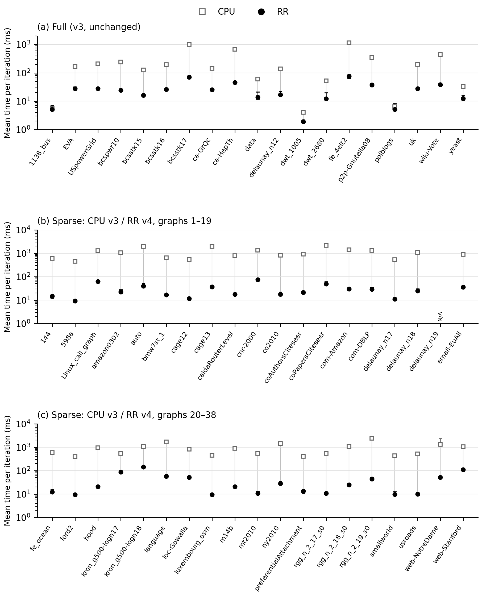
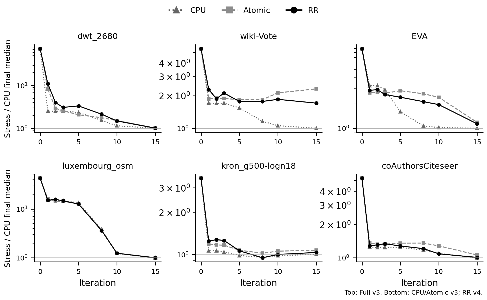
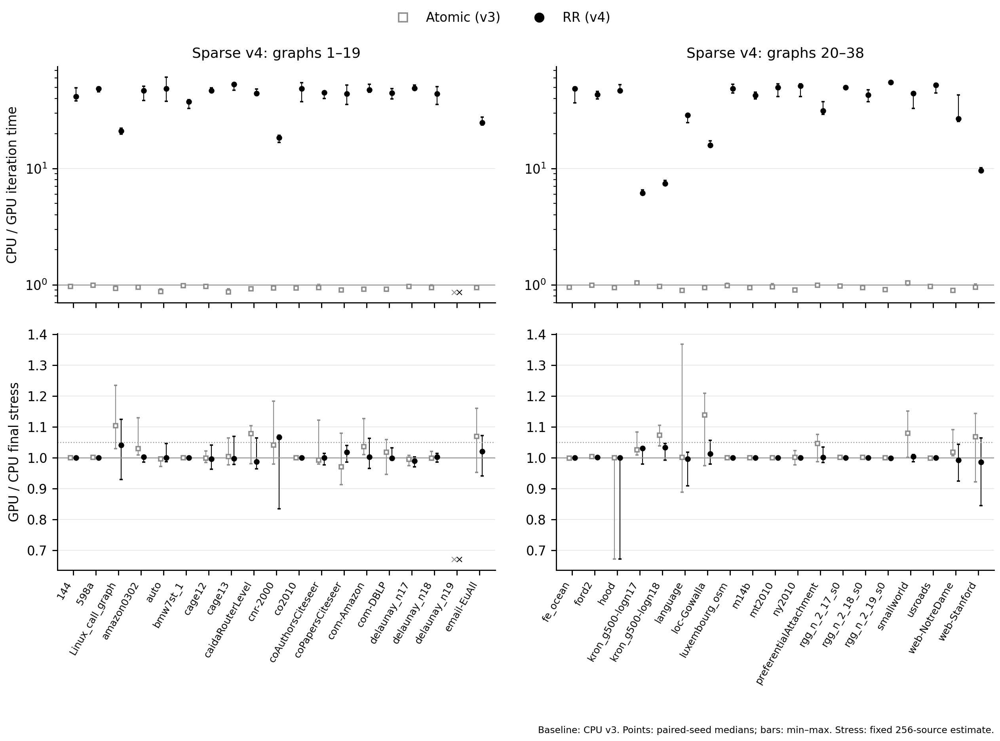
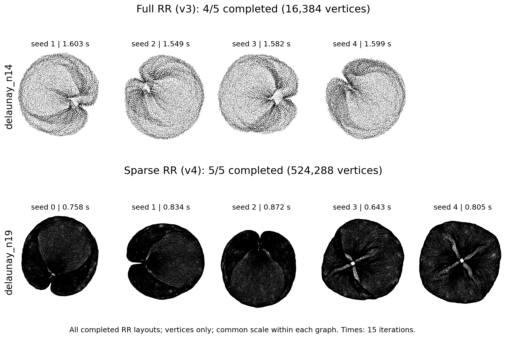

# v4 Sparse SGD 論文図の再実験結果

RR Sparseのみ現行実装で再測定し、CPU・Atomic Sparseは既存v3の結果を参照した。Fullの数値もv3を継承する。
標準GPUは単一f32、CPUはf64。丸め誤差の補償、疑似倍精度、追加反復、グラフ別の方式変更は使っていない。

## 実験範囲と条件

図5の既存37グラフと図7のdelaunay_n19を対象にRRのみ5 seed、図6のSparse 3グラフをRRのみ10 seedで測定した。
RR計220条件の記録が完了し、状態内訳は完了 220件。CPU・Atomicの参照は440条件で、比較用データ全体の状態内訳は完了 641件、時間上限 3件、RSS上限 6件、事前試行失敗で未起動 10件。
当初3手法を再測定した後、ユーザー指示でRRのみへ変更した。変更前のCPU・Atomic 111条件は補助記録として保存し、以下の比較には混ぜない。
これは以前図に掲載された38グラフの追試であり、v3の78大規模候補すべての追試ではない。
入力はv3と同じ前処理済み最大連結成分をSHA照合した。

全て15反復、epsilon=0.1、pivot=200。基本比較seedは0〜4、収束seedは0〜9。
RR v4は頂点ごとのpivot置換と4分割相実行。参照CPU v3は全制約を毎反復shuffleし、参照Atomic v3もCPUでペアIDを事前shuffleする測定版である。
CPU・Atomicは2026年10月24〜25日の既存測定、RRは10月30日の測定であり、同一セッションの計測ではない。単一機種でも実行時の負荷などによる時間差は残る。Atomicの値は現行既定実装の再測定結果とは呼ばない。
GPUとCPUでは精度と更新順序が異なるため、stress差の全てを丸め誤差だけに帰属しない。
共通f64評価器を使い、8,000頂点以下はexact、それより大きい場合は固定256始点・評価seed 0のfull stress推定値。
今回の38グラフはいずれも推定評価であり、微小な優劣や全頂点対での順位を保証しない。

資源監視はプロセス120秒・観測RSS 8 GiB・空きディスク8 GiB。各設定で事前試行1回を行い、失敗時は正式seedを未実行として記録した。
RSS監視の間隔は約200 msで、終了後の最大RSSも併記する。厳密な瞬時上限ではない。
通常計測には収束checkpoint保存を入れず、収束診断の座標保存・readbackは反復時間から除いた。
図5の1反復平均は15反復の合計÷15、誤差棒は対応seed間の最小〜最大であり、信頼区間ではない。

## CPU v3との時間・stress比較

RR Sparse：比較可能37グラフ中37グラフでCPUより高速。速度比中央値の範囲は6.136〜55.053倍、stress比中央値は0.987〜1.067。速度比>1かつstress比≤1.05は36グラフ。

Atomic Sparse（既存v3参照）：比較可能37グラフ中2グラフでCPUより高速。速度比中央値の範囲は0.869〜1.042倍、stress比中央値は0.971〜1.139。速度比>1かつstress比≤1.05は1グラフ。

| グラフ | CPU/RR対応seed数 | CPU 1反復 ms | RR 1反復 ms | CPU/RR速度比 | RR/CPU stress比 |
| --- | ---: | ---: | ---: | ---: | ---: |
| 144 | 5 | 602.127 | 14.579 | 41.602 | 1.001 |
| 598a | 5 | 453.842 | 9.281 | 48.826 | 1.001 |
| Linux_call_graph | 5 | 1298.250 | 61.771 | 20.986 | 1.042 |
| amazon0302 | 5 | 1059.482 | 22.546 | 47.014 | 1.003 |
| auto | 5 | 1962.737 | 40.280 | 48.712 | 1.000 |
| bmw7st_1 | 5 | 636.148 | 16.947 | 37.538 | 1.000 |
| cage12 | 5 | 538.834 | 11.592 | 46.891 | 0.996 |
| cage13 | 5 | 1948.872 | 36.773 | 52.923 | 0.998 |
| caidaRouterLevel | 5 | 780.148 | 17.508 | 44.494 | 0.987 |
| cnr-2000 | 5 | 1366.185 | 73.895 | 18.501 | 1.067 |
| co2010 | 5 | 823.027 | 17.898 | 48.895 | 1.000 |
| coAuthorsCiteseer | 5 | 911.872 | 21.160 | 45.059 | 1.000 |
| coPapersCiteseer | 5 | 2175.503 | 49.457 | 43.988 | 1.018 |
| com-Amazon | 5 | 1401.510 | 29.809 | 47.672 | 1.003 |
| com-DBLP | 5 | 1325.953 | 29.344 | 44.726 | 0.998 |
| delaunay_n17 | 5 | 534.405 | 10.915 | 49.025 | 0.989 |
| delaunay_n18 | 5 | 1066.194 | 24.853 | 44.038 | 1.002 |
| email-EuAll | 5 | 897.241 | 36.020 | 24.884 | 1.020 |
| fe_ocean | 5 | 586.446 | 12.088 | 48.757 | 1.000 |
| ford2 | 5 | 399.283 | 9.282 | 43.263 | 1.001 |
| hood | 5 | 950.776 | 20.364 | 46.747 | 1.000 |
| kron_g500-logn17 | 5 | 535.151 | 87.393 | 6.136 | 1.031 |
| kron_g500-logn18 | 5 | 1071.292 | 143.245 | 7.451 | 1.033 |
| language | 5 | 1668.135 | 57.809 | 28.856 | 0.997 |
| loc-Gowalla | 5 | 820.308 | 51.376 | 15.905 | 1.012 |
| luxembourg_osm | 5 | 456.563 | 9.310 | 48.839 | 1.000 |
| m14b | 5 | 895.891 | 20.763 | 42.528 | 1.000 |
| mt2010 | 5 | 535.177 | 10.685 | 49.845 | 1.000 |
| ny2010 | 5 | 1442.657 | 28.031 | 51.506 | 1.000 |
| preferentialAttachment | 5 | 408.249 | 13.105 | 31.488 | 1.001 |
| rgg_n_2_17_s0 | 5 | 535.013 | 10.778 | 49.736 | 1.000 |
| rgg_n_2_18_s0 | 5 | 1071.427 | 25.003 | 42.922 | 1.000 |
| rgg_n_2_19_s0 | 2 | 2427.069 | 44.124 | 55.053 | 0.999 |
| smallworld | 5 | 428.078 | 9.727 | 44.313 | 1.003 |
| usroads | 5 | 508.021 | 9.791 | 52.169 | 1.000 |
| web-NotreDame | 4 | 1335.816 | 51.152 | 26.947 | 0.992 |
| web-Stanford | 5 | 1054.731 | 109.349 | 9.632 | 0.987 |

速度比・stress比は同seedで比を求めてから中央値を取る。時間の中央値同士の比とは一般に一致しない。

## stress推移

15反復用の学習率を維持し、0・1・2・3・5・8・10・15反復の配置を評価した。
線は同手法のstress中央値を対応するCPU最終stress中央値で割った値であり、単一seedの軌跡ではない。

| グラフ | 手法 | CPU対応成功数 | 1.05倍目標への到達観測 | 最終時点でも目標内 | 初回到達観測の累積SGD時間中央値 s |
| --- | --- | ---: | ---: | ---: | ---: |
| luxembourg_osm | sparse_sgd | 10 | 10 | 10 | 6.722 |
| luxembourg_osm | atomic_sparse_sgd | 10 | 10 | 10 | 6.719 |
| luxembourg_osm | rr_sparse_sgd | 10 | 10 | 10 | 0.149 |
| kron_g500-logn18 | sparse_sgd | 10 | 10 | 10 | 2.138 |
| kron_g500-logn18 | atomic_sparse_sgd | 10 | 9 | 6 | 5.677 |
| kron_g500-logn18 | rr_sparse_sgd | 10 | 10 | 10 | 0.919 |
| coAuthorsCiteseer | sparse_sgd | 10 | 10 | 10 | 13.925 |
| coAuthorsCiteseer | atomic_sparse_sgd | 10 | 5 | 5 | 15.024 |
| coAuthorsCiteseer | rr_sparse_sgd | 10 | 10 | 10 | 0.391 |

保存点間の到達・再上昇は観測していないため、厳密な初到達時間ではない。

## 大規模配置：delaunay_n19

| 手法 | 正式完了数 | 15反復SGD時間 s | 入力・評価・保存を含むプロセス時間 s | 観測最大RSS GiB |
| --- | ---: | ---: | ---: | ---: |
| sparse_sgd | 0/5 | — | — | — |
| atomic_sparse_sgd | 0/5 | — | — | — |
| rr_sparse_sgd | 5/5 | 0.643〜0.872 | 15.949〜16.394 | 1.882〜2.291 |

## 非成功条件

| 実験 | グラフ | 手法・測定元 | 状態 | 理由 | 件数 |
| --- | --- | --- | --- | --- | ---: |
| basic | auto | atomic_sparse_sgd (v3) | RSS上限 |  | 1 |
| basic | delaunay_n19 | atomic_sparse_sgd (v3) | 事前試行失敗で未起動 | RSS上限 | 5 |
| basic | delaunay_n19 | sparse_sgd (v3) | 事前試行失敗で未起動 | RSS上限 | 5 |
| basic | rgg_n_2_19_s0 | atomic_sparse_sgd (v3) | RSS上限 |  | 2 |
| basic | rgg_n_2_19_s0 | sparse_sgd (v3) | RSS上限 |  | 3 |
| basic | web-NotreDame | atomic_sparse_sgd (v3) | 時間上限 |  | 2 |
| basic | web-NotreDame | sparse_sgd (v3) | 時間上限 |  | 1 |

## 速度と品質の全対象比較

同seedのCPUに対する比の中央値と最小〜最大。上段は大きいほど高速、下段は小さいほどstressが低い。下段の点線は1.05。×は対応成功seedがない条件を表す。全38対象を表示し、成功したGPUだけの選抜はしない。

図7は全ての正式完了RR配置を示す。CPUに結果が得られた場合は「CPUでは処理不能」とは表現しない。
Full delaunay_n14の上段はv3の既存結果である。

## データの所在

`config/`に計画・入力・ソース・バイナリSHA、`raw/results.jsonl`に全条件、`warmups/`に事前試行、
`tables/missing.csv`に欠測理由、`tables/paired-ratios.csv`にseedごとの対応比較、
`tables/convergence.csv`にcheckpointのstress、`figures/`にPNG/PDF/SVGを保存した。
Fullの出所は`reference/full-v3/`、Sparse CPU・Atomicの出所は`reference/sparse-v3/`。
新規RRの計画は`config/rr-only-plan.json`、変更前の計画は`config/plan.json`、
比較から除いた途中までのCPU・Atomic v4は`tables/excluded-auxiliary-v4.csv`に保存した。
