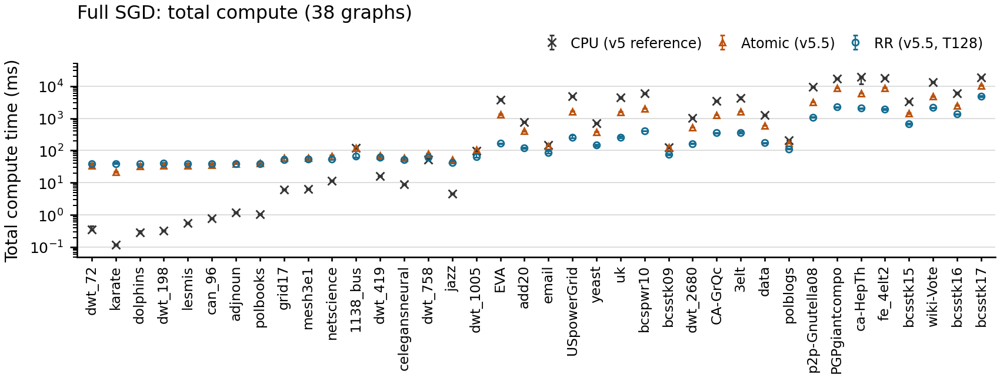

# v5.5 Full：CPU・Atomic・RRのComplete時間比較

論文図6と同じ38グラフ・辺数昇順・対数縦軸・マーカーと5seed範囲。黒×CPU、橙△Atomic、青○RR。値は各seed内3反復中央値→5seed中央値、whiskerは5seedの最小〜最大。

Completeはtotal_compute_time_ms。入力からCPU座標が揃うまでで、前処理・GPU準備・GPU完了待ち・読み戻しを含み、Stress評価・保存・描画は含まない。描画直前までの全処理時間ではない。

CPUはv5.5で参照している過去v5の570記録、Atomicは今回のマージ済みmainの新570記録、RRはv5.5 EX2の新570記録（T=W128/shared）。全方式で同一入力・15反復・epsilon0.1・seed0〜4×3回。RRはGPU timestamp有効、Atomicは無効。測定時期と計測設定が異なるため、同時・同一instrumentationで取り直した比較とは区別する。

対応seed比を用いた38グラフ等重み幾何平均のCPU速度比：Atomic 0.445倍、RR 0.863倍。初期座標一致：570/570組。

| graph | CPU ms | Atomic ms | RR ms |
|---|---:|---:|---:|
| dwt_72 | 0.35 | 33.91 | 39.61 |
| karate | 0.12 | 21.91 | 39.41 |
| dolphins | 0.29 | 32.60 | 39.47 |
| dwt_198 | 0.33 | 34.44 | 40.28 |
| lesmis | 0.55 | 34.56 | 39.39 |
| can_96 | 0.77 | 36.25 | 38.55 |
| adjnoun | 1.20 | 38.85 | 38.89 |
| polbooks | 1.05 | 39.65 | 38.91 |
| grid17 | 6.21 | 59.98 | 52.31 |
| mesh3e1 | 6.41 | 58.17 | 53.35 |
| netscience | 11.71 | 67.99 | 54.55 |
| 1138_bus | 119.19 | 118.75 | 66.56 |
| dwt_419 | 16.21 | 70.70 | 60.72 |
| celegansneural | 8.77 | 59.21 | 52.88 |
| dwt_758 | 51.92 | 79.97 | 60.97 |
| jazz | 4.67 | 51.35 | 42.93 |
| dwt_1005 | 99.15 | 106.34 | 64.26 |
| EVA | 3814.74 | 1292.23 | 167.24 |
| add20 | 758.00 | 398.51 | 118.47 |
| email | 148.57 | 136.74 | 86.21 |
| USpowerGrid | 4782.39 | 1649.77 | 259.57 |
| yeast | 703.07 | 381.24 | 146.76 |
| uk | 4440.26 | 1578.47 | 254.27 |
| bcspwr10 | 5856.98 | 1996.12 | 408.39 |
| bcsstk09 | 124.59 | 124.22 | 74.82 |
| dwt_2680 | 1036.89 | 524.20 | 161.06 |
| CA-GrQc | 3459.89 | 1271.17 | 354.53 |
| 3elt | 4269.45 | 1604.63 | 358.96 |
| data | 1241.23 | 588.31 | 175.07 |
| polblogs | 209.44 | 169.93 | 112.91 |
| p2p-Gnutella08 | 9337.37 | 3156.38 | 1087.32 |
| PGPgiantcompo | 16822.04 | 8668.46 | 2239.38 |
| ca-HepTh | 18944.14 | 5992.05 | 2103.59 |
| fe_4elt2 | 17621.90 | 8807.03 | 1903.01 |
| bcsstk15 | 3281.75 | 1412.65 | 667.84 |
| wiki-Vote | 13260.62 | 4749.80 | 2139.47 |
| bcsstk16 | 5968.25 | 2482.30 | 1349.73 |
| bcsstk17 | 18286.04 | 10459.36 | 4756.56 |

[PDF](../figures/paper-style-v55-full-complete-methods.pdf) / [SVG](../figures/paper-style-v55-full-complete-methods.svg) / [数値CSV](../tables/full-complete-method-summary.csv)
