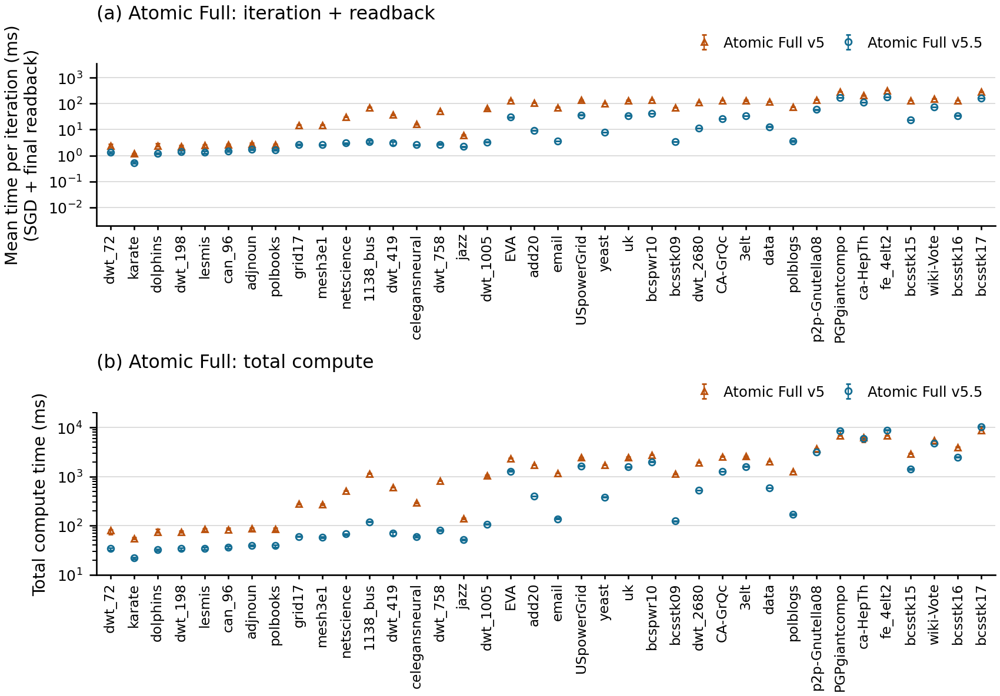
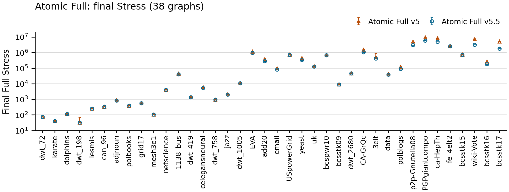

# 論文形式：v5とv5.5のAtomic Full比較

論文図6のFullパネルと同じ38グラフを、同じ辺数昇順・グラフ名順で表示する。対数縦軸、線で結ばないマーカー、5 seed中央値の最小〜最大、配色・寸法・縦向きラベルを揃えた。橙△はv5、青○はv5.5。各点はseed内3反復中央値→5seed中央値。

## 速度

上段は `(sgd_time_ms + readback_time_ms) / 15`。新mainはGPU完了待ちがreadback側にあるので、待機を含めて15反復へ均等配分した比較値であり、純GPU時間やnativeのsgd_time_ms単独とは区別する。下段は主指標のtotal_compute_time_msで、CPUの全pairハッシュ・shuffleを含む入力から最終CPU座標までの時間。Stress評価・保存・描画は除外。

[速度PDF](../figures/paper-style-v5-v55-speed.pdf) / [速度SVG](../figures/paper-style-v5-v55-speed.svg) / [総計算のみPDF](../figures/paper-style-v5-v55-total.pdf)

## Stress

8,000頂点以下は厳密Full Stress、それ以外は固定256始点・評価seed0。全38グラフを表示し、品質が悪化した対象や速度が遅い対象も省略しない。v5は過去測定との比較で、whiskerは信頼区間ではない。小差から統計的有意差を判断しない。

[Stress PDF](../figures/paper-style-v5-v55-stress.pdf) / [全グラフの集計と考察](results.md) / [描画数値CSV](../tables/paper-style-chart-points.csv)
