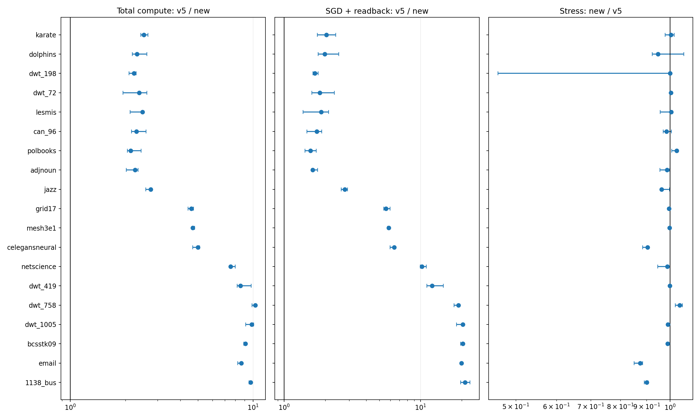
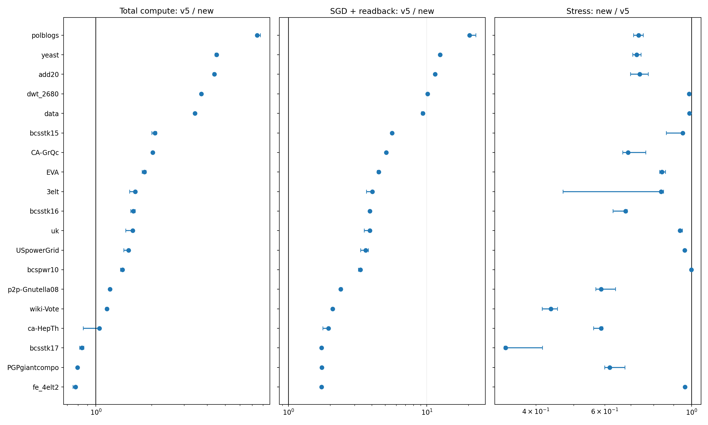
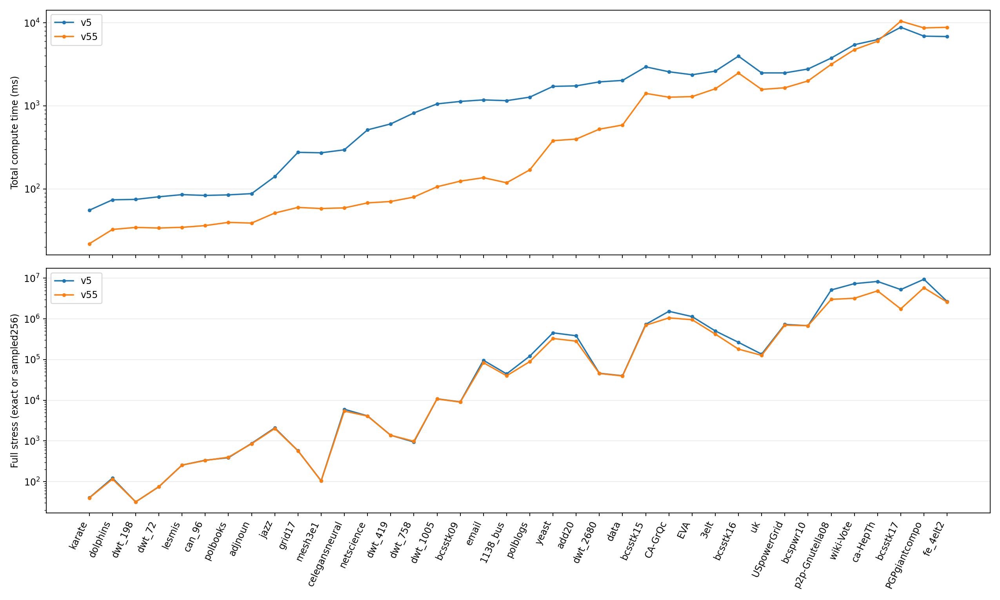
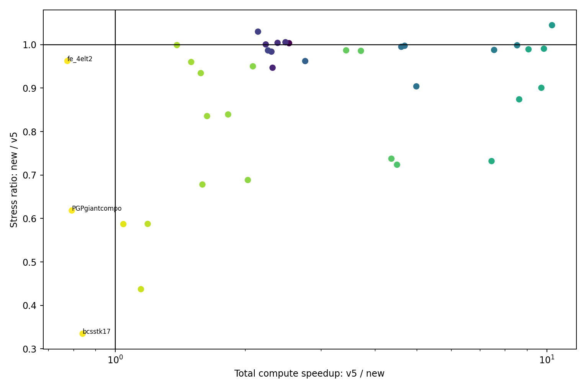

# v5.5：最新main Atomic Full 全対象の速度・Stress比較

完了：2026-11-10T16:27:20+09:00。マージ済みmain `745b38ff9ba2c0f470c02e7496567412ff32ea23`を凍結ビルドし、**38グラフ×5 seed×3回＝570/570件成功、失敗0件**。4グラフの予備実験を流用せず全件新規測定。EX5は中断を維持。

## 条件と計時

v5のAtomic Full本比較570条件を抽出し、同じ入力SHA256・seed0〜4・各3回・15反復・epsilon 0.1を使用。元jobs中のAtomic Full相対順序を維持し逐次実行。各graph/sessionでseed999をウォームアップし除外。GPU timestamp無効。8,000頂点以下は厳密Full Stress、超過は固定256始点・評価seed0の推定Full Stress。既定のchunk-size=0（bank単位）を使用し、実験側でアルゴリズム・精度・実行設定を変更しない。時間打切りなし。

最新実装はGPU反復を非同期submitし、GPU完了待ちがreadback_time_msへ移っている。**主速度指標はGPU完了待ちを含むtotal_compute_time_ms**。入力・前処理・GPU準備・SGD・読み戻しを含み、Stress評価・座標保存・描画・保存後圧縮は含まない。補助指標はsgd_time_ms+readback_time_ms。rawのsgd_time_ms単独はGPU全体の高速化として解釈しない。

## 集計と全体傾向

各seed内3反復の中央値を取ってから、対応seedの旧/新時間比・新/旧Stress比を計算。その5 seedの中央値をgraph代表値とし、最小〜最大を図の範囲として示す。グラフ全体は38グラフ等重みの幾何平均。単純な570回平均やグラフサイズによる加重平均ではない。

- 総計算の高速化（グラフ等重み幾何平均）：**2.811倍**。高速化したグラフ：35/38。
- SGD+読み戻しの高速化（同）：4.690倍。
- 新/旧Stress比（同）：**0.8502**。Stress低下：32/38、5%超悪化：0/38。
- 初期座標SHA一致：570/570。厳密評価510件、256始点評価60件。全570件で15反復分の全pair更新完了を検証。

## グラフ別結果

時間とStressの値はseed内中央値→5seed中央値。速度比とStress比は対応seed比の中央値なので、表の中央値同士の商と完全一致するとは限らない。速度比は1超が高速、Stress比は1未満が低下。

| graph | n | 評価 | v5総計算 ms | v5.5総計算 ms | 高速化 | v5 Stress | v5.5 Stress | 新/旧Stress |
|---|---:|---|---:|---:|---:|---:|---:|---:|
| karate | 34 | exact | 55.50 | 21.91 | 2.528 | 39.964 | 39.7028 | 1.0033 |
| dolphins | 62 | exact | 74.06 | 32.60 | 2.316 | 121.908 | 115.157 | 0.9468 |
| dwt_198 | 72 | exact | 74.95 | 34.44 | 2.233 | 31.6445 | 31.6585 | 1.0005 |
| dwt_72 | 72 | exact | 80.53 | 33.91 | 2.378 | 74.6297 | 74.9334 | 1.0041 |
| lesmis | 77 | exact | 85.52 | 34.56 | 2.480 | 254.339 | 254.519 | 1.0055 |
| can_96 | 96 | exact | 83.60 | 36.25 | 2.302 | 335.237 | 330.096 | 0.9839 |
| polbooks | 105 | exact | 84.96 | 39.65 | 2.142 | 386.25 | 397.796 | 1.0299 |
| adjnoun | 112 | exact | 87.88 | 38.85 | 2.260 | 870.591 | 851.887 | 0.9867 |
| jazz | 198 | exact | 141.01 | 51.35 | 2.756 | 2092.78 | 2020.09 | 0.9622 |
| grid17 | 289 | exact | 275.99 | 59.98 | 4.601 | 574.377 | 571.515 | 0.9950 |
| mesh3e1 | 289 | exact | 272.43 | 58.17 | 4.684 | 104.319 | 104.066 | 0.9974 |
| celegansneural | 297 | exact | 296.00 | 59.21 | 4.986 | 6002.49 | 5412.97 | 0.9040 |
| netscience | 379 | exact | 514.19 | 67.99 | 7.550 | 4121.02 | 4072.96 | 0.9878 |
| dwt_419 | 419 | exact | 606.30 | 70.70 | 8.536 | 1377.62 | 1375.53 | 0.9985 |
| dwt_758 | 758 | exact | 821.49 | 79.97 | 10.282 | 939.814 | 981.543 | 1.0447 |
| dwt_1005 | 1005 | exact | 1056.67 | 106.34 | 9.848 | 10849.3 | 10746.1 | 0.9906 |
| bcsstk09 | 1083 | exact | 1130.54 | 124.22 | 9.071 | 9100.47 | 9002.56 | 0.9892 |
| email | 1133 | exact | 1180.02 | 136.74 | 8.630 | 96050.4 | 83824.5 | 0.8741 |
| 1138_bus | 1138 | exact | 1154.95 | 118.75 | 9.714 | 44403.9 | 39974.8 | 0.9007 |
| polblogs | 1222 | exact | 1273.90 | 169.93 | 7.448 | 121771 | 89146.2 | 0.7321 |
| yeast | 2224 | exact | 1714.97 | 381.24 | 4.498 | 454563 | 329574 | 0.7237 |
| add20 | 2395 | exact | 1740.19 | 398.51 | 4.365 | 384619 | 283659 | 0.7376 |
| dwt_2680 | 2680 | exact | 1943.28 | 524.20 | 3.710 | 46118.1 | 45458 | 0.9857 |
| data | 2851 | exact | 2024.41 | 588.31 | 3.429 | 39998.1 | 39509.1 | 0.9868 |
| bcsstk15 | 3942 | exact | 2947.04 | 1412.65 | 2.085 | 733745 | 697150 | 0.9501 |
| CA-GrQc | 4158 | exact | 2572.79 | 1271.17 | 2.029 | 1.5367e+06 | 1.05826e+06 | 0.6885 |
| EVA | 4475 | exact | 2367.78 | 1292.23 | 1.827 | 1.13863e+06 | 955553 | 0.8394 |
| 3elt | 4720 | exact | 2615.92 | 1604.63 | 1.633 | 506190 | 422974 | 0.8356 |
| bcsstk16 | 4810 | exact | 3963.17 | 2482.30 | 1.593 | 265019 | 180432 | 0.6782 |
| uk | 4824 | exact | 2492.46 | 1578.47 | 1.579 | 135865 | 126976 | 0.9345 |
| USpowerGrid | 4941 | exact | 2492.14 | 1649.77 | 1.500 | 731516 | 702271 | 0.9600 |
| bcspwr10 | 5300 | exact | 2776.11 | 1996.12 | 1.390 | 679995 | 679275 | 0.9989 |
| p2p-Gnutella08 | 6299 | exact | 3756.89 | 3156.38 | 1.190 | 5.13671e+06 | 3.02085e+06 | 0.5876 |
| wiki-Vote | 7066 | exact | 5441.18 | 4749.80 | 1.147 | 7.3556e+06 | 3.21512e+06 | 0.4373 |
| ca-HepTh | 8638 | sampled | 6270.38 | 5992.05 | 1.045 | 8.32766e+06 | 4.88565e+06 | 0.5871 |
| bcsstk17 | 10456 | sampled | 8822.49 | 10459.36 | 0.840 | 5.26262e+06 | 1.76246e+06 | 0.3349 |
| PGPgiantcompo | 10680 | sampled | 6902.32 | 8668.46 | 0.794 | 9.42291e+06 | 5.82398e+06 | 0.6184 |
| fe_4elt2 | 11143 | sampled | 6819.05 | 8807.03 | 0.775 | 2.68934e+06 | 2.58828e+06 | 0.9624 |

## 解釈と保存

v5は過去の実測であり、常駐プロセスやswap等の環境変動を含む参考比較。Atomicの実行順序による座標・Stress変動を含み、5seedの範囲は信頼区間ではない。品質と速度を分けて判断し、速度向上から品質維持を推測しない。Stressが悪化したグラフも除外せず表・図・全測定に残す。CPU・RR・Sparseは今回新規測定しない。

config/に全570jobs・入力hash・元570記録とhash・実行条件、raw/に新測定・コマンド・資源履歴・座標圧縮manifest、warmups/に除外したwarmup、source-snapshot/に測定ソースを保存。各初期・最終座標は可逆XZで復元hashと長さを検証して保持。巨大座標・実行バイナリはローカル、記録・ログ・hash・図表はGitに保存する。

総計算が遅くなった対象：bcsstk17（旧/新時間0.840、新/旧Stress0.3349）、PGPgiantcompo（旧/新時間0.794、新/旧Stress0.6184）、fe_4elt2（旧/新時間0.775、新/旧Stress0.9624）。この3グラフもSGD+読み戻しは高速化しているが、それ以外の処理を含む総計算は遅い。

最新mainのmain.rsではfull_preprocess_sha256による全pairのハッシュ計算とCPUの全pair shuffleがcommon_preprocess_time_msの計測後に実行され、total_compute_time_msには含まれる。したがって、記録された前処理・GPU準備・SGD・読み戻しの単純合計は総計算と一致しない。前処理時間はsummary.csvにも保持するが、ハッシュ計算とshuffleの個別寄与は今回分離計測しておらず、速度低下の全量をどちらかへ帰属しない。

5%超の悪化件数は対応5seed比の中央値に対する判定であり、すべてのseedや実行の品質維持を意味しない。予備実験でdwt_198のseed0に見られたばらつきも、全5seedの結果へ一般化しない。

