# v5.5 EX2：RR Full／Sparse速度・Stress比較

**EX2のみ実施。新規RR測定1,410件成功（当初1,395件＋容量拡張後15件）。未実行0件。CPU・Atomicの新規実行0件、過去2,820件を参照。EX1は742件で停止した途中結果として別フォルダに保持し、このEX2集計へ混ぜない。**

前回EX2と同じ56入力、Full38条件・Sparse56条件、seed0〜4×各3回。15反復、epsilon0.1、RR Full T=W128/shared/内外shuffleあり、RR Sparse W128・p=min(200,n)、phase_chunks1、auto BFS。GPU timestamp有効。各graph/methodのseed999ウォームアップを除外し、逐次測定した。時間打切りなし。代表小/大入力のtimestamp有無で保存座標一致、全10計時項目の取得を事前確認した。

## 容量拡張による補測

当初の4bank各128MiB（計512MiB）ではcoPapersCiteseer n=434,102・p=200の86,820,400項目が上限外となり15件を未実行として記録した。その元記録は変更せず、4bank各256MiB（計1GiB）への拡張後、同じseed0〜4×3回・p=200・W128・15反復で15件を補測した。GPUの実際のバッファ上限も検査する。SGD計算式・順序・精度は変更していない。小規模回帰確認で拡張前後の座標・Stress・前処理fingerprint一致を確認し、大規模15件も前回EX2の保存座標hashとStress値が全件一致した。RR Full570件、RR Sparse840件が成功。実装variantとバイナリhashは個々のrecordに残し、元1,395件の時間を拡張後バイナリで測り直したものとして扱わない。

## 評価・集計

Fullは全38入力で厳密Full Stress。Sparseはn<=8,000で厳密、それ以上は256固定始点・評価seed0の推定Full Stress（Sparse目的関数ではない）。初期座標hashとSparse前処理fingerprintを前回EX2と照合。同じ最終座標から速度計時終了後にStress評価・Afterの実GPU描画を行った。2048×2048、blue、半径1px。F→Gは中心化・Stress評価・座標保存/読込・プロセス起動・描画準備を含み、純粋な描画kernel時間ではない。PNGエンコード・保存はF→G外。PNGはhash/サイズを記録して省略し、初期/最終座標を復元検証付きで保存した。

同seed3回中央値→5seedの中央値・最小〜最大。比は対応するgraph/method/seed/repetitionごとに計算して階層集計。誤差棒はseed中央値の範囲で、信頼区間ではない。欠測と未実行を除外し成功数を併記。10計時項目は重複を含み、単純に積み上げて総時間としない。

## 過去CPU・Atomicの参照

CPU/Atomicはv5通常比較の過去2,820件を読み取り専用で使用。Atomic参照は旧Metal実装であり、今回のPRのwgpu Atomicを測り直したものではない。過去のFull sampled Stressは、既存の保存座標から作成済みの厳密再評価overlayがあるrunだけ、新しい参照ビュー内で厳密値を使用した。元のrecordは変更しない。評価方式が揃わないCPU比は未算出とし、validation/quality-comparability.jsonへ記録した。

RRの前回比は、前回EX2のRR128・timestamp有効の1,410件を基準にする。W1024・timestamp無効の旧v5 RRと混同しない。CPU/Atomicとの速度比は異なる日時・計測条件の過去参照であり同時測定ではない。温度・電源・常駐アプリを専用に固定しておらず、小さい差の断定は避ける。

## 図表

前回EX2 RR128に対する、グラフ別・対応実行比の階層中央値を各グラフ等重みで幾何平均した参考集計：

| 方式 | 比較グラフ数 | SGD速度比（前回/今回） | 総計算速度比 | Stress比のグラフ別中央値範囲 |
|---|---:|---:|---:|---:|
| rr_sgd | 38 | 1.103 | 1.138 | 1.00000–1.00000 |
| rr_sparse_sgd | 56 | 0.942 | 0.932 | 1.00000–1.00000 |

既存厳密Stress overlayの評価時間は不明のため、新しい参照ビューのstress_eval_time_msを未計測とし、元の推定評価時間はnative_historical_stress_eval_time_msとして保持する。CPUの追加実行・再評価は行っていない。

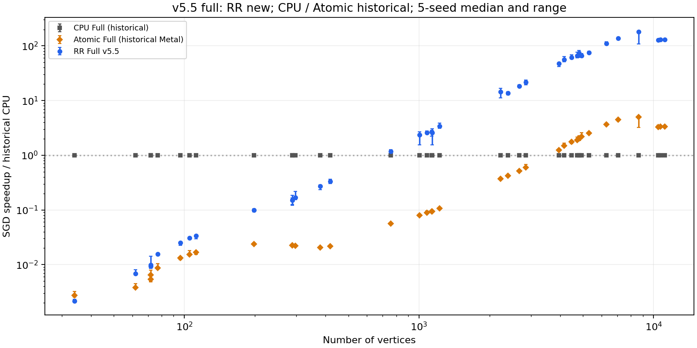

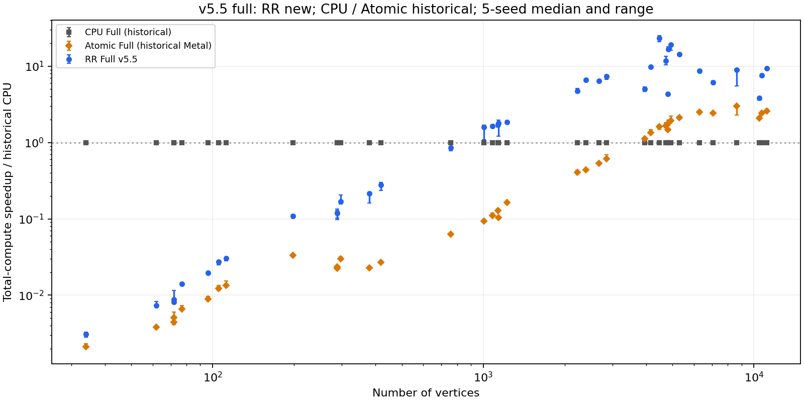

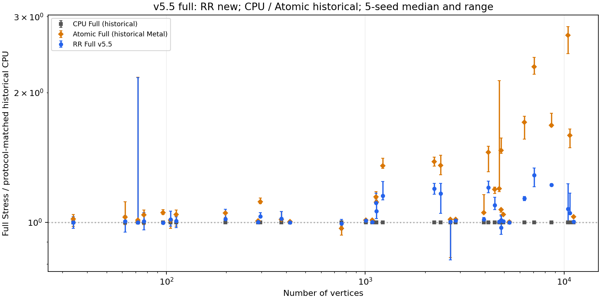

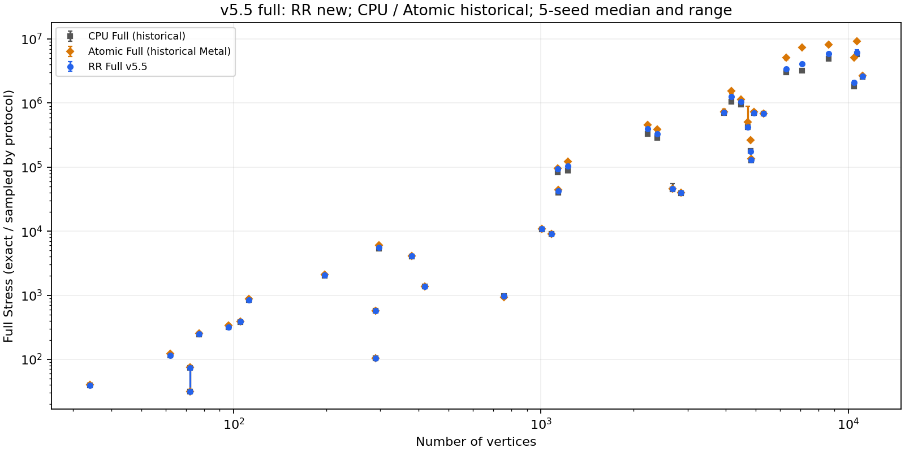

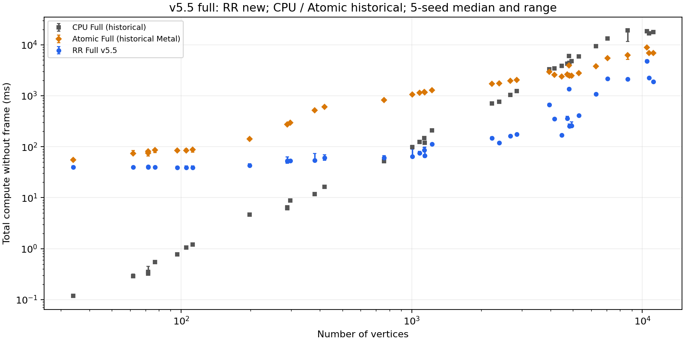

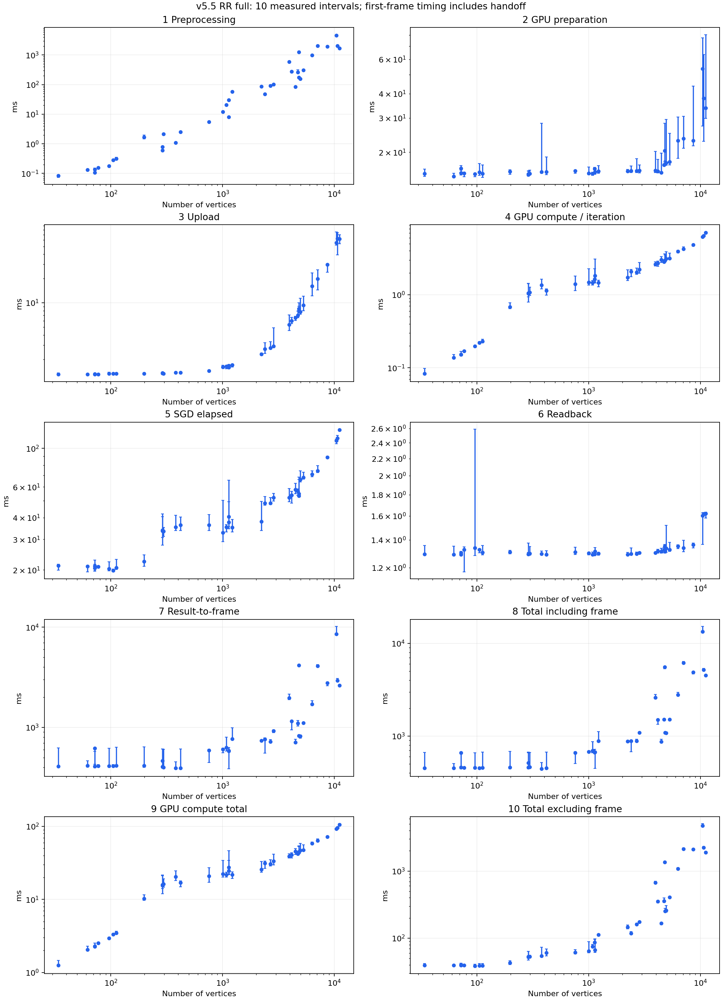

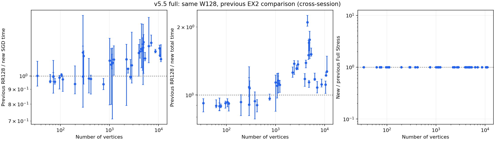

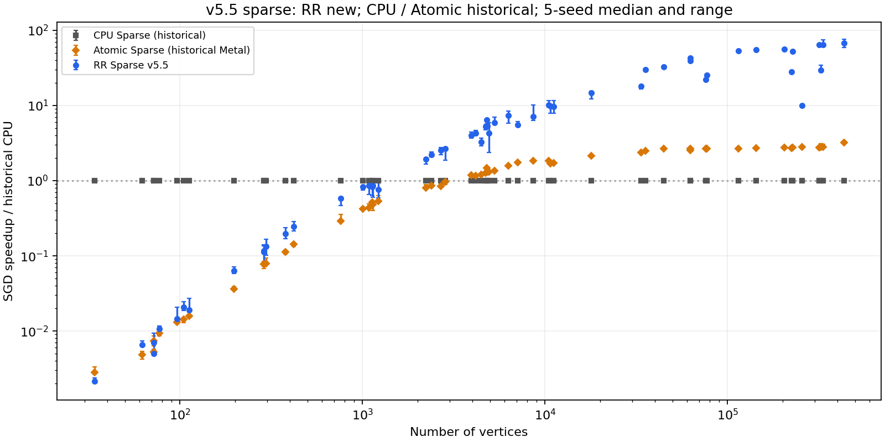

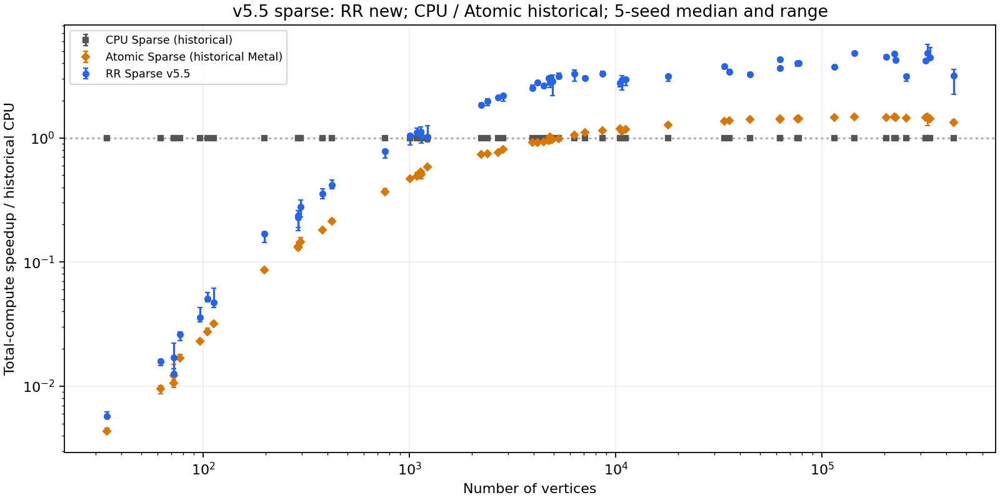

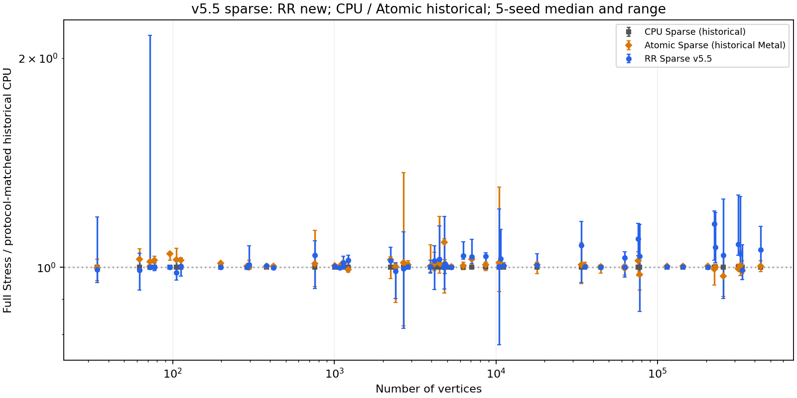

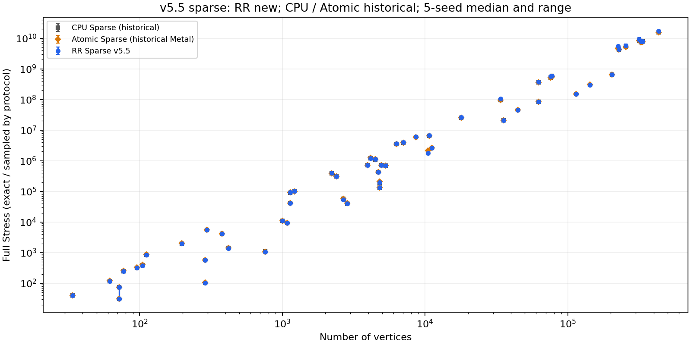

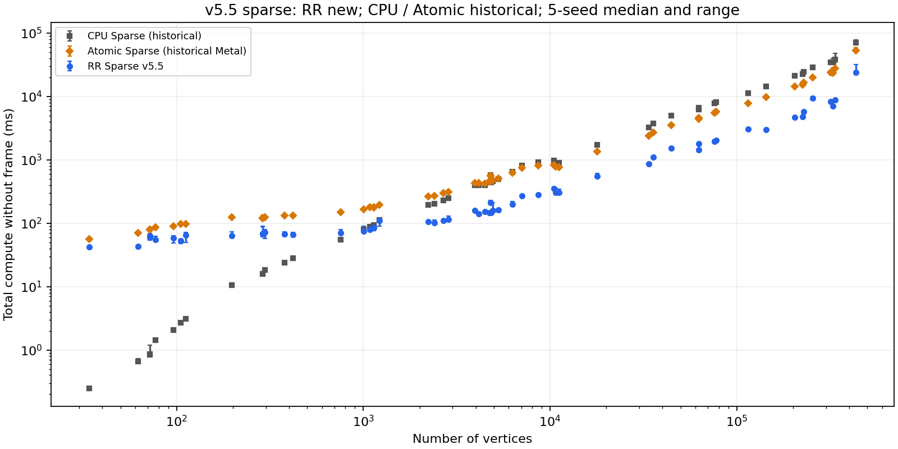

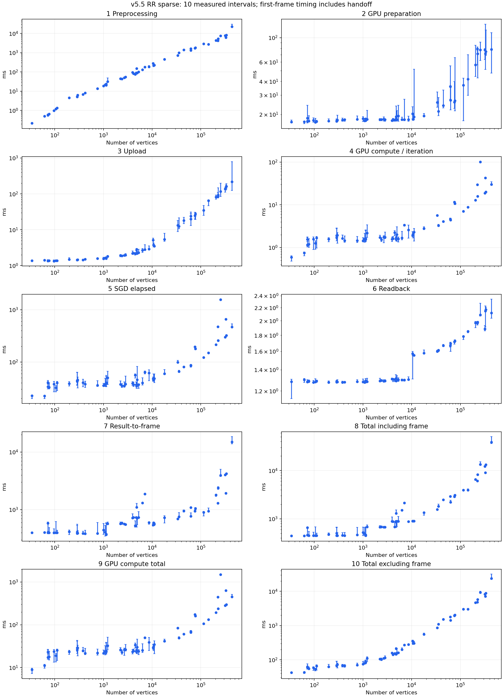

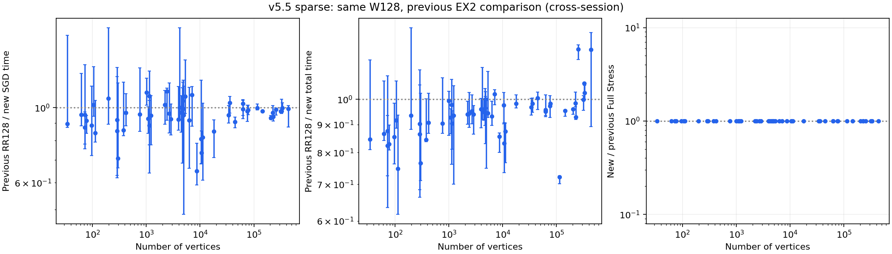

## 保存先

`/Users/kose/master/GPU-Accelerated-SGD-for-Stress-Minimization/experiment_results/v5.5/ex2-copapers-capacity-supplement-20261110`

config/に入力・条件・順序・参照・source/binary SHA、raw/に測定JSON・コマンド・ログ・圧縮座標、validation/に予備検証・計時充足・比較可能性、tables/に統合CSV/JSON・対応する前回比、figures/にPNG/PDF。過去のv5 EX1/EX2・CPU/Atomic recordのハッシュ不変を完了時に確認。v5.5のEX1途中データは別保管。

## 最新mainでの最終確認

最新main（cafb96704948d8c7c154294cc13f89a36b35d8a8）へ容量拡張を反映して再ビルドし、dwt_1005とcoPapersCiteseer / p=200で座標・Stress・前処理fingerprintの一致を確認した。この追加確認は計時集計へ混ぜない。元1,395件、容量拡張後15件、最新mainの確認実行を個別のバイナリhash・source snapshotで区別する。詳細：validation/latest-main.json。
