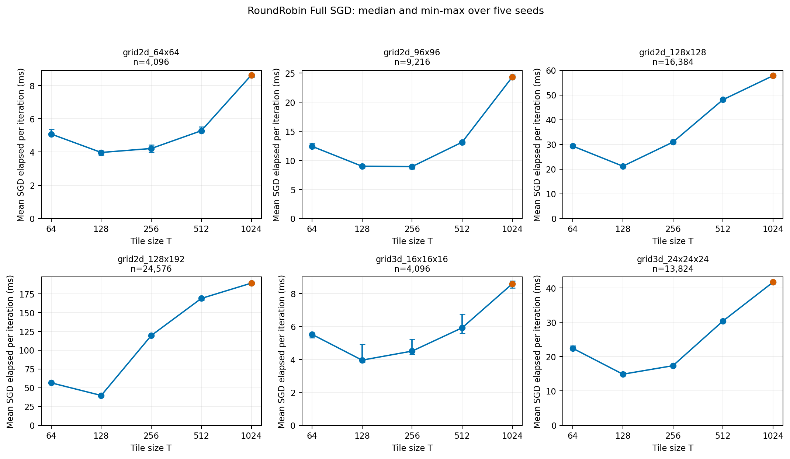
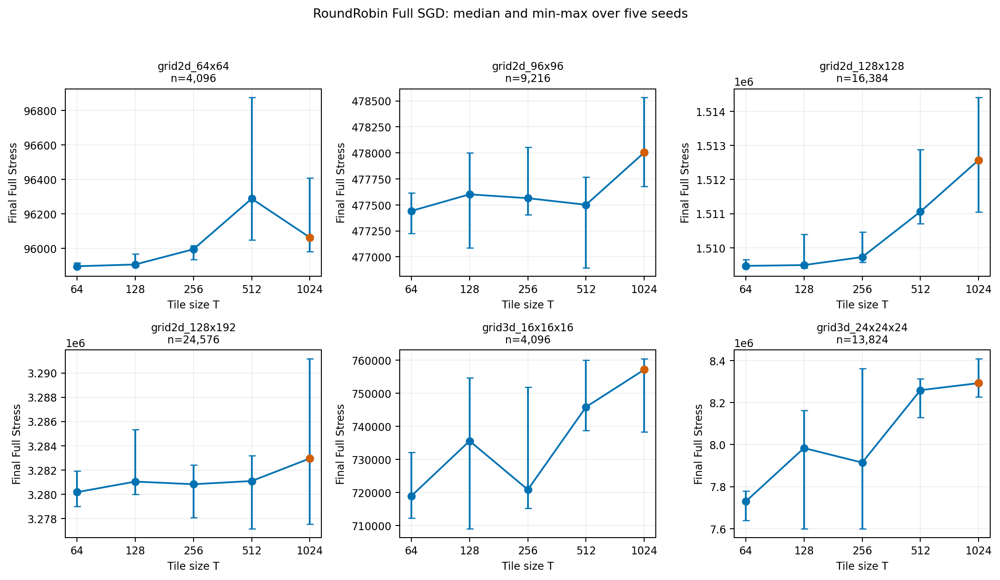
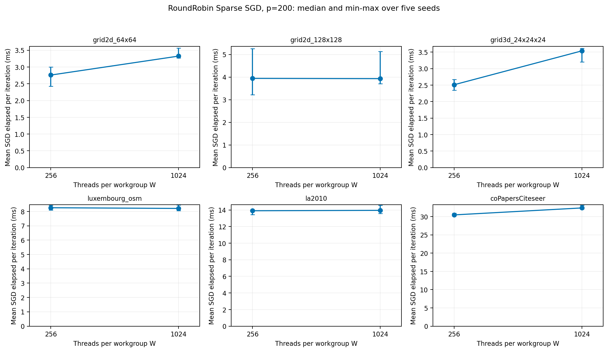
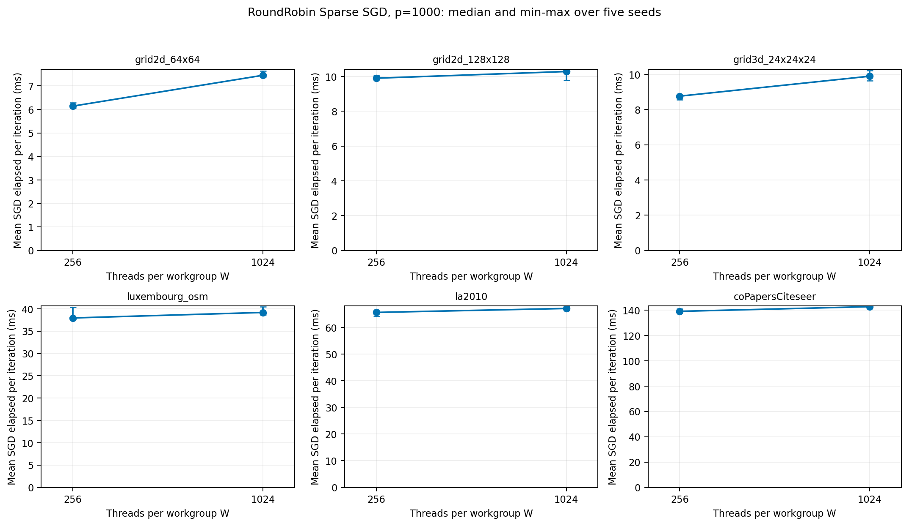

# 追加実験：gridとSparse workgroup

更新: 2026-11-07T17:58:20+09:00。成功810、失敗0、未測定0。

- grid2d_64x64: 最速T=128、平均1反復3.976ms。
- grid2d_96x96: 最速T=256、平均1反復8.926ms。
- grid2d_128x128: 最速T=128、平均1反復21.197ms。
- grid2d_128x192: 最速T=128、平均1反復39.680ms。
- grid3d_16x16x16: 最速T=128、平均1反復3.956ms。
- grid3d_24x24x24: 最速T=128、平均1反復14.895ms。

全Tが揃った6グラフ中、T1024が最速だったのは0件。選定した全グラフを表示し、勝った条件だけで一般的優位性を主張しない。

- Sparse grid2d_64x64, p200: W256/W1024の対応速度比中央値0.8180。1より大きいとW1024が高速。
- Sparse grid2d_64x64, p1000: W256/W1024の対応速度比中央値0.8272。1より大きいとW1024が高速。
- Sparse grid2d_128x128, p200: W256/W1024の対応速度比中央値1.0029。1より大きいとW1024が高速。
- Sparse grid2d_128x128, p1000: W256/W1024の対応速度比中央値0.9633。1より大きいとW1024が高速。
- Sparse grid3d_24x24x24, p200: W256/W1024の対応速度比中央値0.7153。1より大きいとW1024が高速。
- Sparse grid3d_24x24x24, p1000: W256/W1024の対応速度比中央値0.8847。1より大きいとW1024が高速。
- Sparse luxembourg_osm, p200: W256/W1024の対応速度比中央値1.0228。1より大きいとW1024が高速。
- Sparse luxembourg_osm, p1000: W256/W1024の対応速度比中央値0.9722。1より大きいとW1024が高速。
- Sparse la2010, p200: W256/W1024の対応速度比中央値1.0037。1より大きいとW1024が高速。
- Sparse la2010, p1000: W256/W1024の対応速度比中央値0.9779。1より大きいとW1024が高速。
- Sparse coPapersCiteseer, p200: W256/W1024の対応速度比中央値0.9389。1より大きいとW1024が高速。
- Sparse coPapersCiteseer, p1000: W256/W1024の対応速度比中央値0.9778。1より大きいとW1024が高速。

## 解釈と制約

主指標は15反復のSGD経過時間/15。各seed3回中央値→5seed中央値・最小最大。これは平均1反復であり、各反復を個別に測定した値ではない。GPU準備・転送・読戻し込みも生表・階層集計へ保存。純GPU pass時間は未計測。FullのTとSparseのWは別の変数であり、SparseにFullと同じtile実験があるとは扱わない。入力・サイズ・条件は追加測定前に固定した。Fullの全頂点対処理ではgrid形状だけでなくnと並列度が効くため、構造だけの因果効果とは断定しない。SparseはW間の初期配置と制約一致を確認する一方、p間では初期配置も変わる可能性がある。容量停止の未測定条件を0時間や高速成功として埋めない。既存v5の結果とは別の追加実験で、既存バイナリを変更していない。

FullではT128が5件、T256が1件で最速。T1024は各gridの最速に対して2.17〜4.77倍のSGD時間だった。最大24,576頂点まで今回の予想を支持せず、未検証のさらに大きい入力や別GPUまで結論を拡張しない。96×96のT128と256は約0.7%差なので厳密な優劣は強調しない。T変更では更新順と最終Stressも変化し得るため、同じ15反復での時間と品質を併記する。

SparseのW比較は180対応組すべてで初期配置・制約ハッシュが一致し、最終Stressも180/180組で完全一致。pivot1000は全6graphでW256の方が速かった。pivot200のW1024による小さい改善はgrid128²・Luxembourg・la2010でseedごとに逆転し、安定した優位性を示していない。一方、coPapersではpivot200でもW1024の時間が約6.5%増えた。GPU準備等を合計した指標は別の対応比として保存し、SGD単体の結論と混同しない。

p間の初期配置は全30個のgraph×seedで異なった（fingerprints.json）。pivot数の変更に伴う時間・品質差には制約と初期配置の両方が含まれるため、pivot数だけの品質効果と断定できない。対応seed・反復のp比はsparse-pivot-paired-ratios.csvへ保存した。

測定は単一のM4 Pro上で行い、Codex等の常駐処理とOS swapが存在した。入力graph順とpivot1000→200の順は固定されている。226件後のディスク基準による中断・cache整理・新セッションwarmupがあり、順序や資源状態の影響を完全には分離できない。256始点のStressはサンプル評価で、その推定誤差はseed間のmin-max棒では表していない。誤差棒は信頼区間ではなく、各seed内中央値の5seed最小〜最大。GPU occupancyや同期待ちをprofilingしていないため、T/W1024が遅いハードウェア上の支配要因は同定していない。coPapersのXZ/gzip圧縮・APFS辺共有はnative測定後で、SGD/total_compute_time_msへ含めない。

