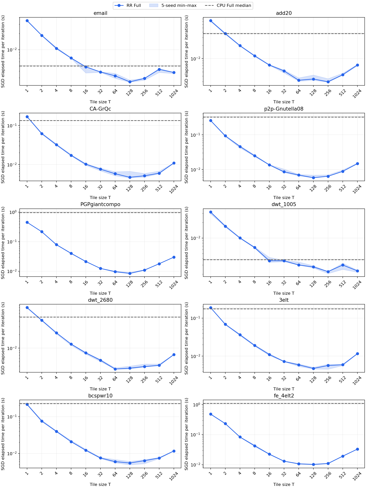
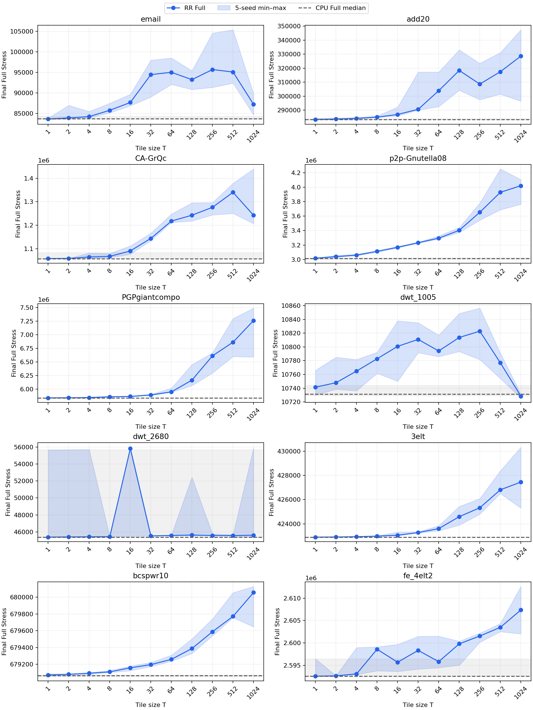
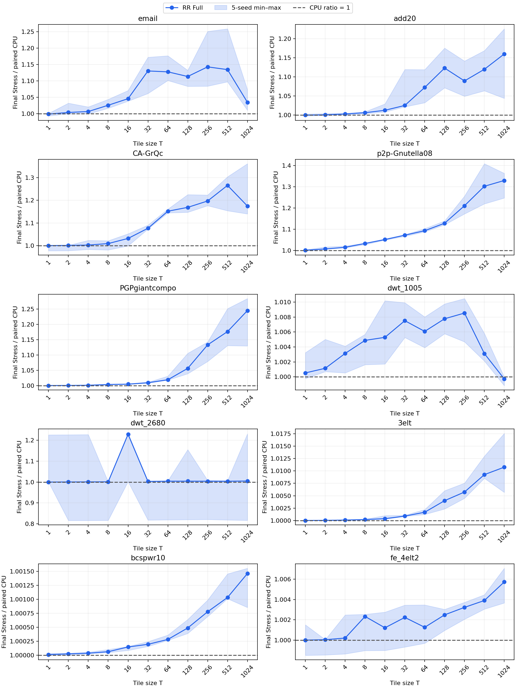
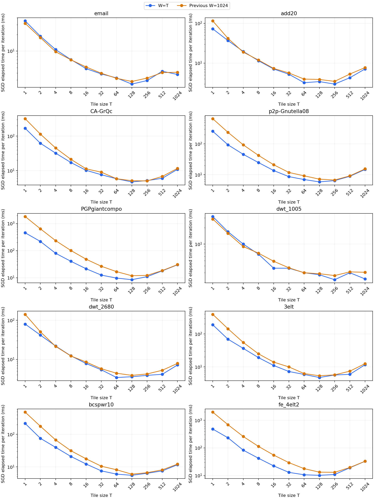

# v5 追加実験 EX1：タイル実験（W=T）の結果と考察

10グラフ×（RR Fullの11サイズ＋CPU Full）×5seed×3回＝1,800実行。
全件成功・全10グラフで厳密Full Stress。15反復、epsilon=0.1、shared、内外shuffleあり、phase_chunks=1。
T=W=1,2,4,8,16,32,64,128,256,512,1024。T<32はSIMD幅を変更する設定ではなく、32未満のスレッドをWGに用意する設定。
品質評価はSGD・総計算時間の計測終了後に行い、評価時間は別途記録した。GPU timestampは無効。

集計は同seed3回の中央値→5seedの中央値・最小〜最大。CPUとの比は対応するgraph/seed/repetitionごとに求めてから同じ順で集計した。
前回のW1024固定実験は保持。今回の初期座標fingerprintは前回の同graph/seed/T/repetitionと一致し、今回の全T・繰り返し間でも一致した。

## グラフ別の結果

最速TはSGD経過時間の中央値で選択した観測値であり、品質による候補除外や未知グラフへの一般化はしていない。

| グラフ | 最速T=W | SGD時間/反復 (ms) | CPU速度比 | 最終厳密Stress/CPU | 前回W1024の最速T |
|---|---:|---:|---:|---:|---:|
| email | 128 | 2.530 | 1.99 | 1.11373 | 128 |
| add20 | 256 | 2.976 | 12.50 | 1.08949 | 256 |
| CA-GrQc | 128 | 4.718 | 28.40 | 1.16884 | 256 |
| p2p-Gnutella08 | 128 | 5.820 | 55.40 | 1.12795 | 256 |
| PGPgiantcompo | 128 | 8.465 | 114.85 | 1.05631 | 128 |
| dwt_1005 | 256 | 2.241 | 1.68 | 1.00853 | 256 |
| dwt_2680 | 64 | 3.432 | 14.48 | 1.00420 | 128 |
| 3elt | 128 | 4.762 | 37.68 | 1.00400 | 128 |
| bcspwr10 | 128 | 5.491 | 42.08 | 1.00049 | 128 |
| fe_4elt2 | 128 | 10.242 | 108.22 | 1.00249 | 256 |

## 評価上の注意

W=TでTを増やすと、座標再利用が増える一方、1WGの仕事量・SIMD組数・共有メモリ量が増え、配れるWG数と外側ラウンド数が減る。この実験はその総合的なトレードオフを評価する。個別のハードウェア要因の寄与率や同一サイクルの命令発行数を切り分けた実験ではない。

同seedの3回は独立した初期配置ではない。更新順が変わるためT間の最終Stressは一致を要求しない。速度と品質の両方を報告し、低い実行時間だけで品質優位とは判断しない。

前回W1024と今回W=Tの実験時刻は異なる。速度の対応比較には環境変動も含まれる。特にT1024は両方ともW1024なので、同じ設定の再測定として差を確認できる。
前回PGPgiantcompo・fe_4elt2のStressは256始点からの推定、今回は厳密値であるため、そのまま品質改善率として比較しない。CPU比は今回の厳密CPU測定を基準にする。

## 図表

## 保存先

`experiment_results/v5/ex1-tile-w-equal-t-20261107/`

- `raw/tile/`：全1,800実行のコマンド・出力・検証済み圧縮座標・メモリ・評価時間。
- `tables/tile-runs.csv`：生データ一覧。`tile-hierarchical.json`、`tile-summary.csv`：階層集計。
- `tables/tile-paired-ratios.csv`：同条件のCPUとの対応比。
- `tables/previous-w1024-time-comparison.json`：前回との対応するSGD時間比。
- `figures/`：上記チャートのPNG・PDF。
- `config/`、`source-snapshot/`、`bin/`：入力ハッシュ・実行順・機材・ソース・新旧バイナリ。
