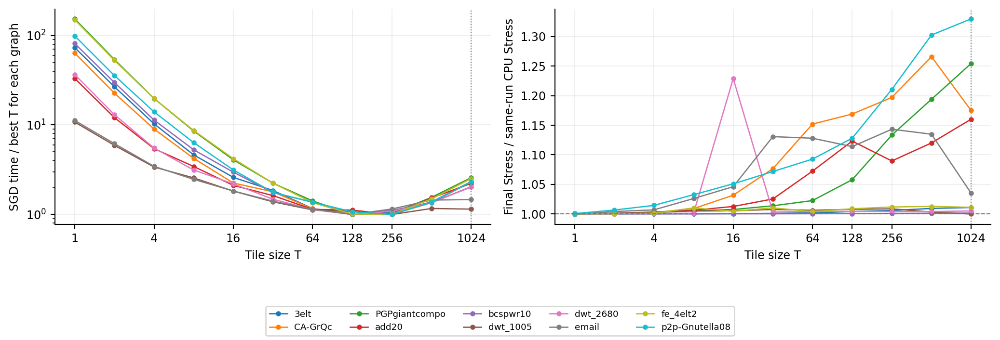
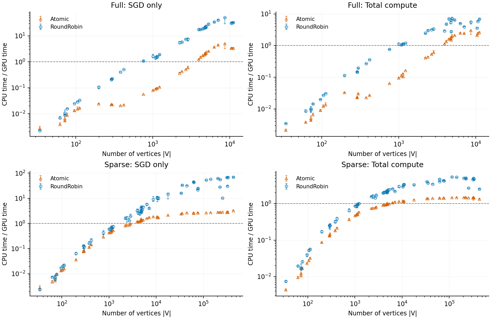
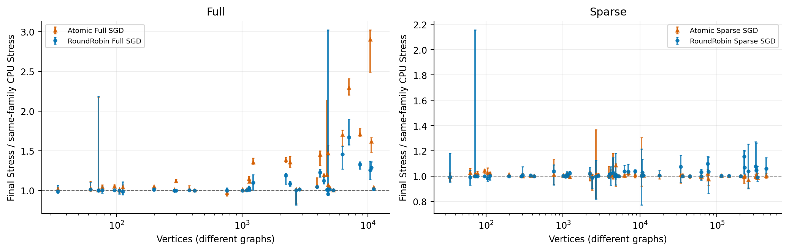
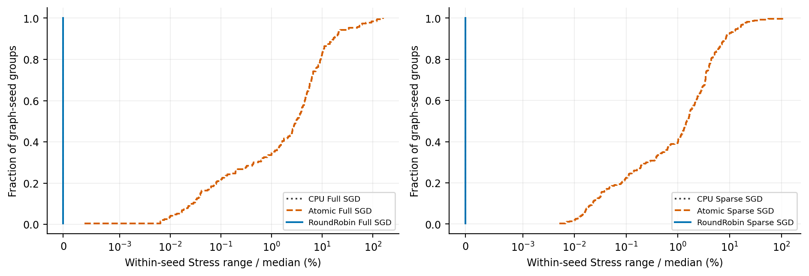
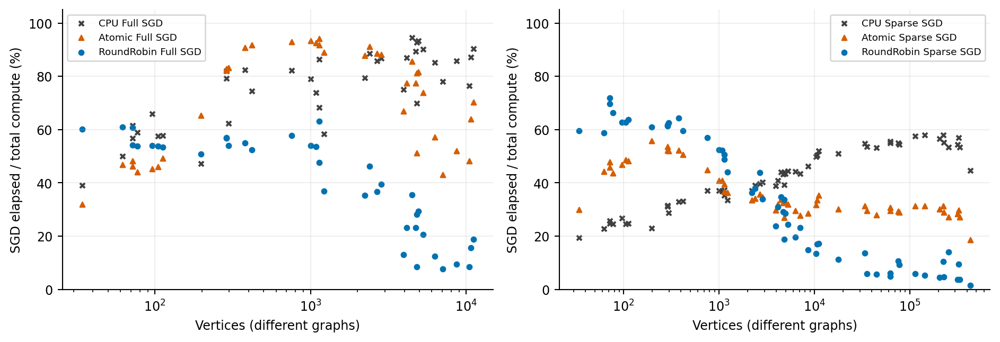
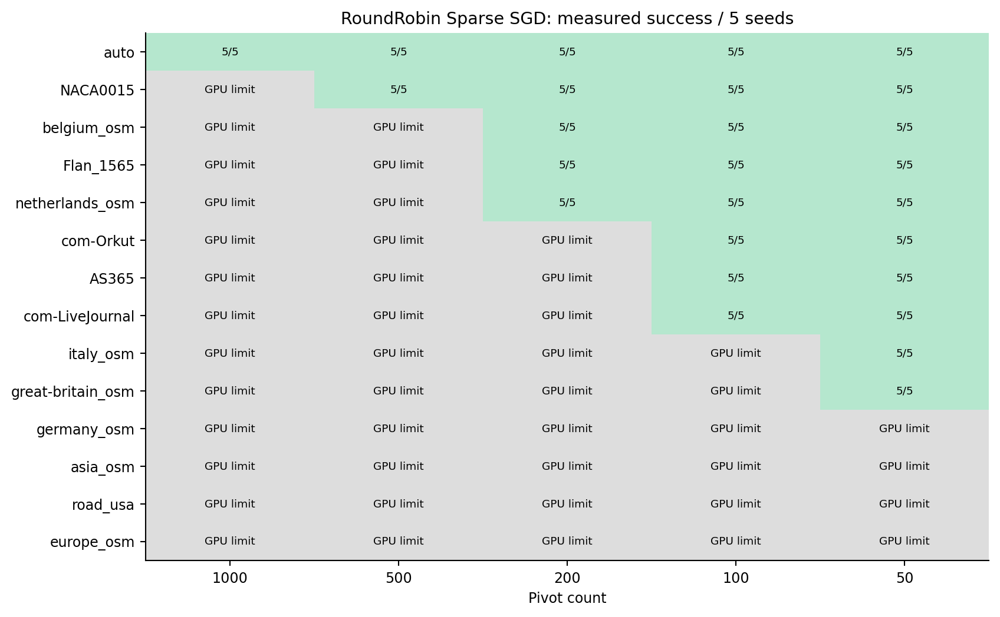
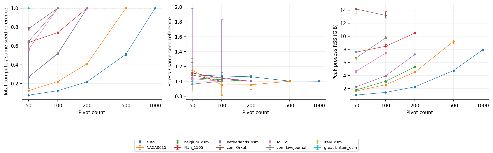
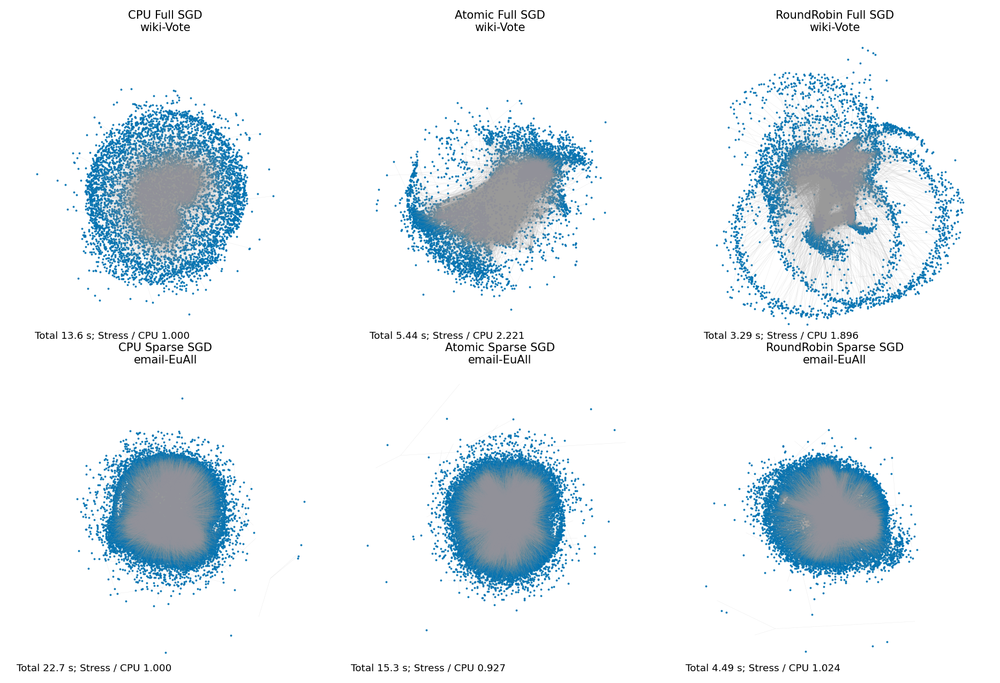
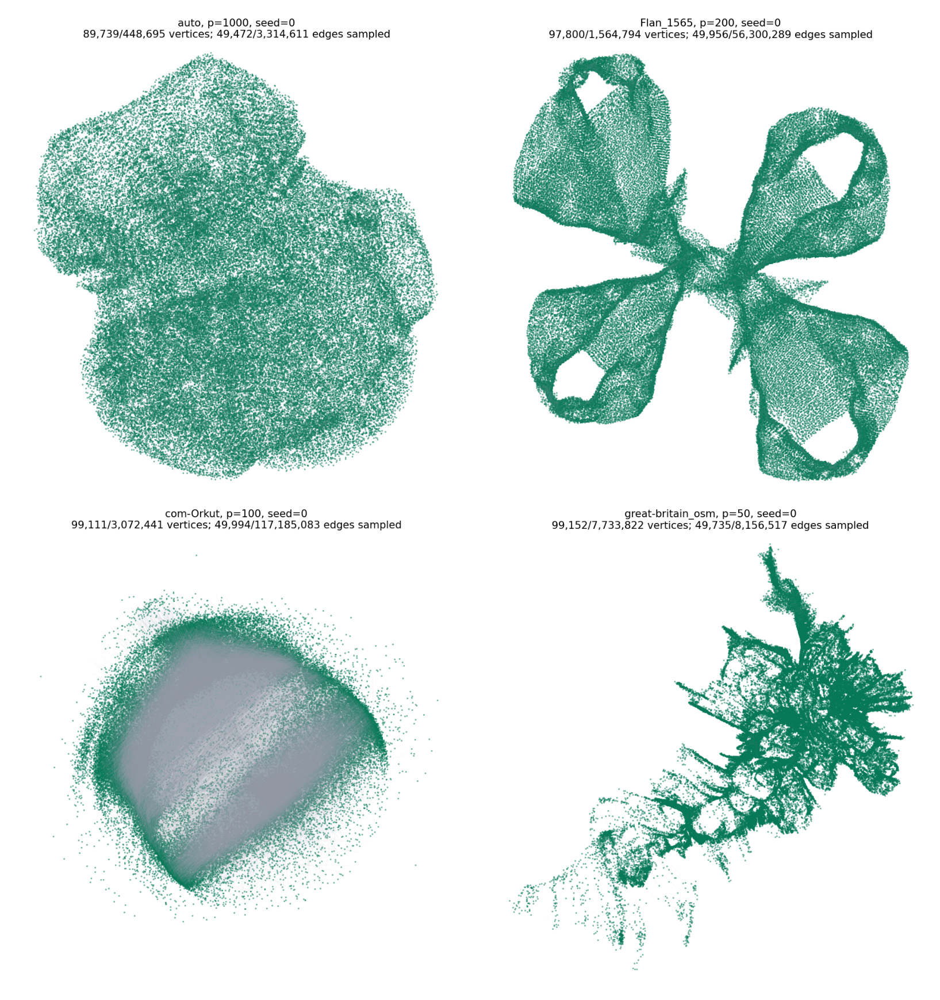

# 実験結果の要点と論文用チャート

通常比較4,230実行・タイル1,800実行・大規模130実行が成功。大規模の220条件はGPU/現実装の上限による未実行として区別する。今回の図の作成で新規レイアウト実行は0。旧実験の図・本文へ置き換え可能な実測図を集めた。

## 研究として言えそうなこと

1. **RoundRobinによる更新スケジュールは、十分な仕事量のある入力でSGD更新を高速化できる。** ただし小規模では固定費が勝ち、処理全体の一律高速化は言えない。全グラフを残したF2を主結果にする。
2. **速度と最終品質の交換関係を示せる。** FullのTとSparseのpの変更に応じて時間・最終Stressが変化した。ただし固定15反復、異なる初期配置等の影響が残るため、最適解品質や収束速度とは言わない。
3. **同seedの繰り返しで最終Stressが安定したという観測がある。** CPU/RoundRobinでは3回一致、Atomicでは全graph×seed群で変動。ただしビット単位決定性や原因がlock競合だけであることの証明ではない。
4. **単一GPU・指定条件で数百万頂点を処理できた。** 最大は英国道路網7,733,822頂点、p50、5seed成功。CPU比較をしていない大規模段階でCPU速度比やCPUの一般的不可能性は言えない。
5. **SGD以外が主要なコストとして残る。** 大規模のSGD/総計算時間はrun単位比の中央値2.42%。更新カーネル高速化を、レイアウト全体の同じ倍率の高速化と取り違えない。

| 方式 | 対象数 | SGDのCPU速度比・幾何平均 | 総計算のCPU速度比・幾何平均 | 最終Stress/CPU・幾何平均 |
|---|---:|---:|---:|---:|
| Atomic Full SGD | 38 | 0.173 | 0.159 | 1.1818 |
| RoundRobin Full SGD | 38 | 1.383 | 0.630 | 1.0656 |
| Atomic Sparse SGD | 56 | 0.522 | 0.453 | 1.0083 |
| RoundRobin Sparse SGD | 56 | 1.871 | 1.021 | 1.0171 |

速度比は1より大きいと高速、Stress比は1より大きいと悪化。各グラフを同じ重みで集約した記述量であり、有意差や同等品質の保証ではない。FullはCPU Full、SparseはCPU Sparseが分母。Sparse専用18件ではRoundRobinのSGD35.40倍・総計算4.16倍・Stress比1.0377だが、この部分集合だけで全対象の結論を置き換えない。

## 気になるところ・主張の限界

- **Fullの品質差が大きい入力がある。** RoundRobin FullのStress/CPUは全38件で幾何平均1.0656、最大wiki-Voteの1.6710。Sparseも最大email-EuAllで1.1552。「品質を維持した高速化」を無条件に主張しない。
- **総計算の全対象平均は控えめ。** RoundRobin Fullは0.630倍、Sparseは1.021倍。n≥1000ではそれぞれ3.32倍・2.61倍だが、これは事後の補足集計で、都合のよい切り取りにしない。
- **通常比較のT1024は性能最適値ではない。** タイル実験ではT128〜256が速度上良好。T128は各グラフ最速より幾何平均2.9%増、T1024は104.0%増。ユーザー指定条件の結果であり、最適Tを採用した性能とは書かない。
- **Tに対する構造差の説明は仮説。** 5対5は構造候補で、add20は回路グラフ。厳密なスケールフリー分類や次数分布の因果実験とは呼ばない。
- **初期条件と目的関数を区別。** 同族CPU/Atomic/RoundRobinの初期配置は一致、Sparse前処理も一致。Full対Sparse、および大規模のp間では同seedだけで初期配置は一致せず、複数pが成功した40 graph×seed群すべてでfingerprintが異なった。アルゴリズム・設定全体の比較として読む。
- **純GPU時間と描画時間は欠測。** 取得状況は次表。⑤のホスト経過時間を⑨のGPU計算pass合計と呼ばない。
- **固定15反復・5初期条件。** 同seed3回を15独立seedとして扱わない。推定Stressの標準誤差は出力されておらず、小差を統計的に確定しない。通常は256始点、大規模は64始点。途中収束・time-to-qualityは未測定。
- **機材・実装への依存。** Apple M4 Pro 24GiBの観測。GPU上限220条件は現バッファ設計/dispatch上限で、GPU一般の不可能性ではない。RSSを専用GPUメモリ量と呼ばない。容量中断・再ウォームアップ・常駐Codexを含む。
- **復旧と再試行は分離。** 保存時容量停止の再試行前1件を本測定に混ぜていない。成功出力を復旧したLiveJournalの1件は終了code/終了直後RAMが欠測で、timeのwallは0.01秒精度。native計算値・Stressは保持した。

方式比較はスケジュールだけを差し替えた切り分け実験ではなく、各実装全体の比較である。CPUと今回のAtomic以外の全GPU手法に対する優位性も、この比較からは主張できない。

## 事前に話した計時9項目の取得状況

**全9項目を取得できている、とは言えない。** 定義は既存の「9_計測時間」の①〜⑨と追加⑩に対応する。GPU timestamp確保エラーを避けるため全GPU本測定で無効化し、描画も本測定と切り離した。CPUの②③⑥は対象外であり欠測として失敗扱いしない。

| 区間 | 保存field | CPU（1560成功） | GPU（4600成功） |
|---|---|---:|---:|
| ① 前処理 | `preprocess_time_ms` | 1560/1560 | 4600/4600 |
| ② GPU準備 | `gpu_prepare_time_ms` | 対象外（GPU区間） | 4600/4600 |
| ③ 初期転送 | `upload_time_ms` | 対象外（GPU区間） | 4600/4600 |
| ④ 各反復の計算時間 | `iteration_times_ms` | 1560/1560 | 0/4600 |
| ⑤ SGD経過時間 | `sgd_time_ms` | 1560/1560 | 4600/4600 |
| ⑥ 結果取得 | `readback_time_ms` | 対象外（GPU区間） | 4600/4600 |
| ⑦ 描画 | `draw_time_ms` | 0/1560 | 0/4600 |
| ⑧ 描画込み総時間 | `total_with_draw_time_ms` | 0/1560 | 0/4600 |
| ⑨ 反復計算時間合計 | `iteration_total_time_ms` | 1560/1560 | 0/4600 |
| ⑩ 描画なし総計算時間 | `total_compute_time_ms` | 1560/1560 | 4600/4600 |

④はCPUではシャッフル・座標更新を含む15個のCPU反復時間。GPUでは純GPU pass時間なので、⑤/15で代用できない。⑦⑧は後から作ったPNGの生成時間でも代用できない。③や②は実装の対応区間であり、処理順が概念図と異なる場合がある。⑩は直接計測し、内訳の単純な足し算に置き換えない。全6160成功を監査し、実行していない220条件を分母に含めていない。

## 論文への組み込み順

本文候補はF1（T）、F2（時間）、F3（最終品質）、F6（大規模の完了可否）、F7（pの交換関係）、F8（品質差の配置例）。F4/F5/F9は補足または紙幅に応じて置換。現稿には旧16分割・Sparse4分割・収束10seed・120秒打切り・旧40pivot道路実験が残るため、今回の条件と混在させず実験節の改稿が必要。ここでは論文本文・旧結果を変更していない。主結果の最悪値や小規模の低速化も掲載する。

## F1：タイルサイズの速度・品質の交換関係

**掲載位置：本文候補**

10グラフ、T=1〜1024、seed10〜14×各3回。seed内3回中央値→5seed中央値。左は各グラフの最速Tで正規化、右は対応CPU比を先に計算して集計。T1024の点線は通常比較に採用した条件。線は傾向を読むためで、スケールフリー性の実証やTの因果効果の分離ではない。

## F2：SGDと総計算時間の速度比較

**掲載位置：本文候補**

Full38件、Sparse56件をすべて表示。縦軸は同族CPU時間/GPU時間、1より上で高速。graph・seed・repetition対応比→seed内3回中央値→5seedの中央値と最小最大。総計算時間は入力読込からCPU上の最終座標までで、Stress評価・保存・描画は含めない。両対数軸。小規模の低速化を省略していない。

## F3：同じ実行から取得した最終Stress

**掲載位置：本文候補**

速度と同じ4230実行。対応比→seed内3回中央値→5seed中央値と最小最大。n≤8000は厳密Full Stress、それ以外は256始点・評価seed0の推定Full Stress。1より上はStress増加。Full/Sparseの分母が異なるので両パネルの値を直接比べない。固定15反復後の値であり、収束到達や最適解の品質ではない。

## F4：同seed内3回のStressの再現性

**掲載位置：補足・本文の再現性主張用**

Full各方式190群、Sparse各方式280群。(最大−最小)/中央値の経験累積分布。CPU・RoundRobinは全群でStressが3回一致し、Atomicは全群で変動した。これは観測したStressの再現性であり、全GPUや全機材のビット単位決定性の保証ではない。ゼロを表示できる対称対数軸。

## F5：SGD高速化が処理全体へ及ぼす範囲

**掲載位置：補足・前処理ボトルネックの説明用**

各runの⑤SGD経過時間/⑩総計算時間を求め、seed内3回中央値→5seed中央値。純GPU時間ではない。残りの時間をGPU待ち・転送など特定の要因へ一括帰属しない。複数の重複したタイマーを足した積み上げ棒グラフにはしていない。

## F6：大規模実験の成功とGPU上限

**掲載位置：本文候補**

14グラフ×5p×5seedの350条件。130実測成功、220は照会済みstorage binding/dispatch上限で確保前に未実行。灰色は実行失敗ではない。CPU/Atomicはこの規模で測定していないため、CPUの一般的不可能性やCPU速度比を示さない。

## F7：大規模のpivot数と時間・品質・RSS

**掲載位置：本文候補**

各グラフで5seed成功した最大pを基準に、同seedの比を先に計算し、5seedの中央値と最小最大を表示。Stressは64始点・評価seed0。p間では初期座標fingerprintも変わるため、p単独の因果効果とは断定しない。RSSは専用GPUメモリ量ではない。各seed1回。

## F8：品質差が大きかった入力の配置比較

**掲載位置：本文候補・定性的な限界の確認**

Full/SparseそれぞれRoundRobinのグラフ別Stress比中央値が最大だった入力を選び、seed0・repetition0を固定。表示した時間・比はこの1実行の値で、主図の5seed中央値とは異なる。同族3方式の初期配置一致を確認、行内で共通スケール、回転や位置合わせなし。50k頂点/20k辺以下の決定的間引き。見栄えのよい入力だけを選んだ図ではない。

## F9：大規模入力の描画例

**掲載位置：補足・大規模の実例**

auto、Flan_1565、com-Orkut、great-britain_osm。各グラフで5seed成功した最大pのseed0。保存済みレイアウト図を配置し、測定・再レイアウトは行わない。100k頂点/50k辺以下に決定的間引き、全座標のextentを保持し、グラフ間は独立スケール。CPUとの品質比較ではない。

## 正本・再生成

実験repoの `experiment_results/v5/paper/` にPNG/PDF、各図の基データJSON、計時カバレッジCSV/JSON、出典SHA256を保存。`python3 experiments/report_v5_paper.py` で測定なしに再生成する。通常の詳細考察、全グラフ別図、大規模全19図は既存ノートとレポートを保持。
