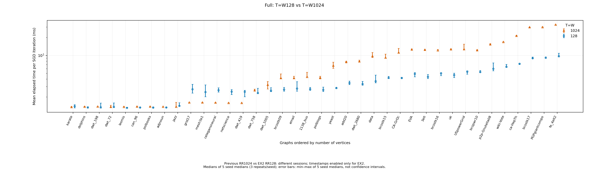
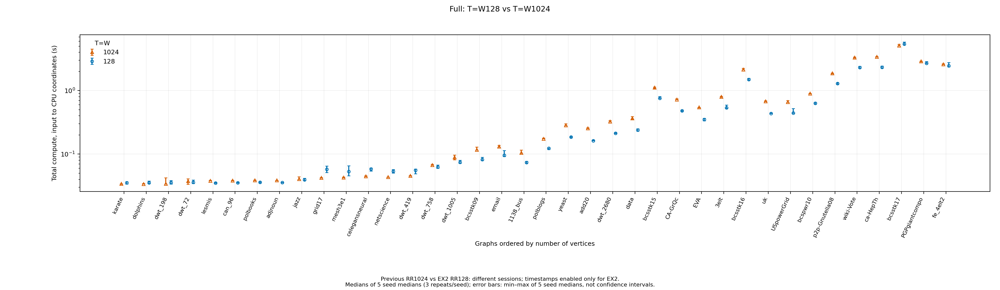
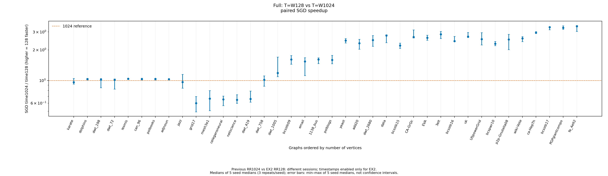
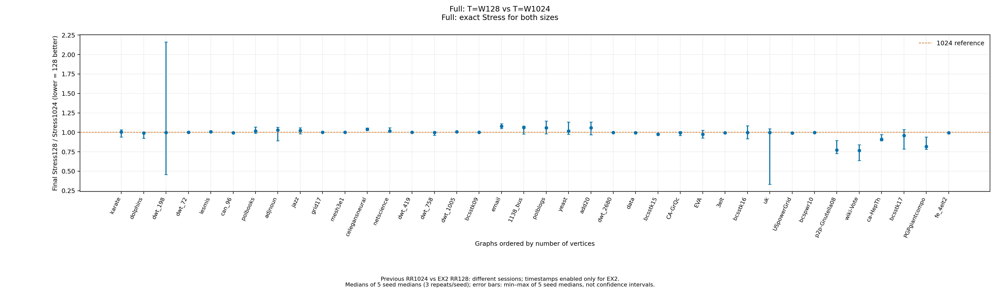
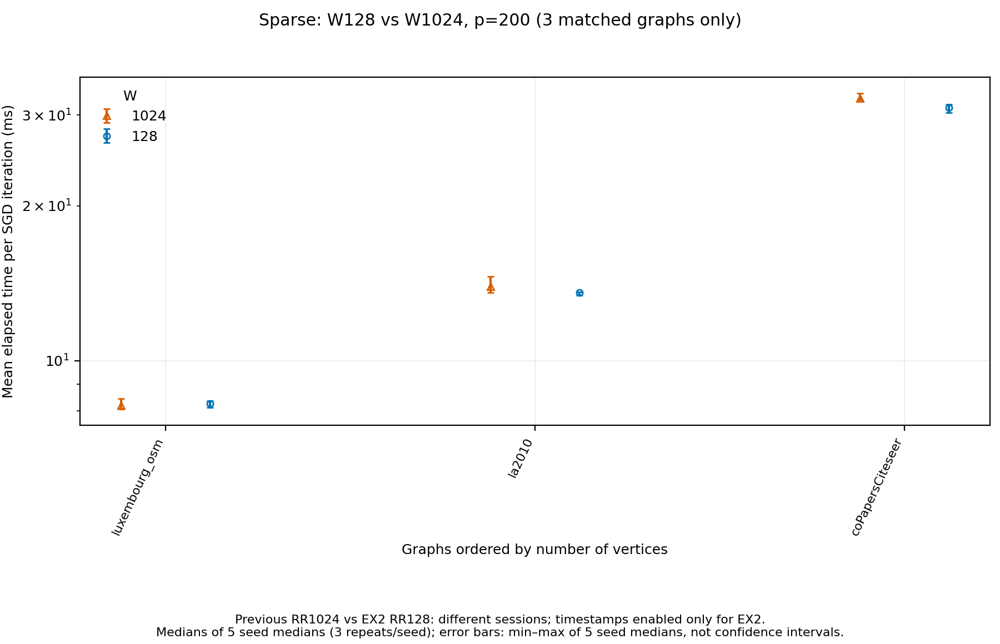
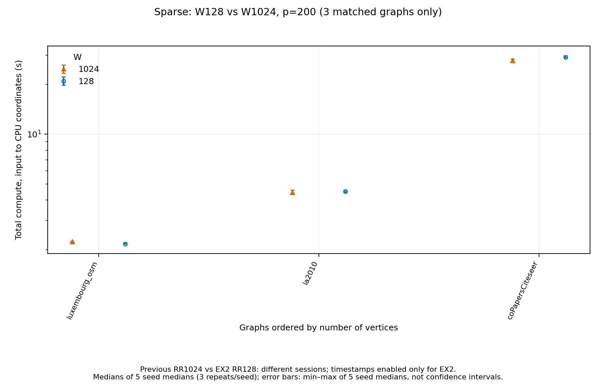
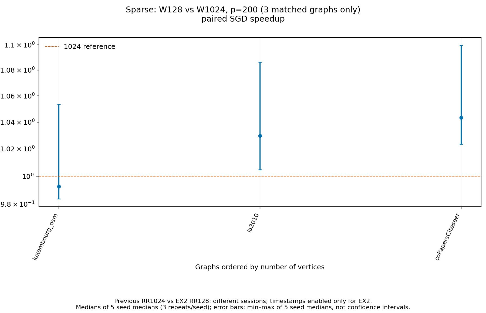
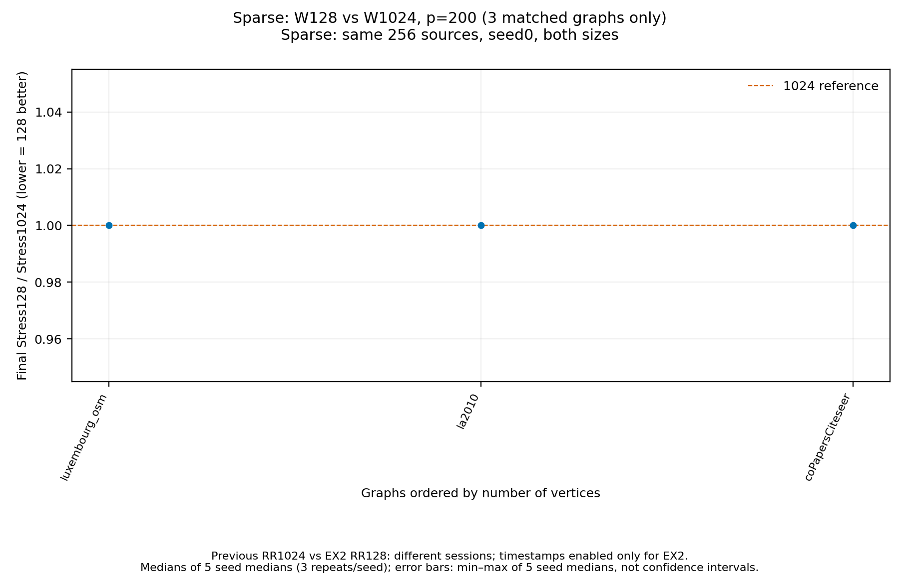

# EX_チャート集：128と1024のグラフ別比較

[[EX_チャート集]] / [[EX2_速度ストレス実験]]

## 比較条件

- **Full：38グラフすべてでT=W1024（前回v5）対T=W128（EX2）。** shared・内外shuffle・phase_chunks1、15反復、epsilon0.1、seed0〜4×3回。初期配置一致を確認。
- **Sparse：W1024（追加grid/workgroup実験）対W128（EX2）。** 入力・p200・初期配置・前処理・seed・反復が一致するluxembourg_osm、la2010、coPapersCiteseerの3グラフだけを比較する。SparseにFullと同じ意味のTはない。
- 前回通常比較のSparseはW256であり、1024として扱わない。W1024のデータがない残り53グラフや、RR128未測定のgrid入力は比較図へ入れない。新規レイアウト実行は行っていない。
- FullのStressは両サイズとも厳密。前回推定だった4グラフのRR1024計60記録は保存済み座標から厳密再評価し、元recordを変更せず評価オーバーレイに保存した。
- Sparseの3グラフは両サイズとも同一の256始点・評価seed0による推定Full Stress。Fullの厳密値と混同しない。
- 点・棒は同seed3回中央値→5seed中央値。誤差棒は5seed中央値の最小〜最大で、信頼区間ではない。速度比・Stress比は対応するrunごとに求めてから集計する。
- 測定時期が異なり、RR128のみGPU timestampが有効。差をT/W変更だけの因果効果とは断定しない。主速度はSGD経過時間/15と描画なし総計算時間。

## 一覧図

SGD速度比は1024/128で**1より大きいほど128が高速**。Stress比は128/1024で**1より小さいほど128のStressが低い**。

### Full: T=W128 vs T=W1024 — Mean elapsed time per SGD iteration (ms)

### Full: T=W128 vs T=W1024 — Total compute, input to CPU coordinates (s)

### Full: T=W128 vs T=W1024 — SGD time1024 / time128 (higher = 128 faster)

### Full: T=W128 vs T=W1024 — Final Stress128 / Stress1024 (lower = 128 better)

### Sparse: W128 vs W1024, p=200 (3 matched graphs only) — Mean elapsed time per SGD iteration (ms)

### Sparse: W128 vs W1024, p=200 (3 matched graphs only) — Total compute, input to CPU coordinates (s)

### Sparse: W128 vs W1024, p=200 (3 matched graphs only) — SGD time1024 / time128 (higher = 128 faster)

### Sparse: W128 vs W1024, p=200 (3 matched graphs only) — Final Stress128 / Stress1024 (lower = 128 better)

## グラフ別の数値と個別図

| 族 | グラフ | SGD速度比1024/128 | Stress比128/1024 | 個別図（時間・総時間・Stress） |
|---|---|---:|---:|---|
| full | karate | 0.963 | 1.00599 | [開く](../figures/full-detail-karate.png) |
| full | dolphins | 1.031 | 0.99298 | [開く](../figures/full-detail-dolphins.png) |
| full | dwt_198 | 1.021 | 0.99907 | [開く](../figures/full-detail-dwt_198.png) |
| full | dwt_72 | 1.015 | 1.00052 | [開く](../figures/full-detail-dwt_72.png) |
| full | lesmis | 1.043 | 1.00784 | [開く](../figures/full-detail-lesmis.png) |
| full | can_96 | 1.032 | 0.99544 | [開く](../figures/full-detail-can_96.png) |
| full | polbooks | 1.039 | 1.01860 | [開く](../figures/full-detail-polbooks.png) |
| full | adjnoun | 1.029 | 1.03099 | [開く](../figures/full-detail-adjnoun.png) |
| full | jazz | 0.964 | 1.02336 | [開く](../figures/full-detail-jazz.png) |
| full | grid17 | 0.598 | 1.00190 | [開く](../figures/full-detail-grid17.png) |
| full | mesh3e1 | 0.664 | 1.00116 | [開く](../figures/full-detail-mesh3e1.png) |
| full | celegansneural | 0.652 | 1.03818 | [開く](../figures/full-detail-celegansneural.png) |
| full | netscience | 0.646 | 1.01877 | [開く](../figures/full-detail-netscience.png) |
| full | dwt_419 | 0.659 | 1.00012 | [開く](../figures/full-detail-dwt_419.png) |
| full | dwt_758 | 1.016 | 0.99800 | [開く](../figures/full-detail-dwt_758.png) |
| full | dwt_1005 | 1.187 | 1.00907 | [開く](../figures/full-detail-dwt_1005.png) |
| full | bcsstk09 | 1.607 | 1.00068 | [開く](../figures/full-detail-bcsstk09.png) |
| full | email | 1.538 | 1.07919 | [開く](../figures/full-detail-email.png) |
| full | 1138_bus | 1.609 | 1.06091 | [開く](../figures/full-detail-1138_bus.png) |
| full | polblogs | 1.591 | 1.06024 | [開く](../figures/full-detail-polblogs.png) |
| full | yeast | 2.472 | 1.01662 | [開く](../figures/full-detail-yeast.png) |
| full | add20 | 2.319 | 1.05863 | [開く](../figures/full-detail-add20.png) |
| full | dwt_2680 | 2.498 | 0.99883 | [開く](../figures/full-detail-dwt_2680.png) |
| full | data | 2.768 | 0.99508 | [開く](../figures/full-detail-data.png) |
| full | bcsstk15 | 2.204 | 0.97608 | [開く](../figures/full-detail-bcsstk15.png) |
| full | CA-GrQc | 2.673 | 0.99382 | [開く](../figures/full-detail-CA-GrQc.png) |
| full | EVA | 2.631 | 0.97659 | [開く](../figures/full-detail-EVA.png) |
| full | 3elt | 2.846 | 0.99543 | [開く](../figures/full-detail-3elt.png) |
| full | bcsstk16 | 2.441 | 0.99896 | [開く](../figures/full-detail-bcsstk16.png) |
| full | uk | 2.696 | 0.99801 | [開く](../figures/full-detail-uk.png) |
| full | USpowerGrid | 2.549 | 0.99168 | [開く](../figures/full-detail-USpowerGrid.png) |
| full | bcspwr10 | 2.295 | 0.99921 | [開く](../figures/full-detail-bcspwr10.png) |
| full | p2p-Gnutella08 | 2.531 | 0.77342 | [開く](../figures/full-detail-p2p-Gnutella08.png) |
| full | wiki-Vote | 2.589 | 0.76624 | [開く](../figures/full-detail-wiki-Vote.png) |
| full | ca-HepTh | 2.940 | 0.91237 | [開く](../figures/full-detail-ca-HepTh.png) |
| full | bcsstk17 | 3.340 | 0.95817 | [開く](../figures/full-detail-bcsstk17.png) |
| full | PGPgiantcompo | 3.292 | 0.81950 | [開く](../figures/full-detail-PGPgiantcompo.png) |
| full | fe_4elt2 | 3.406 | 0.99448 | [開く](../figures/full-detail-fe_4elt2.png) |
| sparse | luxembourg_osm | 0.993 | 1.00000 | [開く](../figures/sparse-detail-luxembourg_osm.png) |
| sparse | la2010 | 1.030 | 1.00000 | [開く](../figures/sparse-detail-la2010.png) |
| sparse | coPapersCiteseer | 1.043 | 1.00000 | [開く](../figures/sparse-detail-coPapersCiteseer.png) |

## 保存先

`experiment_results/v5/rr128-vs1024-charts-20261108/`

- `figures/`：一覧8図＋個別41図。各PNG・ベクトルPDF。
- `tables/paired-runs.csv`：615対応組（Full570＋Sparse45）。`hierarchical.json`：グラフ別の階層集計。
- `tables/full1024-exact-stress-overlay.json`、`exact-stress/cache/`：Full1024の厳密再評価の出典と値。
- `validation/`：元の実験記録のハッシュと完了検証。

前回v5・追加grid実験・EX2の記録は保持した。
