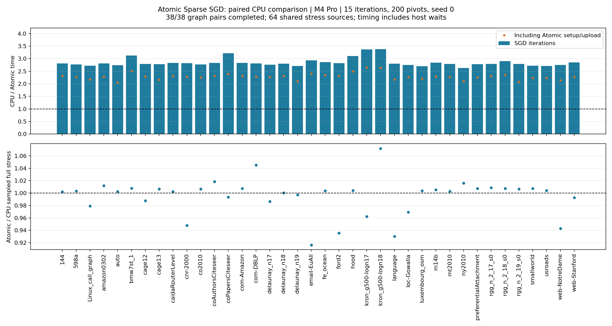

# 測定結果

完了 48/48 ケース。主比較成功 38/38、追加seed成功 10/10。

主比較の反復速度比は中央値 **2.80倍**、範囲 2.63–3.37倍。
Atomicの初回準備・転送を含めた比は中央値 **2.28倍**。
推定stress比（Atomic/CPU）は中央値 1.0035、範囲 0.9165–1.0719。

反復時間はホスト待機・完了検証込み。stressは主比較64始点、追加seed256始点の共通サンプルによる推定値。
差が小さいことはexact full stressの同等性や全seedでの同等性を保証しない。

| グラフ | CPU ms/反復 | Atomic ms/反復 | CPU/Atomic | 初回準備込み | stress比 |
|---|---:|---:|---:|---:|---:|
| 144 | 587.1 | 208.7 | 2.81 | 2.31 | 1.0022 |
| 598a | 445.9 | 161.0 | 2.77 | 2.28 | 1.0033 |
| Linux_call_graph | 1301.8 | 477.8 | 2.72 | 2.17 | 0.9791 |
| amazon0302 | 1066.4 | 379.9 | 2.81 | 2.28 | 1.0118 |
| auto | 1890.9 | 691.1 | 2.74 | 2.05 | 1.0025 |
| bmw7st_1 | 631.6 | 201.9 | 3.13 | 2.51 | 1.0079 |
| cage12 | 526.0 | 188.3 | 2.79 | 2.30 | 0.9880 |
| cage13 | 1895.6 | 682.4 | 2.78 | 2.16 | 1.0067 |
| caidaRouterLevel | 770.6 | 272.1 | 2.83 | 2.31 | 1.0026 |
| cnr-2000 | 1375.2 | 487.1 | 2.82 | 2.28 | 0.9478 |
| co2010 | 812.2 | 293.0 | 2.77 | 2.26 | 1.0067 |
| coAuthorsCiteseer | 925.3 | 326.3 | 2.84 | 2.33 | 1.0187 |
| coPapersCiteseer | 2117.9 | 658.3 | 3.22 | 2.40 | 0.9935 |
| com-Amazon | 1383.4 | 489.4 | 2.83 | 2.30 | 1.0073 |
| com-DBLP | 1295.7 | 460.5 | 2.81 | 2.28 | 1.0452 |
| delaunay_n17 | 519.3 | 188.3 | 2.76 | 2.27 | 0.9866 |
| delaunay_n18 | 1063.2 | 379.7 | 2.80 | 2.31 | 1.0006 |
| delaunay_n19 | 2182.9 | 804.8 | 2.71 | 2.10 | 0.9970 |
| email-EuAll | 942.3 | 321.8 | 2.93 | 2.40 | 0.9165 |
| fe_ocean | 598.6 | 208.9 | 2.87 | 2.35 | 1.0039 |
| ford2 | 406.1 | 143.7 | 2.82 | 2.31 | 0.9355 |
| hood | 942.4 | 303.2 | 3.11 | 2.49 | 1.0042 |
| kron_g500-logn17 | 524.8 | 156.0 | 3.36 | 2.65 | 0.9623 |
| kron_g500-logn18 | 1056.7 | 313.1 | 3.37 | 2.64 | 1.0719 |
| language | 1670.2 | 597.2 | 2.80 | 2.17 | 0.9301 |
| loc-Gowalla | 822.8 | 299.6 | 2.75 | 2.26 | 0.9695 |
| luxembourg_osm | 470.9 | 174.2 | 2.70 | 2.21 | 1.0038 |
| m14b | 918.0 | 323.6 | 2.84 | 2.29 | 1.0053 |
| mt2010 | 538.1 | 192.9 | 2.79 | 2.27 | 1.0028 |
| ny2010 | 1451.2 | 551.2 | 2.63 | 2.11 | 1.0162 |
| preferentialAttachment | 406.1 | 146.2 | 2.78 | 2.26 | 1.0073 |
| rgg_n_2_17_s0 | 529.2 | 189.7 | 2.79 | 2.30 | 1.0086 |
| rgg_n_2_18_s0 | 1103.0 | 380.3 | 2.90 | 2.36 | 1.0073 |
| rgg_n_2_19_s0 | 2277.3 | 815.1 | 2.79 | 2.08 | 1.0066 |
| smallworld | 404.2 | 148.3 | 2.72 | 2.23 | 1.0076 |
| usroads | 504.9 | 186.4 | 2.71 | 2.23 | 1.0040 |
| web-NotreDame | 1342.7 | 487.8 | 2.75 | 2.14 | 0.9428 |
| web-Stanford | 1078.7 | 378.9 | 2.85 | 2.27 | 0.9928 |

## 未使用seedでの追加検証

| グラフ | seed | CPU/Atomic | stress比 |
|---|---:|---:|---:|
| coAuthorsCiteseer | 1 | 2.79 | 0.9954 |
| coAuthorsCiteseer | 2 | 2.83 | 0.9995 |
| kron_g500-logn17 | 1 | 3.29 | 1.0378 |
| kron_g500-logn17 | 2 | 3.38 | 0.9831 |
| luxembourg_osm | 1 | 2.67 | 1.0046 |
| luxembourg_osm | 2 | 2.72 | 1.0044 |
| smallworld | 1 | 2.81 | 1.0123 |
| smallworld | 2 | 2.60 | 1.0249 |
| web-NotreDame | 1 | 2.75 | 0.9544 |
| web-NotreDame | 2 | 2.79 | 1.0260 |

## 品質悪化例の旧Atomicとの再比較

主比較でCPU比のstress上昇が大きかった2グラフを選び、seed 0,1・256共通始点で再評価。
旧Atomicはv3 shaderと毎反復CPUシャッフルの再現対照。以下は主比較の64始点と別の測定。

| グラフ | seed | CPU ms/反復 | 旧Atomic ms/反復 | 新Atomic ms/反復 | 旧stress/CPU | 新stress/CPU | 新stress/旧 |
|---|---:|---:|---:|---:|---:|---:|---:|
| com-DBLP | 0 | 1302.5 | 1433.8 | 463.6 | 0.9931 | 0.9967 | 1.0036 |
| com-DBLP | 1 | 1305.4 | 1410.9 | 466.6 | 0.9758 | 0.9928 | 1.0174 |
| kron_g500-logn18 | 0 | 1050.7 | 1061.1 | 304.8 | 1.0647 | 1.0077 | 0.9465 |
| kron_g500-logn18 | 1 | 1058.2 | 1092.5 | 317.8 | 1.0269 | 0.9720 | 0.9466 |

[全CSV](paired-summary.csv) · [条件と原因調査](README.md)
