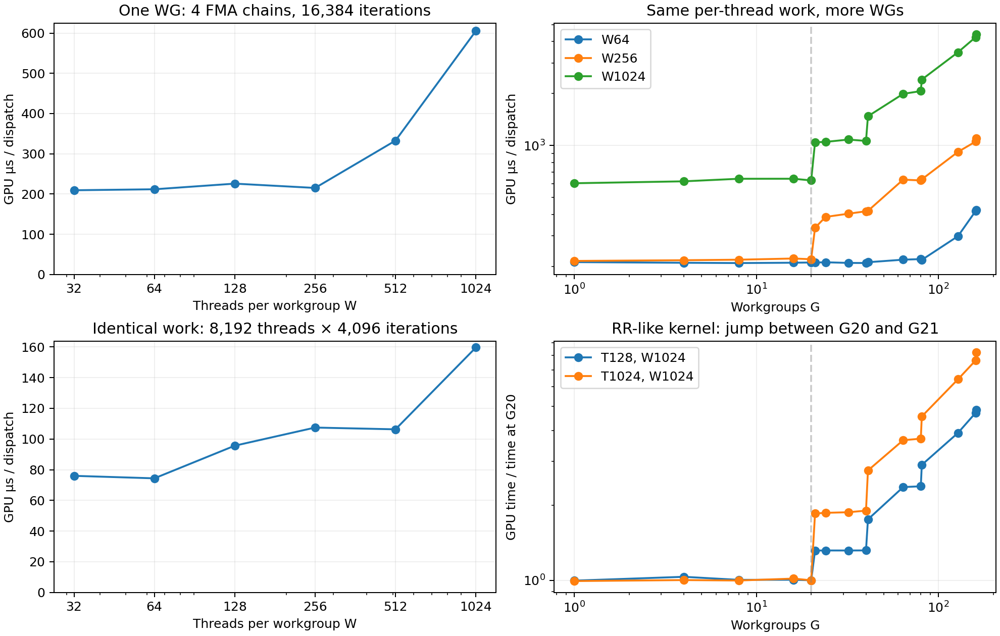
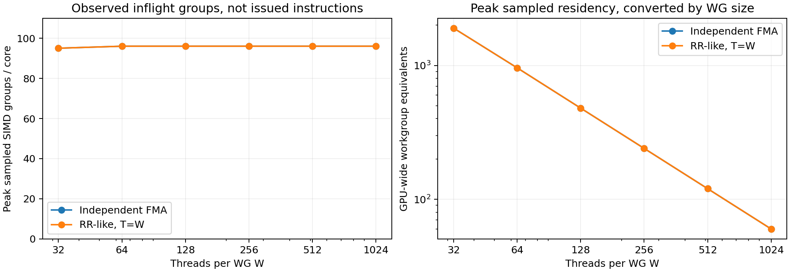

# M4 Pro workgroup capacity investigation

- [Results, definitions, and limitations](RESULTS.md)
- [Time and grouping measurements](capacity.png) / [PDF](capacity.pdf)
- [Observed residency measurements](residency.png) / [PDF](residency.pdf)
- [Full unprofiled grouped results](summary.json)
- [Primary hardware counter catalog](profile-counter-info.xml)
- [Counter measurements with increasing G](profile2-counter-summary.json)
- [Counter measurements with abundant queued work](resident-counter-summary.json)
- [Reproduction instructions](../../../tools/diagnostics/metal-workgroup-capacity/README.md)
- [Provenance and validation](provenance.json)

The 4,296 unprofiled trials include warmups; there are 3,580 measured trials.
An additional 80 quick validation trials and 392 profiled trials are separate.
Raw traces remain local and are ignored by Git. Selected counter sample CSVs
are gzip-compressed; the large derived XML can be regenerated from the traces.
Time plateaus and sampled inflight groups are not same-cycle instruction counts.

